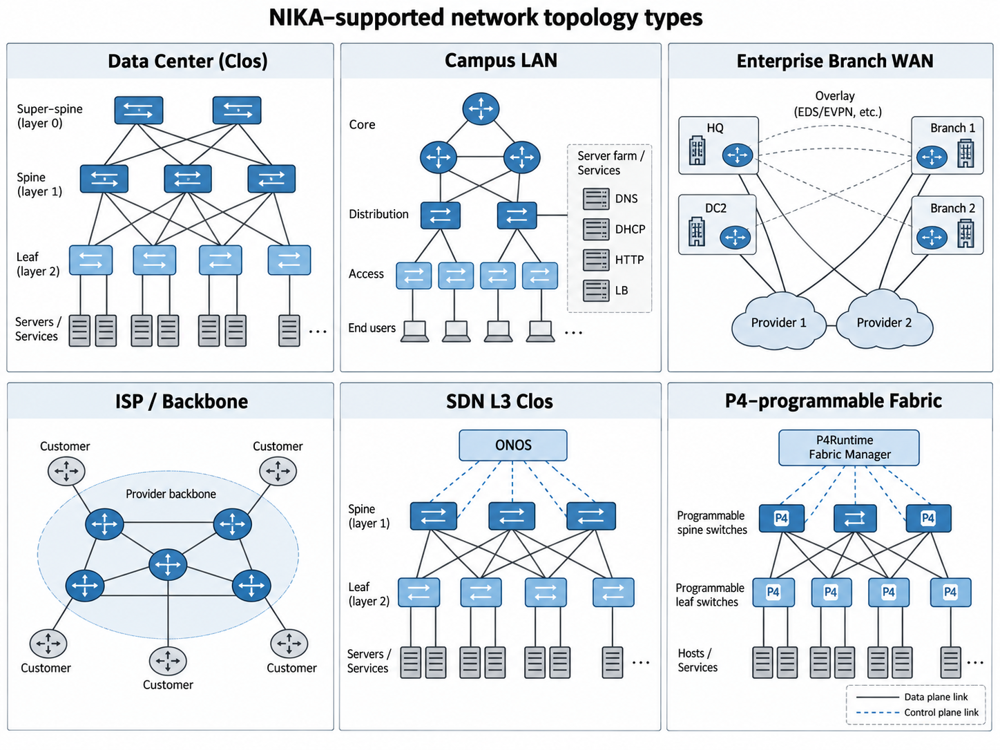
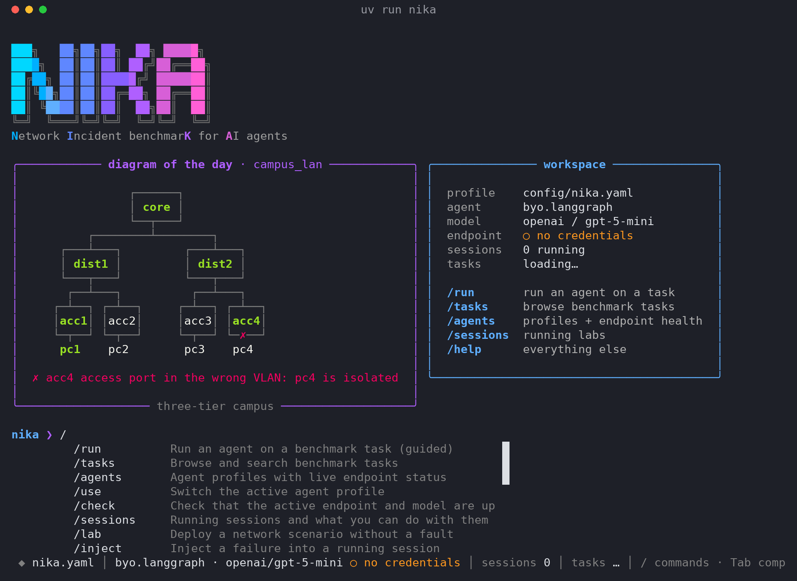

<div align="center">


<br />

[✨ Features](#-features) ·
[🤖 Overview](#-overview) ·
[📦 Installation](#-installation) ·
[🚀 Quick start](#-quick-start) ·
[📖 Learn more](#-learn-more) ·
[📄 Docs](docs/README.md) ·
[🌐 Website](https://sands-lab.github.io/nika/) ·
[📚 Cite](#-citation)

[](https://arxiv.org/abs/2512.16381)
[](https://sands-lab.github.io/nika/)
[![Slack](https://img.shields.io/badge/-Join%20Slack-4A154B?logo=data%3Aimage%2Fsvg%2Bxml%3Bbase64%2CPHN2ZyB4bWxucz0iaHR0cDovL3d3dy53My5vcmcvMjAwMC9zdmciIHZpZXdCb3g9IjAgMCAyNCAyNCI%2BPHBhdGggZmlsbD0iI2ZmZiIgZD0iTTUuMDQyIDE1LjE2NWEyLjUyOCAyLjUyOCAwIDAgMS0yLjUyIDIuNTIzQTIuNTI4IDIuNTI4IDAgMCAxIDAgMTUuMTY1YTIuNTI3IDIuNTI3IDAgMCAxIDIuNTIyLTIuNTJoMi41MnYyLjUyek02LjMxMyAxNS4xNjVhMi41MjcgMi41MjcgMCAwIDEgMi41MjEtMi41MiAyLjUyNyAyLjUyNyAwIDAgMSAyLjUyMSAyLjUydjYuMzEzQTIuNTI4IDIuNTI4IDAgMCAxIDguODM0IDI0YTIuNTI4IDIuNTI4IDAgMCAxLTIuNTIxLTIuNTIydi02LjMxM3pNOC44MzQgNS4wNDJhMi41MjggMi41MjggMCAwIDEtMi41MjEtMi41MkEyLjUyOCAyLjUyOCAwIDAgMSA4LjgzNCAwYTIuNTI4IDIuNTI4IDAgMCAxIDIuNTIxIDIuNTIydjIuNTJIOC44MzR6TTguODM0IDYuMzEzYTIuNTI4IDIuNTI4IDAgMCAxIDIuNTIxIDIuNTIxIDIuNTI4IDIuNTI4IDAgMCAxLTIuNTIxIDIuNTIxSDIuNTIyQTIuNTI4IDIuNTI4IDAgMCAxIDAgOC44MzRhMi41MjggMi41MjggMCAwIDEgMi41MjItMi41MjFoNi4zMTJ6TTE4Ljk1NiA4LjgzNGEyLjUyOCAyLjUyOCAwIDAgMSAyLjUyMi0yLjUyMUEyLjUyOCAyLjUyOCAwIDAgMSAyNCA4LjgzNGEyLjUyOCAyLjUyOCAwIDAgMS0yLjUyMiAyLjUyMWgtMi41MjJWOC44MzR6TTE3LjY4OCA4LjgzNGEyLjUyOCAyLjUyOCAwIDAgMS0yLjUyMyAyLjUyMSAyLjUyNyAyLjUyNyAwIDAgMS0yLjUyLTIuNTIxVjIuNTIyQTIuNTI3IDIuNTI3IDAgMCAxIDE1LjE2NSAwYTIuNTI4IDIuNTI4IDAgMCAxIDIuNTIzIDIuNTIydjYuMzEyek0xNS4xNjUgMTguOTU2YTIuNTI4IDIuNTI4IDAgMCAxIDIuNTIzIDIuNTIyQTIuNTI4IDIuNTI4IDAgMCAxIDE1LjE2NSAyNGEyLjUyNyAyLjUyNyAwIDAgMS0yLjUyLTIuNTIydi0yLjUyMmgyLjUyek0xNS4xNjUgMTcuNjg4YTIuNTI3IDIuNTI3IDAgMCAxLTIuNTItMi41MjMgMi41MjYgMi41MjYgMCAwIDEgMi41Mi0yLjUyaDYuMzEzQTIuNTI3IDIuNTI3IDAgMCAxIDI0IDE1LjE2NWEyLjUyOCAyLjUyOCAwIDAgMS0yLjUyMiAyLjUyM2gtNi4zMTN6Ii8%2BPC9zdmc%2B&labelColor=24292f)](https://sands-lab.github.io/nika/community/)
[](https://www.open-telco.ai/resources/nika/)

</div>

## ❓ What is NIKA?

Think about [SWE-Bench](https://github.com/swe-bench/SWE-bench), but for network troubleshooting. [NIKA](https://sands-lab.github.io/nika/), **Network Incident Benchmark for AI Agents**, is an *open benchmark for agentic evals on network troubleshooting tasks*. NIKA reproduces network incidents across data center and campus networks, enterprise WAN overlays, ISP backbones, SDN and P4 fabrics, Kubernetes clusters, and vendor routing environments. It connects any agent directly to a live network stack while the incident is ongoing, evaluating the ability of the AI agent to troubleshoot the network using network diagnostic tools, switch CLIs, and network telemetry data. You don't need physical hardware to run the benchmark, NIKA is powered by state-of-the-art network emulation backends like [Kathará](https://www.kathara.org/) and [Containerlab](https://containerlab.dev/), so you can run it on your laptop or in the cloud.

<p align="center">
  <a href="https://sands-lab.github.io/nika/leaderboard/#gh-light-mode-only"></a>
  <a href="https://sands-lab.github.io/nika/leaderboard/#gh-dark-mode-only"></a>
</p>

## 🙋 Why NIKA?

NIKA enables the comparison of AI agents for network operations under identical, reproducible conditions. This may help different users:

- 💬 **Network SRE** *"I respond to network incidents every day. I want an AI agent to help, but I can't test it in the production network due to safety concerns."*
- 💬 **Network Manager** *"A vendor is pitching me an AI solution for network operations. It passes all the offline telecom benchmarks (TeleQnA, TeleLogs, TeleMath, 3GPP-TSG), but I need evidence it can handle live network operations before I sign off."*
- 💬 **AI Researcher** *"I'm designing a new harness for networking tasks. I need a benchmark to ablate components, measure reproducibly, and compare against published baselines."*
- 💬 **Applied ML Engineer** *"I want to post-train an open-source model on network troubleshooting and need a structured dataset paired with a rigorous evaluation framework."*
- 💬 **Contributor** *"I want to publish a twin of my network environment along with the common faults I experience, and see if the community can create an agent better than mine!"*

## ✨ Features

- **Network emulators:** Use NIKA with [Kathará](https://www.kathara.org/) or [Containerlab](https://containerlab.dev/) to run live networks without physical hardware.
- **Pre-built tasks:** Troubleshoot network incidents without building the setup yourself. NIKA deploys the network and injects the faults.
- **Bring your AI agent:** Use the included Claude Code, Codex, or LangGraph agents, or [connect your own harness](docs/agents/custom-agents.md).
- **Agent sandboxing:** Run every agent in an [isolated sandbox](docs/operations/agent-sandbox.md), with controlled access to the network, filesystem, and tools.
- **Fair evaluation:** Evaluate incident detection, localization, and diagnosis under reproducible conditions, and [submit your results](docs/benchmarks/leaderboard-submission.md) to the leaderboard.
- **MCP network telemetry:** Give agents access to [network diagnostic tools](#network-inspection-via-mcp), telemetry, and router and switch CLIs.
- **Parallel and remote execution:** Run isolated sessions in parallel to speed up evaluations, or deploy the network on a [remote server](docs/operations/remote.md).
- **Session inspection:** Review agent actions, logs, and scores in the browser with [`nika inspect`](docs/operations/session-inspect.md).
- **NIKA SDK:** [Create benchmark tasks](docs/development/creating-benchmark-tasks.md) with new network environments, traffic patterns, and faults.

## 🤖 Overview


NIKA combines two components:

1. **NIKA Benchmark** — a set of tasks, each combining a **network environment**, a **network incident**, and a **network traffic pattern**.
2. **NIKA Orchestrator** — a modular platform that deploys network environments, injects faults, connects agents to MCP tools, and evaluates their submissions.

### Network types

Choose the network environment you want to troubleshoot. See the [environment reference](docs/operations/network-scenarios.md) for deployment details.



| Network type | Environments | Emulator | What they run |
| --- | --- | --- | --- |
| Data center Clos | [`dc_clos`](docs/operations/network-scenarios.md#data-center-clos-scenario), [`min3clos`](docs/operations/network-scenarios.md#min3clos) | Kathará (`dc_clos`), Containerlab (`min3clos`) | FRR or Nokia SR Linux routed fabrics |
| Campus LAN | [`campus_lan`](docs/operations/network-scenarios.md#campus-lan-scenario) | Kathará | OSPF, DHCP, DNS, and web services |
| Enterprise WAN | [`enterprise_branch`](docs/operations/network-scenarios.md#enterprise_branch) | Kathará | Provider underlay and WireGuard/eBGP overlay |
| ISP backbone | [`isp_abilene`](docs/operations/network-scenarios.md#sndlib-isp-scenarios), [`isp_france`](docs/operations/network-scenarios.md#sndlib-isp-scenarios), and other SNDlib topologies | Kathará or Containerlab | SNDlib backbone graphs with configurable routing |
| SDN fabric | [`sdn_l3_clos`](docs/operations/network-scenarios.md#sdn_l3_clos) | Kathará | ONOS and OVS Clos fabric |
| P4 fabric | [`p4_dc_fabric`](docs/operations/network-scenarios.md#p4_dc_fabric), [`p4_dc_gateway`](docs/operations/network-scenarios.md#p4_dc_gateway) | Kathará | BMv2 switches and P4Runtime |
| Kubernetes networking | [`k8s_lab`](docs/operations/network-scenarios.md#k8s_lab), [`llmd_lab`](docs/operations/network-scenarios.md#llmd_lab) | Kathará | k3s clusters in emulated networks |
| Vendor routing | [`iosxr_simple_bgp`](docs/operations/network-scenarios.md#ios-xr-simple-bgp-scenario), [`routeros_simple_bgp`](docs/operations/network-scenarios.md#routeros-simple-bgp-scenario) | Kathará | Cisco XRd or MikroTik RouterOS eBGP router pair |


### Network incidents

Explore the [network incidents](docs/operations/failures.md) included in the working benchmark:

| Failure domain | Failure types | Tasks |
| --- | ---: | ---: |
| Link & Interface | 6 | 267 |
| Routing & Control Plane | 8 | 196 |
| Forwarding, Encapsulation & Policy | 26 | 324 |
| Service Networking | 6 | 17 |
| Management & Orchestration Plane | 4 | 11 |
| Addressing, Neighbor & Naming | 13 | 132 |
| Endpoint & Application | 2 | 38 |
| Traffic, Queueing & Resource | 3 | 25 |
| Security | 7 | 88 |
| **Total** | **75** | **1,098** |

See the [failure reference](docs/operations/failures.md#registered-failures) for individual faults and injection options.

### Pluggable agents

NIKA includes agents built with [LangGraph](https://reference.langchain.com/python/langgraph/overview), [mcp-agent](https://github.com/lastmile-ai/mcp-agent), and [AutoGen](https://microsoft.github.io/autogen/stable/); sandboxed [Codex](https://github.com/openai/codex), [Claude Code](https://github.com/anthropics/claude-code), [OpenCode](https://opencode.ai), and [DeepSeek Harness](https://github.com/deepseek-ai/deepseek-harness) agents; and community integrations such as [SADE](docs/agents/community/sade.md). [Choose an agent](docs/agents/agent-implementations.md) or [integrate your own](docs/agents/custom-agents.md).

### Network inspection via MCP

Depending on the network environment, agents can use MCP tools to inspect hosts, routers, switches, and Kubernetes clusters, capture packets, and query Pingmesh and INT telemetry. See [MCP servers](docs/agents/mcp-servers.md) for available tools.


## 📦 Installation

### Prerequisites

- Linux with Python 3.12+, `curl`, `git`, and `sudo`.
- [Docker Engine](https://docs.docker.com/engine/install/).
- The host `vrf` kernel module. On Ubuntu, install it with `sudo apt-get install linux-modules-extra-$(uname -r)`.
- KVM (`/dev/kvm`) for the agent sandboxes, or an [E2B](https://e2b.dev/) account on hosts without it.

### Install NIKA

```shell
git clone https://github.com/sands-lab/nika.git
cd nika
./scripts/install.sh
```

The installer keeps NIKA's tools in `.venv/` and `.nika_cache/` and does not install system packages.

More install options: [Installation](docs/operations/installation.md).
If containers lose network access or environments fail to start, see [Troubleshooting](docs/operations/troubleshooting.md).
To run networks on another server, see [remote execution](docs/operations/remote.md).

### Agent sandboxing

Every agent runs in its own sandbox, so its framework and dependencies never touch NIKA's environment and it reaches the network only through NIKA's tools. Install a sandbox runtime; we recommend [AgentENV](https://github.com/kvcache-ai/AgentENV), an open-source sandbox service that runs in Docker on your host:

```shell
./scripts/install.sh --with-agentenv
```

It needs KVM and kernel 6.8 or later. To use Docker Sandboxes instead, run `./scripts/install.sh --with-sbx` and `sbx login`; without KVM, use E2B cloud. See [agent sandboxing](docs/operations/agent-sandbox.md) to compare them.

## 🚀 Quick start

### Choose and configure an agent

NIKA ships preconfigured agents with templates in [`config/`](config/). The example below sets up the LangGraph agent with an OpenAI model.

**Step 1. Pick an agent.** List the available agents:

```shell
uv run nika agent list
```

**Step 2. Select the agent.** Update the installer-created configuration, keeping its sandbox settings:

```shell
uv run nika config set agent.type=byo.langgraph
```

**Step 3. Select the provider and model:**

```shell
uv run nika config set agent.provider=openai agent.model=gpt-5-mini
```

**Step 4. Add your API key.** The installer also creates `.env` for credentials. Add your key to it:

```ini
OPENAI_API_KEY=<your key>
```

**Step 5. Check the active configuration:**

```shell
uv run nika config show
```

For other agents or a custom model endpoint, see [choose and run an agent](docs/agents/agent-implementations.md). For configuration options, see the [configuration reference](docs/operations/configuration.md).

### Run a task

Browse the available tasks (Ctrl+C to leave the browser), then try one with the agent you configured:

```shell
uv run nika case browse
uv run nika agent run --problem dc_clos_s_link_down
```

NIKA deploys the environment, injects the fault, runs the agent, closes the session, and saves the results.

Review the run in the NIKA Inspect dashboard:

```shell
uv run nika inspect
```


To evaluate the same agent on a benchmark release:

```shell
uv run nika benchmark run --release 0.2.0 --split test --result_dir results/my-run
uv run nika eval summary --result_dir results/my-run
```

### Interactive shell

NIKA also provides a terminal UI for browsing tasks and running agents:

```shell
uv run nika
```



- `/tasks` — browse and search benchmark tasks.
- `/run` — choose a task and an agent, then start a run.

Type `/` to see all commands. See the [interactive shell guide](docs/operations/tui.md) for more.

For environment and session management, see the [CLI reference](docs/operations/cli-reference.md).

## 📖 Learn more

Pick the path that matches what you're trying to do:

**🏁 I want to run the benchmark, any agent**

1. [Quick start](#-quick-start) — run a task or a benchmark release.
2. [Run configuration](docs/operations/configuration.md): YAML settings, credentials, defaults, and migration.
3. [CLI reference](docs/operations/cli-reference.md): `nika` commands, sessions, and result paths.
4. [Browse sessions with `nika inspect`](docs/operations/session-inspect.md): local UI over result directories for agent timelines and scores.
5. [Leaderboard submission](docs/benchmarks/leaderboard-submission.md) (GitHub scores + Hugging Face trajectories)

**🔌 I want to connect my own agent**

1. [Choose and run an agent](docs/agents/agent-implementations.md): agent choices and hosted/self-hosted walkthroughs; [agent reference](docs/agents/agent-reference.md) for configuration and limits.
2. [Agent integration workflow](docs/agents/custom-agents.md): agent contract and integration workflow.
3. [Agent skills](docs/agents/agent-skills.md): reusable troubleshooting knowledge you can attach to an agent.
4. [Agent sandboxing](docs/operations/agent-sandbox.md): isolated microVM execution.

**🌐 I want to create a new network environment**

1. [Creating benchmark tasks](docs/development/creating-benchmark-tasks.md)
2. [Network environment reference](docs/operations/network-scenarios.md)
3. [Failure reference](docs/operations/failures.md)
4. [Testing guide](docs/development/testing.md)

**💬 I want to ask a question or contribute**

1. [NIKA Slack community](https://sands-lab.github.io/nika/community/)
2. [GitHub issues](https://github.com/sands-lab/nika/issues)


## Network management benchmarks

NIKA is part of a growing ecosystem. The table below compares NIKA with other benchmarks in terms of their focus, agent interactivity, variety, scale, and realism. While the best benchmark depends on your use case, NIKA currently outstands  for realistic agentic evaluations in online environments**.

| Benchmark | Description | Variety | Scale | Environment Realism | Type | Best for |
|---|---|:---:|:---:|:---:|:---:|---|
| **[NIKA](https://sands-lab.github.io/nika)** | Live network troubleshooting | ⭐️⭐️⭐️ <br> 75 registered fault types <br> 40 network environments | ⭐️⭐️ <br> 1,098 tasks | ⭐️⭐️⭐️ <br> ✔ Kathará/Containerlab emulation <br> ✔ Vendor CLIs & telemetry tools | 🟢 Online | Agentic evals |
| [NetOpsBench](https://github.com/NetX-lab/NetOpsBench) | Live network troubleshooting | ⭐️ <br> 13 fault types <br> 1 network type | ⭐️⭐️ <br>~600 incident variants | ⭐️⭐️⭐️ <br> ✔ Containerlab emulation <br> ✔ Vendor CLIs & telemetry tools | 🟢 Online | Agentic evals |
| [NetArena](https://github.com/Froot-NetSys/NetArena) | Network operations | ⭐️ <br> 3 setups, 5 fault types | ⭐️⭐️⭐️ <br> ~9,000 variants | ⭐️⭐️ <br>Mininet <br> Basic netutils (e.g., ping) | 🟢 Online | Large-scale synthetic variants for ML |
| [NetConfEval](https://github.com/RedHatResearch/conext24-NetConfEval) | Basic network configuration | ⭐️ <br> Reachability, waypoint, load balancing on 8x topologies | ⭐️⭐️⭐️ <br> ~3,000 variants | ⭐️ <br> Simple offline validator | 🔴 Offline / Static | Basic LLM config-generation capability |
| [Cornetto](https://arxiv.org/abs/2604.22513) | Config-repair with formal verification | ⭐️⭐️ <br> 50 fault types, misconfigurations only | ⭐️⭐️ <br> 231 scenarios, 20-754x topology size | ⭐️⭐️ <br> Batfish | 🔴 Offline / Static | Basic LLM config-fix capability |
| [GSMA Open Telco](https://huggingface.co/datasets/GSMA/ot-full) | Q&A telecom knowledge | ⭐️⭐️ <br> Multiple telecom datasets | ⭐️⭐️⭐️ <br> 20,588 samples | ⭐️ <br> Simple offline validator | 🔴 Offline / Static | Basic LLM telecom knowledge |

**Notes:** `Type=Online` indicates that agents can observe, modify and interact with a live network environment while running. `Offline` benchmarks evaluate pre-collected (or generated) samples.

## 📚 Citation

If you use NIKA in your research, please cite:

```bibtex
@misc{nika25long,
  title          = {A Network Arena for Benchmarking AI Agents on Network Troubleshooting},
  author         = {Zhihao Wang and Alessandro Cornacchia and Alessio Sacco and Franco Galante and Marco Canini and Dingde Jiang},
  year           = {2025},
  eprint         = {2512.16381},
  archivePrefix  = {arXiv},
  primaryClass   = {cs.NI},
  url            = {https://arxiv.org/abs/2512.16381}
}
```

Please also cite our [NGNO '25 paper](https://doi.org/10.1145/3748496.3748990):

```bibtex
@inproceedings{nika25ngno,
  title        = {Towards a Playground to Democratize Experimentation and Benchmarking of AI Agents for Network Troubleshooting},
  author       = {Wang, Zhihao and Cornacchia, Alessandro and Galante, Franco and Centofanti, Carlo and Sacco, Alessio and Jiang, Dingde},
  year         = {2025},
  publisher    = {Association for Computing Machinery},
  url          = {https://doi.org/10.1145/3748496.3748990},
  booktitle    = {Proceedings of the 1st Workshop on Next-Generation Network Observability},
  location     = {Coimbra, Portugal},
  series       = {NGNO '25}
}
```

## 🙏 Acknowledgement

We thank the authors of [AIOpsLab](https://github.com/microsoft/AIOpsLab) for their useful feedbacks.

## 📄 License

NIKA is released under the MIT License.
