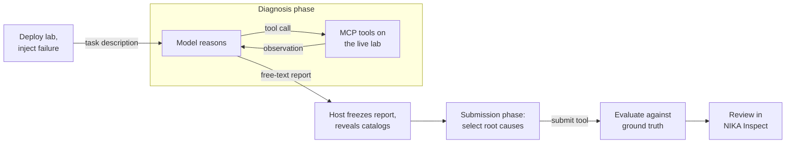

# Choose and run an agent

NIKA lets you run different troubleshooting agents against the same network incidents. Choose an **agent implementation** (the model/tool loop), a **provider and model** (the service it calls), and an **execution location** (host or Docker Sandbox). Changing the model does not require writing a new agent.

Troubleshooting agents investigate through NIKA's MCP tools, produce a diagnosis report, and submit structured root causes for evaluation. The host freezes the report before exposing the submission catalogs. See [Custom agent integration](custom-agents.md) to build your own.



Every implementation follows this loop. Agents differ in how they choose the next tool call, not in what NIKA records or how it scores the result.

## Choose an implementation

| Your goal | Agent | Why it is available |
| --- | --- | --- |
| Start with a conventional tool-using agent, including self-hosted models | `byo.langgraph` | A host-run ReAct loop provides a straightforward baseline and configurable model endpoint. |
| Use mcp-agent's orchestration | `byo.mcp_agent` | Runs diagnosis and submission with mcp-agent workers, for experiments within that framework. |
| Use AutoGen's orchestration | `byo.autogen` | Runs the phases with AutoGen AssistantAgent workers. |
| Evaluate the behavior of a complete agent CLI | `cli.codex`, `cli.claude` | Drives Codex or Claude Code in a Docker Sandbox, preserving the CLI's own agent loop. |
| Integrate through a vendor's Python agent SDK | `sdk.codex_sdk`, `sdk.claude_sdk` | Uses SDK threads/sessions in a Docker Sandbox rather than invoking the agent CLI directly. |
| Evaluate a specialized community implementation | `community.sade` | Adds SADE's network troubleshooting skill library to a Claude Agent SDK agent. See [SADE](community/sade.md). |
| Check the lab and submission pipeline without an LLM | `mock` | Deterministic workflow check; unsuitable for comparing model diagnosis quality. |

The BYO agents execute on the host; CLI, SDK, and SADE agents execute in Docker Sandboxes. The lab and MCP gateway stay on the host in both cases. Framework and execution differences can affect results: record the agent, model, configuration, and versions for comparisons. These choices do not imply a ranking of diagnosis quality.

## Run with a hosted provider

Install NIKA and its lab prerequisites using [Installation](../operations/installation.md), then run `uv sync`. You can also run `uv run nika` to [choose a task and agent interactively](../operations/tui.md). For the command-line walkthrough below, put your provider credential in the repository's `.env`, for example:

```dotenv
OPENAI_API_KEY=<your-api-key>
```

Run a small link-down incident:

```shell
uv run nika agent run -a byo.langgraph -p openai -m gpt-5-mini -n 20 \
  --problem dc_clos_s_link_down
```

`--problem` selects task mode: NIKA deploys the lab, injects the failure, runs both agent phases, closes the session, and evaluates the result. Keep the printed session ID for [Inspect results](#inspect-results). Without `--problem`, the command uses an already running session.

## Run with Ollama

Install [Ollama](https://docs.ollama.com/) separately. On the same host as the BYO agent, start its server in one terminal:

```shell
ollama serve
```

In another terminal, download a tool-capable model and check the endpoint:

```shell
ollama pull qwen2.5:7b
curl http://localhost:11434/v1/models
```

Then run NIKA:

```shell
uv run nika agent run -a byo.langgraph -p custom -m qwen2.5:7b -n 20 \
  --base-url http://localhost:11434/v1 --problem dc_clos_s_link_down
```

Ollama exposes an [OpenAI-compatible API](https://docs.ollama.com/api/openai-compatibility). Choose a model that supports tool calling; a model that only produces text cannot reliably investigate through MCP. The example is a starting configuration, not a benchmark quality recommendation. Ensure the model's context budget accommodates tool descriptions and network output; see Ollama's context configuration in that reference.

Local unauthenticated endpoints do not require `NIKA_CUSTOM_API_KEY`. For an authenticated gateway, put that credential in `.env`.

## Run with vLLM

Install [vLLM](https://docs.vllm.ai/en/stable/) separately on a machine with enough accelerator memory for the chosen model. Start a server with automatic tool calling enabled:

```shell
vllm serve Qwen/Qwen2.5-7B-Instruct \
  --host 127.0.0.1 --port 8000 \
  --enable-auto-tool-choice --tool-call-parser hermes
```

This model uses the Hermes tool format. Other models may require a different parser, chat template, or reasoning parser; follow the [vLLM tool-calling reference](https://docs.vllm.ai/en/stable/features/tool_calling/) for your installed version and checkpoint.

From the agent host, check the server and run the incident:

```shell
curl http://localhost:8000/v1/models
uv run nika agent run -a byo.langgraph -p custom \
  -m Qwen/Qwen2.5-7B-Instruct -n 20 \
  --base-url http://localhost:8000/v1 --problem dc_clos_s_link_down
```

Use the model ID returned by `/v1/models` if you configured a different served name. For a server on another machine, replace `localhost` with its reachable address and configure server binding/authentication accordingly. A successful `/models` request checks connectivity; it does not prove that tool calls work. Inspect the NIKA trajectory for actual tool invocations.

Both self-hosted examples use `provider: custom`. Set `agent.base_url` to the API root, usually ending in `/v1`; only the custom provider reads this setting. To save the endpoint instead of repeating flags:

```yaml
agent:
  type: byo.langgraph
  provider: custom
  model: Qwen/Qwen2.5-7B-Instruct
  max_steps: 20
  base_url: http://localhost:8000/v1
```

Save these values in `config/nika.yaml`; then pass only `--problem` to `nika agent run`. See [Run configuration](../operations/configuration.md) for precedence and additional settings.

## Run a sandboxed agent

Install and authenticate `sbx`, with the required virtualization support, using [Docker Sandbox execution](../operations/agent-sandbox.md#prerequisites). For an OpenAI API-key run, use the `.env` credential above:

```shell
uv run nika agent run -a cli.codex -p openai -m gpt-5-mini -n 20 \
  --problem dc_clos_s_link_down
```

To use the Python SDK implementation, install the SDK extra and change the agent:

```shell
uv sync --extra sdk --prerelease=allow
uv run nika agent run -a sdk.codex_sdk -p openai -m gpt-5-mini -n 20 \
  --problem dc_clos_s_link_down
```

For a custom endpoint, match its API to the agent: the BYO examples above use OpenAI-compatible chat; Claude-family agents (`cli.claude`, `sdk.claude_sdk`, `community.sade`) require Anthropic `/v1/messages`. Use a server that supports that route, such as a compatible vLLM deployment or Ollama 0.14 or later. NIKA checks the route before creating the sandbox and stops with an endpoint error if it is missing.

`localhost` inside a sandbox refers to that sandbox. Self-hosted endpoints need an address reachable from the microVM and sandbox network permission. See [sandbox authentication and networking](../operations/agent-sandbox.md) before adapting an endpoint example.

## Inspect results

Task mode writes results and removes its lab through NIKA's lifecycle. Open the trajectory in **NIKA Inspect**, the local dashboard over your result directories:

```shell
uv run nika inspect
```


*A 62-step `cli.claude` run on `dc_clos_s_link_down`. The strip above the table maps NIKA, agent, and tool events over time; the right pane shows one `exec_shell` call and the router output the model received.*

Use it to follow the agent's investigation step by step:

- **Timeline:** NIKA lifecycle events (deploy, inject, verify), model thinking and output, and every MCP tool call, merged in time order. Filter by source or search tool inputs and outputs with `/`.
- **Event inspector:** the exact tool parameters and returned output, so you can check whether the agent tested the right device and read the result correctly.
- **Overview:** where the wall clock went (lab setup, LLM requests, tool execution) and the slowest operations.
- **Scores:** detection, localization, and root-cause scores, a row-by-row comparison of the submission with ground truth, and step, token, and tool-call counts.

`nika benchmark run` starts the same dashboard automatically. See [Browse sessions with `nika inspect`](../operations/session-inspect.md) for remote access, column filters, and tags.

For scripted checks, print the metrics directly:

```shell
uv run nika eval metrics --session_id <session_id>
```

The underlying files are in the session result directory: the diagnosis report and model/tool events in `messages.jsonl`, and the structured answer in `submission.json`. Metrics distinguish diagnosis quality from steps, tokens, and tool calls; see [Root-cause scoring](../benchmarks/root-cause-evaluation.md).

If you started a lab manually with `nika env run`, close that session explicitly when finished, including after a failed agent run:

```shell
uv run nika session close --session_id <session_id> -y
```

Use the ID of the session you created. Stopping an Ollama or vLLM server is separate from closing the NIKA lab.

## Further configuration

- [Agent reference](agent-reference.md): complete catalog, provider support, step limits, token caps, and observability.
- [MCP servers](mcp-servers.md): available network investigation tools.
- [Agent skills](agent-skills.md): reusable instructions for supported agents.
- [Custom agent integration](custom-agents.md): the contract for a new implementation.
