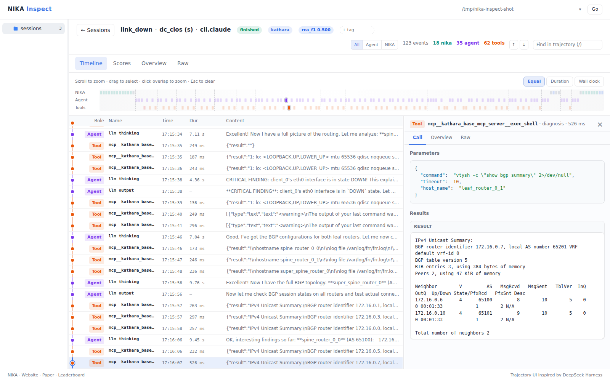

# Choose and run an agent

NIKA evaluates an **agent**: a model plus the **harness** that drives it. The harness is the investigation loop, prompts, and tool access around the model. This page shows how to run your first agent on a task and inspect the result. Then it covers the other harnesses and self-hosted models.

## Run your first agent

Complete [installation](../operations/installation.md) and [set up a sandbox runtime](../operations/agent-sandbox.md#set-up-the-runtime). Every agent runs in its own sandbox, isolated from NIKA. Add your provider key to the repository's `.env`:

```dotenv
OPENAI_API_KEY=<your-api-key>
```

Run LangGraph (`byo.langgraph`) on one task:

```shell
uv run nika agent run -a byo.langgraph -p openai -m gpt-5-mini \
  --problem dc_clos_s_link_down
```

NIKA deploys the network environment, injects the failure, runs the agent, scores its answer, and closes the environment.

> [!TIP]
> Run `uv run nika` to choose a task and agent in the [interactive shell](../operations/tui.md).

## Inspect the result

Open the results in the web UI:

```shell
uv run nika inspect
```



*A Claude Code investigation, with a selected tool call and its router output.*

Open your session to follow the investigation in **Timeline**, inspect tool inputs and outputs, and compare the answer with the ground truth in **Scores**. See [Inspect](../operations/session-inspect.md) for the dashboard, and [root-cause scoring](../benchmarks/root-cause-evaluation.md) for how answers are scored.

To print the metrics in the terminal, pass the session ID that `nika inspect` shows:

```shell
uv run nika eval metrics --session_id <session_id>
```

---

The sections below cover the other harnesses and models. For provider support and every option, see the [agent reference](agent-reference.md). To bring your own harness, see [custom agents](custom-agents.md).

## Choose a harness

Pick the harness that matches the framework or CLI you already use. Each name links to its example configuration. Changing the provider or model does not require a new harness.

A Claude or ChatGPT subscription needs a [subscription login](../operations/agent-sandbox.md#subscriptions) on the NIKA host first, because NIKA does not reuse your local CLI login.

### Agent frameworks

- [LangGraph](../../config/byo.langgraph.example.yaml) (`byo.langgraph`)
- [mcp-agent](../../config/byo.mcp_agent.example.yaml) (`byo.mcp_agent`)
- [AutoGen](../../config/byo.autogen.example.yaml) (`byo.autogen`)

### Coding agent CLIs and SDKs

- [Codex CLI](../../config/cli.codex.example.yaml) (`cli.codex`)
- [Claude Code](../../config/cli.claude.example.yaml) (`cli.claude`)
- [OpenCode](../../config/cli.opencode.example.yaml) (`cli.opencode`; needs [Node.js 22+](../operations/agent-sandbox.md#set-up-the-runtime) on the NIKA host)
- [DeepSeek Harness](../../config/cli.dsh.example.yaml) (`cli.dsh`; needs [Node.js 22+](../operations/agent-sandbox.md#set-up-the-runtime) on the NIKA host)
- [Codex SDK](../../config/sdk.codex_sdk.example.yaml) (`sdk.codex_sdk`)
- [Claude Agent SDK](../../config/sdk.claude_sdk.example.yaml) (`sdk.claude_sdk`)

For example:

```shell
uv run nika agent run -a cli.codex -p openai -m gpt-5-mini \
  --problem dc_clos_s_link_down
```

### Community and testing

- [SADE](community/sade.md) combines a structured troubleshooting workflow with a skill library. Read the [SADE paper](https://arxiv.org/abs/2605.04530).
- `oracle` runs the reference diagnosis of each task. See [Oracle solver](../benchmarks/oracle-solver.md).

## Use a self-hosted model

To evaluate a model served on your own machine or network, run LangGraph with `-p custom` and an OpenAI-compatible endpoint. The model must support tool calling.

### Ollama

Install [Ollama](https://docs.ollama.com/), start `ollama serve`, then run in another terminal:

```shell
ollama pull qwen2.5:7b
uv run nika agent run -a byo.langgraph -p custom -m qwen2.5:7b \
  --base-url http://localhost:11434/v1 --problem dc_clos_s_link_down
```

### vLLM

Install [vLLM](https://docs.vllm.ai/en/stable/) and start a server with tool calling enabled:

```shell
vllm serve Qwen/Qwen2.5-7B-Instruct \
  --host 127.0.0.1 --port 8000 \
  --enable-auto-tool-choice --tool-call-parser hermes
```

In another terminal:

```shell
uv run nika agent run -a byo.langgraph -p custom \
  -m Qwen/Qwen2.5-7B-Instruct \
  --base-url http://localhost:8000/v1 --problem dc_clos_s_link_down
```

Other models may need different [vLLM tool-calling settings](https://docs.vllm.ai/en/stable/features/tool_calling/). For an authenticated endpoint, set `NIKA_CUSTOM_API_KEY` in `.env`. A local endpoint without authentication needs no key.

The sandbox sends model requests through NIKA's host, so the endpoint must be reachable from the host. An endpoint on the host's `localhost` works. Claude-family agents also need an Anthropic-compatible API; see [endpoint compatibility](agent-reference.md#custom-endpoint-compatibility).

To save these settings, set `agent.type`, `agent.provider`, `agent.model`, and `agent.base_url` in [`config/nika.yaml`](../operations/configuration.md).

## Run an agent on an existing environment

To run an agent on an environment that you deploy and inject yourself, pass the session ID to `nika agent run` with `--session_id`:

```shell
uv run nika env run dc_clos -s s
uv run nika failure inject link_down --set host_name=client_1_1 --set intf_name=eth0
uv run nika agent run -a cli.codex -p openai -m gpt-5-mini --session_id <session_id>
uv run nika session close --session_id <session_id> -y
```

Close the session when you are done so its environment is removed.
