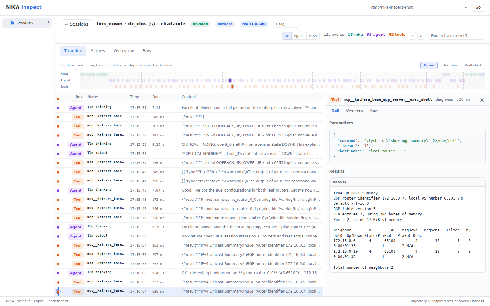

# Choose and run an agent

NIKA runs troubleshooting agents against network incidents and scores their diagnoses. A **harness** connects a model to the investigation loop and tools. Start with LangGraph (`byo.langgraph`); changing its provider or model does not require a new harness.

## Run your first incident

Complete [Installation](../operations/installation.md), [set up a sandbox runtime](../operations/agent-sandbox.md#set-up-the-runtime), and add your provider key to the repository's `.env`. Every agent runs in its own sandbox, isolated from NIKA:

```dotenv
OPENAI_API_KEY=<your-api-key>
```

```shell
uv run nika agent run -a byo.langgraph -p openai -m gpt-5-mini \
  --problem dc_clos_s_link_down
```

NIKA creates the lab, injects the failure, runs the agent, evaluates its answer, and closes the lab. Keep the printed session ID.

> **Interactive setup:** run `uv run nika` to [choose a task and agent](../operations/tui.md).

## Available harnesses

Each harness name links to its example configuration. Docker Sandboxes runs the sandboxes as microVMs on the NIKA host and needs KVM, while E2B runs them on E2B cloud or an E2B-compatible service (like AgentENV).

### Agent frameworks

- [LangGraph](../../config/byo.langgraph.example.yaml) (`byo.langgraph`)
- [mcp-agent](../../config/byo.mcp_agent.example.yaml) (`byo.mcp_agent`)
- [AutoGen](../../config/byo.autogen.example.yaml) (`byo.autogen`)

### Coding agent CLIs and SDKs

For a Claude or ChatGPT subscription, complete the [subscription login](../operations/agent-sandbox.md#subscriptions) for your runtime first; NIKA does not import your local CLI login:

- [Codex CLI](../../config/cli.codex.example.yaml) (`cli.codex`)
- [Claude Code](../../config/cli.claude.example.yaml) (`cli.claude`)
- [OpenCode](../../config/cli.opencode.example.yaml) (`cli.opencode`; [Node.js 22+](../operations/agent-sandbox.md#set-up-the-runtime) on the NIKA host)
- [DeepSeek Harness](../../config/cli.dsh.example.yaml) (`cli.dsh`; [Node.js 22+](../operations/agent-sandbox.md#set-up-the-runtime) on the NIKA host)
- [Codex SDK](../../config/sdk.codex_sdk.example.yaml) (`sdk.codex_sdk`)
- [Claude Agent SDK](../../config/sdk.claude_sdk.example.yaml) (`sdk.claude_sdk`)

For example:

```shell
uv run nika agent run -a cli.codex -p openai -m gpt-5-mini \
  --problem dc_clos_s_link_down
```

### Community and testing

- [SADE](community/sade.md) combines a structured troubleshooting workflow with a skill library. Read the [SADE paper](https://arxiv.org/abs/2605.04530).
- `mock` checks the pipeline without an LLM.

See the [agent reference](agent-reference.md) for provider support and options, or [custom agents](custom-agents.md) to add your own investigation loop.

## Use a self-hosted model

Use `byo.langgraph` with `-p custom` and an OpenAI-compatible endpoint. The model must support tool calling.

### Ollama

Install [Ollama](https://docs.ollama.com/), start `ollama serve`, then run in another terminal:

```shell
ollama pull qwen2.5:7b
uv run nika agent run -a byo.langgraph -p custom -m qwen2.5:7b -n 20 \
  --base-url http://localhost:11434/v1 --problem dc_clos_s_link_down
```

### vLLM

Install [vLLM](https://docs.vllm.ai/en/stable/) and start a tool-enabled server:

```shell
vllm serve Qwen/Qwen2.5-7B-Instruct \
  --host 127.0.0.1 --port 8000 \
  --enable-auto-tool-choice --tool-call-parser hermes
```

In another terminal:

```shell
uv run nika agent run -a byo.langgraph -p custom \
  -m Qwen/Qwen2.5-7B-Instruct -n 20 \
  --base-url http://localhost:8000/v1 --problem dc_clos_s_link_down
```

Other models may need different [vLLM tool-calling settings](https://docs.vllm.ai/en/stable/features/tool_calling/). For authenticated endpoints, set `NIKA_CUSTOM_API_KEY` in `.env`; local unauthenticated endpoints need no key.

To save these flags, use `agent.type`, `agent.provider`, `agent.model`, `agent.max_steps`, and `agent.base_url` in [`config/nika.yaml`](../operations/configuration.md).

For sandboxed agents, NIKA forwards model requests to the endpoint from the NIKA host, so the endpoint must be reachable from the host; an endpoint on the host's `localhost` works. Claude-family agents also require an Anthropic-compatible API. See [endpoint compatibility](agent-reference.md#custom-endpoint-compatibility) before adapting these examples.

## Inspect results

```shell
uv run nika inspect
```



*A Claude Code investigation, with a selected tool call and its router output.*

Open your session to follow the investigation in **Timeline**, inspect tool inputs and outputs, and compare the answer with ground truth in **Scores**. See [Inspect](../operations/session-inspect.md) for dashboard details and [root-cause scoring](../benchmarks/root-cause-evaluation.md) for how answers are evaluated.

For metrics in the terminal:

```shell
uv run nika eval metrics --session_id <session_id>
```

Runs with `--problem` manage lab cleanup. If you instead use an existing lab, close the session you created when finished:

```shell
uv run nika session close --session_id <session_id> -y
```
