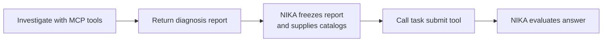

# Integrate a custom agent

Write the investigation loop; NIKA supplies the lab, network tools, and evaluation. Start from a host-run agent using `TwoPhaseAgent`, with any Python model client or framework.

## The two things your agent does

1. **Diagnose:** investigate through MCP tools and return a report with your conclusion and evidence.
2. **Submit:** translate that report into root causes using the catalogs NIKA provides, then call the task MCP `submit` tool.

NIKA freezes the report between these phases. Submission cannot continue investigating, and ground truth stays with the evaluator.



## Implement the two phases

Create `src/agent/community/my_agent/agent.py`. This skeleton shows where your model/tool loop belongs:

```python
from typing import Any

from agent.utils.two_phase import TwoPhaseAgent
from nika.utils.session import Session


class MyAgent(TwoPhaseAgent):
    def __init__(
        self,
        session_id: str,
        model: str,
        max_steps: int = 20,
        stream_output: bool = True,
    ) -> None:
        self.session_id = session_id
        self.model = model
        self.max_steps = max_steps
        self.stream_output = stream_output
        self.session = Session()
        self.session.load_running_session(session_id=session_id)
        self.trace_dir = self.session.session_dir

    async def diagnose(self, task_description: str) -> str:
        # Discover diagnosis tools; run your bounded investigation loop.
        # Return its evidence-based report, or raise on execution failure.
        raise NotImplementedError

    async def submit(self, diagnosis_report: str, context: dict[str, Any]) -> str:
        # Use the frozen report and context to select valid root causes.
        # Invoke the submission MCP tool and return its result as text.
        raise NotImplementedError
```

`TwoPhaseAgent` handles report freezing, phase changes, and lifecycle logging. Your loops must enforce `max_steps` model responses per phase and record model/tool activity with [`MessageLogger`](../../src/agent/utils/loggers.py) (`AgentCallbackLogger` for LangChain). These events drive step, token, and tool-call metrics; see [limits](agent-reference.md#step-limit) and [trace fields](agent-reference.md#trace-event-contract).

For a working example, follow [`byo.langgraph`](../../src/agent/byo/langgraph/react_agent.py) and its [phase workers](../../src/agent/byo/langgraph/phases/). For sandbox execution, follow an [existing sandbox agent](../operations/agent-sandbox.md#phase-boundary) instead of importing host session code into a worker.

## Connect your loop to NIKA's tools

Use the shared helper to get the session's MCP connections:

```python
from agent.utils.mcp_client import load_session_mcp_config

connections = load_session_mcp_config(
    self.session_id, self.session.scenario_name, phase="diagnosis"
)
```

Pass these connections, including their headers, to your framework's MCP adapter. Discover tool schemas, let your model choose calls, and feed results and errors back into the loop. See [available tools](mcp-servers.md) and the [standard Python MCP example](agent-reference.md#python-mcp-client) if your framework has no adapter.

In `submit()`, load connections with `phase="submission"`. The supplied `context` contains `resources` and `fault_ontology`: select `{resource_id, fault_type}` pairs supported by the frozen report and call the task server's `submit` tool with:

```python
{"is_anomaly": True, "root_causes": root_causes}
```

For a healthy network, use `is_anomaly=False` and an empty list. Check that the tool succeeded: it writes `submission.json`; returning a dictionary from your method does not record an answer.

## Register and configure the agent

Add a case to [`create_agent()`](../../src/agent/registry.py):

```python
case "community.my_agent":
    from agent.community.my_agent.agent import MyAgent

    return MyAgent(
        session_id=session_id,
        model=model,
        max_steps=max_steps,
        stream_output=stream_output,
    )
```

Declare your agent's supported providers in `AGENT_PROVIDERS` in [`provider_env.py`](../../src/agent/utils/provider_env.py), which the CLI checks before creating an agent. Pass model-client settings through the factory, keep credentials in `.env`, and use run configuration for operational settings. See [registration details](agent-reference.md#custom-agent-registration) for provider routing and defaults.

## Run and check the result

```shell
uv run nika agent run -a community.my_agent -m <model> -n 20 \
  --problem dc_clos_s_link_down
uv run nika inspect
```

Task mode deploys, injects, closes the lab, and evaluates the answer. In Inspect, check that the agent investigated the network, recorded a report before submission, and submitted successfully. Confirm the trace counts real model/tool calls and the run left no lab resources behind.

Then check healthy cases and diagnosis failures before running a [benchmark matrix](../benchmarks/benchmark-configuration.md).
