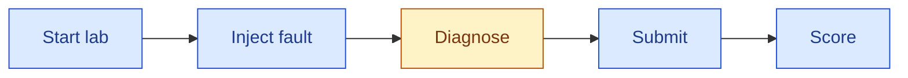

# Integrate a custom agent

Bring your own agent, written with any framework, and NIKA tests it on real network incidents: it provides the lab, the tools your agent uses to inspect it, and the scoring.

This guide builds an agent with [NOOA](https://github.com/NVIDIA-NeMo/labs-OO-Agents), NVIDIA's object-oriented agent framework, in its own project outside NIKA. Other frameworks follow the same steps.

## How a run works

Every run of `nika agent run` goes through the same steps:



Blue steps are run by NIKA; the orange step is run by your agent.

1. **Start lab** and **inject fault**: NIKA deploys the network and breaks it, for example by taking a link down.
2. **Diagnose**: your agent gets a description of the symptoms and investigates the live network through NIKA's [MCP tools](mcp-servers.md), such as running commands on devices or measuring reachability. It returns a written diagnosis report.
3. **Submit**: NIKA freezes the report and converts it into a structured answer, which component failed and how, by default with your agent's model. The answer comes only from the report; the network is no longer reachable.
4. **Score**: NIKA compares that answer with the fault it injected, then closes the lab.

Your agent implements **Diagnose**. NIKA handles the other steps.

## 1. Write your agent

Your agent is a Python class. Inherit `DiagnosisAgent` and implement `diagnose`: it receives the incident description and returns the diagnosis report. `DiagnosisAgent` holds the run settings, such as `self.model` and `self.max_steps`, and its `diagnosis_mcp_config()` returns the MCP servers your agent may use. Create model clients from the standard `OPENAI_BASE_URL` and `OPENAI_API_KEY` variables (or `ANTHROPIC_*`): NIKA runs your agent in an isolated sandbox and points them at your provider.

The example has two classes. `NetworkInvestigator` is the NOOA agent that reasons about the network. `NooaAgent` is the class NIKA runs: it connects the investigator to the lab's MCP tools and returns its report.

```python
from nooa import Agent
from nooa.mcp import MCPManager, MCPTool
from nooa.unifiedllm.registry import get_llm_client

from agent.base import DiagnosisAgent


class NetworkInvestigator(Agent):
    """You are a network operations engineer troubleshooting a live network lab."""

    def __init__(self, servers: dict[str, MCPTool], **kwargs):
        super().__init__(**kwargs)
        self.servers: dict[str, MCPTool] = servers

    async def investigate(self, task: str) -> str:
        """Find the root cause of the incident, using the MCP tools in `self.servers`.

        Return a report that names the faulty devices, interfaces or links,
        the root cause, and the evidence for it.
        """
        ...  # NOOA's model writes and runs Python here


class NooaAgent(DiagnosisAgent):
    async def diagnose(self, task_description: str) -> str:
        servers = {
            name: await MCPManager.create_url_server(
                name, cfg["url"], headers=cfg["headers"]
            )
            for name, cfg in self.diagnosis_mcp_config().items()
        }
        llm = get_llm_client(f"openai/{self.model}")
        investigator = NetworkInvestigator(servers, llm=llm)
        return await investigator.investigate(task_description)
```

## 2. Run it

List your framework in your project's `pyproject.toml`, then run the agent by its import path:

```shell
PYTHONPATH=../nooa-agent uv run nika agent run -a nooa_agent.agent:NooaAgent --problem dc_clos_s_link_down
```

NIKA copies your project into the agent's sandbox, installs its `[project].dependencies` there, and runs every step above. Your framework never enters NIKA's environment, so the two cannot break each other. NIKA prints the score at the end. The provider, model, and limits come from `config/nika.yaml`, as in the [LangGraph example configuration](../../config/byo.langgraph.example.yaml).

## 3. Register it

Running by import path is fine for a quick test, but every run needs the module path, and `PYTHONPATH` set to your project. NIKA also cannot check your configuration: it does not know which LLM providers the agent supports, so a wrong provider fails only mid-run.

Registering gives the agent a short name, such as `nooa`, that works like a built-in one: with `-a nooa`, as `agent.type: nooa` in a run configuration, and in `nika agent list`. NIKA remembers where the project lives and which providers the agent supports.

Describe the agent in a `nika-agent.yaml` next to its `pyproject.toml`:

```text
nooa-agent/
├── pyproject.toml        # dependencies = ["nooa[mcp]==0.0.10"]
├── nika-agent.yaml
└── nooa_agent/
    └── agent.py
```

```yaml
id: nooa                              # the name you run it by
class: nooa_agent.agent:NooaAgent      # the class from step 1
providers: [openai, custom]           # providers your model client supports
```

Then register it once:

```shell
uv run nika agent add ../nooa-agent
uv run nika agent run -a nooa --problem dc_clos_s_link_down
```

NIKA records the project directory in `config/agents.yaml` and copies it into the sandbox on every run, so your edits apply immediately. `nika agent remove nooa` unregisters it. Pin dependency versions so every run installs the same packages.

Other manifest fields, such as a default model, are listed in the [registration reference](agent-reference.md#custom-agent-registration).

<details>
<summary>Example investigation from a real run</summary>

*The NOOA agent on `dc_clos_s_link_down` with `nvidia/Qwen3.6-35B-A3B-NVFP4`; shortened from the recorded trace and report.*

```text
Tool: run_pingmesh_snapshot(count=3)
Result: client_0 → dns_pod0, webserver0_pod0: 100% loss; server-to-server paths healthy

Tool: exec_shell(host_name="client_0", command="ip addr show; ip route show …")
Tool: exec_shell(host_name="super_spine_router_0", command="ip addr show …")
Tool: exec_shell(host_name=…, command='vtysh -c "show bgp summary"') on each router

Report: The physical link between client_0:eth0 and super_spine_router_0:eth2 is
        DOWN, isolating client_0 from the fabric. BGP sessions are up, but
        192.168.0.0/24 is not advertised because eth2 is down.

Score: detection, root cause, and localization 1.0 (17 steps, 20 tool calls)
```

</details>
