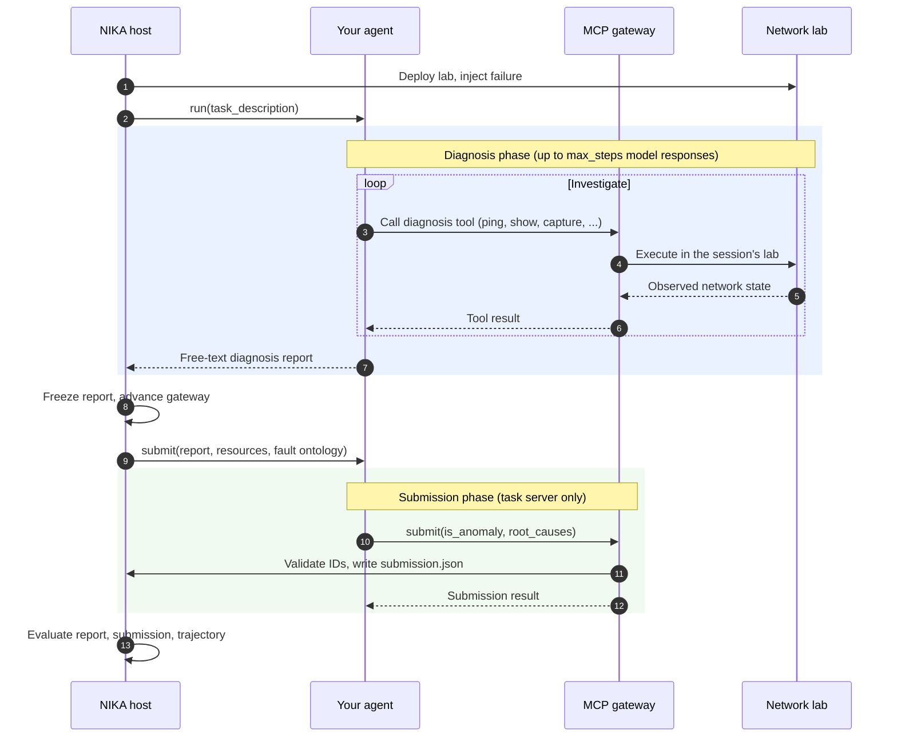

# Integrate a custom agent

Bring your own investigation strategy or agent framework while letting NIKA provide the network lab, tools, submission format, and evaluation. Your agent can use any Python model client or orchestration framework that can invoke MCP tools.

Use the Python protocol and shared helpers below to integrate with NIKA. Your model client and investigation loop remain your choice; the registered `sdk.*` implementations are examples using vendor agent SDKs.

## Understand the workflow



For host-run agents, `TwoPhaseAgent` performs steps 8 and 9 for you; you implement the diagnosis loop (steps 3–7) and the `submit` call (step 10). Every step is recorded and can be replayed in [NIKA Inspect](agent-implementations.md#inspect-results).

| Concept | What it means for your agent |
| --- | --- |
| Session | One lab/task execution with session-scoped tool access and a result directory. Use the session passed by NIKA. |
| Diagnosis | Investigate observable network state through MCP. Return your conclusion and supporting evidence, including uncertainty. |
| Telemetry | Network telemetry is evidence available through tools; agent trace events record model and tool activity for inspection and metrics. Neither should expose ground truth. |
| Frozen report | The host records the diagnosis before revealing the submission catalogs. Submission translates that report; it does not continue investigating. |
| Submission | Call the task MCP `submit` tool with `is_anomaly` and `{resource_id, fault_type}` root causes selected from the supplied catalogs. |
| Evaluator | NIKA compares the saved result against host-held ground truth and derives execution metrics from the trajectory. Your agent does not load ground truth or score itself. |

The [MCP reference](mcp-servers.md) describes investigation tools. The [root-cause scoring reference](../benchmarks/root-cause-evaluation.md) defines valid answers, healthy cases, and metrics.

## Implement the two phases

The required interface is deliberately small:

```python
from typing import Any, Protocol


class TroubleshootingAgent(Protocol):
    session_id: str

    async def run(self, task_description: str) -> dict[str, Any]: ...
```

NIKA constructs the registered implementation and calls `run()` with the session's task description. Subclass [`TwoPhaseAgent`](../../src/agent/utils/two_phase.py) to reuse report freezing, gateway advancement, and phase lifecycle logging. Implement `diagnose()` and `submit()`; you do not need to reproduce the host orchestration.

This skeleton marks the two places where your own model/tool loop belongs. It is not a runnable diagnosis algorithm:

```python
from typing import Any

from agent.utils.two_phase import TwoPhaseAgent
from nika.utils.session import Session


class MyAgent(TwoPhaseAgent):
    def __init__(
        self,
        session_id: str,
        model: str,
        max_steps: int = 20,
        stream_output: bool = True,
    ) -> None:
        self.session_id = session_id
        self.model = model
        self.max_steps = max_steps
        self.stream_output = stream_output
        self.session = Session()
        self.session.load_running_session(session_id=session_id)
        self.trace_dir = self.session.session_dir

    async def diagnose(self, task_description: str) -> str:
        # Discover diagnosis tools; run your bounded investigation loop.
        # Return its evidence-based report, or raise on execution failure.
        raise NotImplementedError

    async def submit(self, diagnosis_report: str, context: dict[str, Any]) -> str:
        # Use the frozen report and context to select valid root causes.
        # Invoke the submission MCP tool and return its result as text.
        raise NotImplementedError
```

The base class rejects empty diagnosis reports and reports starting with `ERROR:`, skipping submission. Your loop must enforce `max_steps` model responses per phase; the base class does not enforce that limit. Reuse `max_steps_report()` for the shared limit behavior. The registry's runner applies the whole-run timeout. See [limits and telemetry](agent-reference.md#step-limit).

This skeleton is for a **host-run** integration. Sandboxed agents return the report to the host driver, which advances the phase between separate workers. They cannot advance it themselves or import host session code. Follow the existing sandbox integration if you need that execution mode; see [the phase boundary](../operations/agent-sandbox.md#phase-boundary).

## Discover and invoke tools with any Python framework

Load the session's phase-specific HTTP MCP connections with the shared helper:

```python
from agent.utils.mcp_client import load_session_mcp_config

connections = load_session_mcp_config(session_id, scenario_name, phase="diagnosis")
```

The helper resolves the session backend and gateway configuration. Use these connections with your framework's MCP adapter or the standard Python MCP client. Keep the returned headers: they carry session-scoped access. Do not build another Docker or emulator client for investigation.

For example, the standard MCP client can list and invoke tools on each connection:

```python
from mcp import ClientSession
from mcp.client.streamable_http import streamablehttp_client


async def invoke_connection(connection: dict, name: str, arguments: dict):
    async with streamablehttp_client(
        connection["url"], headers=connection.get("headers")
    ) as (read, write, _):
        async with ClientSession(
            read, write, **connection.get("session_kwargs", {})
        ) as client:
            await client.initialize()
            tools = await client.list_tools()
            # In your loop, give tools.tools to the model before choosing a call.
            # Each tool supplies name, description, and inputSchema.
            if name not in {tool.name for tool in tools.tools}:
                raise ValueError(f"Unknown tool: {name}")
            result = await client.call_tool(name, arguments=arguments)
            return result
```

The snippet shows one invocation with a tool name and arguments chosen by your model. In a full loop, discover tools across the returned connections, retain the mapping to each server, and keep client sessions open. Feed `result.content` and `result.isError` back to the model before its next turn. Choose arguments from the discovered schemas rather than hardcoding a topology-specific host or address.

When `TwoPhaseAgent` calls `submit()`, load connections again with `phase="submission"`. Only the task server belongs in this phase. The `context` argument provides:

- `diagnosis_report`: the frozen report;
- `resources`: valid resource IDs and kinds;
- `fault_ontology`: valid fault IDs with descriptions and owner kinds.

Select IDs supported by the report, not by their position in the catalog. A healthy conclusion uses `is_anomaly=False` and an empty root-cause list. Invoke the task server's discovered `submit` tool with that answer. It validates IDs and writes the scored `submission.json` on the host; returning a Python dictionary or writing a local file does not replace that call.

For example, inside your submission worker, after your model has selected `is_anomaly` and `root_causes` from the report and catalogs:

```python
submission_connections = load_session_mcp_config(
    self.session_id, self.session.scenario_name, phase="submission"
)
connection = next(iter(submission_connections.values()))
result = await invoke_connection(
    connection,
    "submit",
    {"is_anomaly": is_anomaly, "root_causes": root_causes},
)
if result.isError:
    raise RuntimeError(str(result.content))
return str(result)
```

This fragment belongs inside an async method; `invoke_connection` is the standard MCP example above. A model's proposal is not a recorded submission until the tool succeeds.

## Register and configure the agent

Place community implementations under `src/agent/community/my_agent/`. Keep model configuration and prompts there as needed; no particular internal file layout or framework is required.

Add a case to [`create_agent()`](../../src/agent/registry.py):

```python
case "community.my_agent":
    from agent.community.my_agent.agent import MyAgent

    return MyAgent(
        session_id=session_id,
        model=model,
        max_steps=max_steps,
        stream_output=stream_output,
    )
```

Enable model resolution for the new ID in [`agent_config.py`](../../src/nika/utils/agent_config.py). For provider routing or sandbox registration, follow the [registration reference](agent-reference.md#custom-agent-registration).

Follow an existing implementation for the configuration your model client needs. Keep credentials in `.env` and operational settings in run configuration. NIKA's protocol does not mandate a particular model API.

## Record real model and tool activity

Use [`MessageLogger`](../../src/agent/utils/loggers.py) in each worker phase to record real calls in `messages.jsonl`. `TwoPhaseAgent` already writes phase start/done/error events and the host writes the frozen report.

Log one `llm_end` per actual model response, including available usage metadata. Log tool start, result, and errors with consistent tool names and call IDs. Do not log a deterministic operation as an LLM response: the evaluator uses these events to count steps, tokens, and tool calls. LangChain integrations can use `AgentCallbackLogger`; other frameworks can use `MessageLogger` directly.

See [telemetry contract](agent-reference.md#trace-event-contract) for the event fields. Omit usage metadata when the provider does not report it; do not estimate token counts from text.

## Validate through the normal workflow

First verify the lab/submission pipeline without spending model tokens:

```shell
uv run nika agent run -a mock -m mock-v1 --problem dc_clos_s_link_down
```

Then exercise your registered agent on the same small incident:

```shell
uv run nika agent run -a community.my_agent -m <model> -n 20 \
  --problem dc_clos_s_link_down
uv run nika eval metrics --session_id <printed_session_id>
uv run nika inspect
```

Task mode handles lab deployment, injection, closure, and evaluation. Open the session in NIKA Inspect and check that the Timeline shows actual network investigation, a frozen report before submission, and correctly counted model/tool calls (see [Inspect results](agent-implementations.md#inspect-results)). Confirm the task MCP tool created `submission.json` and that no resources from your run remain.

For explicit session control, start a lab with `nika env run`, inject a failure, and run the agent with `--session_id`. Use `nika exec --help` to inspect actual container state while the lab is running. Always close the session you created with `nika session close --session_id <session_id> -y`, including on failure. Never clean up unrelated Docker or emulator resources.

Once that workflow works, use [benchmark configuration](../benchmarks/benchmark-configuration.md) to run a case matrix with your agent ID. Include healthy cases and diagnosis failures when checking an integration's behavior.
