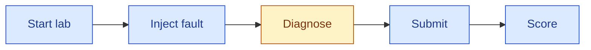

# Integrate a custom agent

Bring your own agent, written with any framework, and NIKA tests it on real network incidents: it provides the lab, the tools your agent uses to inspect it, and the scoring.

This guide builds an agent with [NOOA](https://github.com/NVIDIA-NeMo/labs-OO-Agents), NVIDIA's object-oriented agent framework. Other frameworks follow the same steps.

## How a run works

Every run of `nika agent run` goes through the same steps:



Blue steps are run by NIKA; the orange step is run by your agent.

1. **Start lab** and **inject fault**: NIKA deploys the network and breaks it, for example by taking a link down.
2. **Diagnose**: your agent gets a description of the symptoms and investigates the live network through NIKA's [MCP tools](mcp-servers.md), such as running commands on devices or measuring reachability. It returns a written diagnosis report.
3. **Submit**: NIKA freezes the report and converts it into a structured answer, which component failed and how, by default with your agent's model. The answer comes only from the report; the network is no longer reachable.
4. **Score**: NIKA compares that answer with the fault it injected, then closes the lab.

Your agent implements **Diagnose**. NIKA handles the other steps.

## 1. Write your agent

A custom agent is one Python file in `src/agent/custom/`, and the file name is its name: `src/agent/custom/nooa.py` runs as agent type `custom.nooa`. You do not register it or edit NIKA.

The file defines one class that inherits `DiagnosisAgent` and implements `diagnose`: it receives the incident description and returns the diagnosis report. `DiagnosisAgent` holds the run settings, such as `self.model` and `self.max_steps`, and its `diagnosis_mcp_config()` returns the MCP servers your agent may use. Create model clients from the standard `OPENAI_BASE_URL` and `OPENAI_API_KEY` variables (or `ANTHROPIC_*`): NIKA runs your agent in an isolated sandbox and points them at your provider.

The example has two classes. `NetworkInvestigator` is the NOOA agent that reasons about the network. `NooaAgent` is the class NIKA runs: it declares what its sandbox needs, connects the investigator to the lab's MCP tools, and returns its report.

```python
from nooa import Agent
from nooa.mcp import MCPManager, MCPTool
from nooa.unifiedllm.registry import get_llm_client

from agent.base import DiagnosisAgent


class NetworkInvestigator(Agent):
    """You are a network operations engineer troubleshooting a live network lab."""

    def __init__(self, servers: dict[str, MCPTool], **kwargs):
        super().__init__(**kwargs)
        self.servers: dict[str, MCPTool] = servers

    async def investigate(self, task: str) -> str:
        """Find the root cause of the incident, using the MCP tools in `self.servers`.

        Return a report that names the faulty devices, interfaces or links,
        the root cause, and the evidence for it.
        """
        ...  # NOOA's model writes and runs Python here


class NooaAgent(DiagnosisAgent):
    dependencies = ["nooa[mcp]==0.0.10", "litellm<1.106"]
    requires_python = ">=3.12,<3.14"
    providers = ["openai", "custom"]

    async def diagnose(self, task_description: str) -> str:
        servers = {
            name: await MCPManager.create_url_server(
                name, cfg["url"], headers=cfg["headers"]
            )
            for name, cfg in self.diagnosis_mcp_config().items()
        }
        llm = get_llm_client(f"openai/{self.model}")
        investigator = NetworkInvestigator(servers, llm=llm)
        return await investigator.investigate(task_description)
```

Your framework is not installed in NIKA's environment. The class attributes, all optional, tell NIKA what to set up in the agent's sandbox:

| Attribute | Default | Meaning |
| --- | --- | --- |
| `dependencies` | none | pip requirements, installed from PyPI on every run. Pin versions so every run installs the same packages. |
| `requires_python` | the sandbox's Python | Version specifier, such as `">=3.12,<3.14"`. NIKA runs the agent on a matching interpreter. |
| `providers` | all | LLM providers your model client supports, among `openai`, `anthropic`, `deepseek`, and `custom`. NIKA rejects any other provider before the run starts. |

NIKA reads these attributes without importing your file, so write them as literal values. Everything under `src/agent/` is copied into the sandbox, where the agent must not learn which benchmark runs it: keep the word "NIKA" out of the file, including comments.

The repository ships the complete NOOA agent as [`src/agent/custom/nooa.py`](../../src/agent/custom/nooa.py), which also records its tool calls and model turns and honors the step limit. The [NOOA agent example](nooa-example.md) explains those additions.

## 2. Run it

Run the agent by its name:

```shell
uv run nika agent run -a custom.nooa --problem dc_clos_s_link_down
```

NIKA starts the agent in its sandbox, carries out every step above, and prints the score at the end. To use the agent by default, including for `nika benchmark run`, set `agent.type: custom.nooa` in `config/nika.yaml`. The provider, model, and limits come from the same file, and `uv run nika agent list` shows the agent with its providers.

Custom agents authenticate with an API key in `.env`; subscription logins apply only to the built-in Codex and Claude agents.

<details>
<summary>Example investigation from a real run</summary>

*The NOOA agent on `dc_clos_s_link_down` with `nvidia/Qwen3.6-35B-A3B-NVFP4`; shortened from the recorded trace and report.*

```text
Tool: run_pingmesh_snapshot(count=3)
Result: client_0 → dns_pod0, webserver0_pod0: 100% loss; server-to-server paths healthy

Tool: exec_shell(host_name="client_0", command="ip addr show; ip route show …")
Tool: exec_shell(host_name="super_spine_router_0", command="ip addr show …")
Tool: exec_shell(host_name=…, command='vtysh -c "show bgp summary"') on each router

Report: The physical link between client_0:eth0 and super_spine_router_0:eth2 is
        DOWN, isolating client_0 from the fabric. BGP sessions are up, but
        192.168.0.0/24 is not advertised because eth2 is down.

Score: detection, root cause, and localization 1.0 (17 steps, 20 tool calls)
```

</details>

## Agents in their own project

An agent in `src/agent/custom/` lives in your NIKA checkout. If it already has its own repository, or you want to version it separately, NIKA can run it from that project instead: register the project with `nika agent add`, which reads a `nika-agent.yaml` manifest, or pass its class as `-a module.path:ClassName`. The [registration reference](agent-reference.md#custom-agent-registration) describes both.
