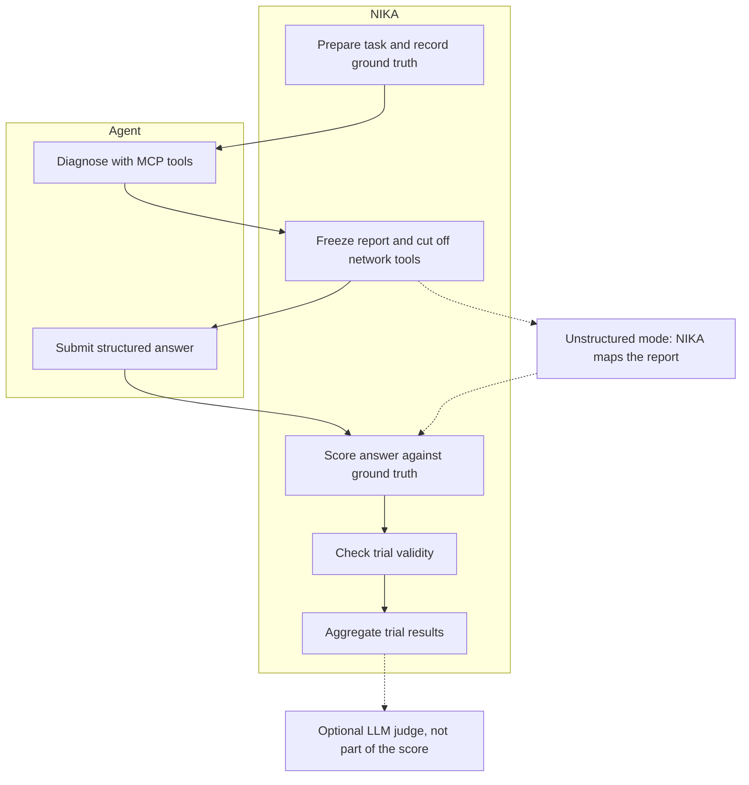
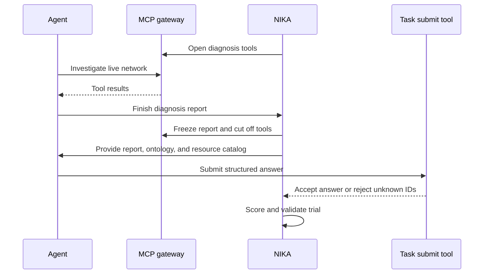
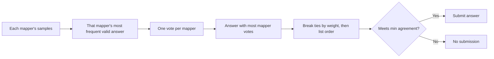
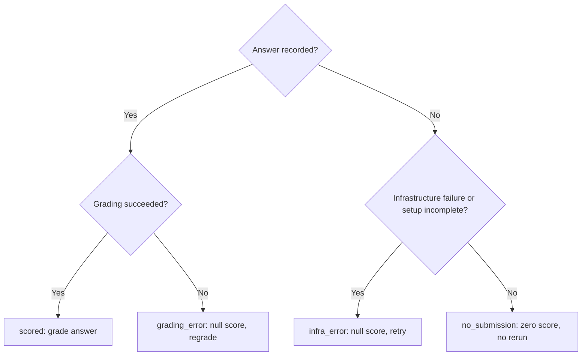

# 🧪 How NIKA evaluates an agent

After reading this guide, you will be able to trace how a run becomes a score, choose the submission mode that fits your comparison, and interpret the resulting summary. The diagrams show where the agent acts, where NIKA takes over, and why some runs score zero while others need infrastructure repair.

## In a nutshell

- NIKA compares a structured answer with the faults it injected into the task.
- The agent investigates first; NIKA then freezes its report and cuts off the network tools before submission.
- `structured` mode uses the agent's model to submit. `unstructured` mode has NIKA map the report to an answer.
- A missing answer usually scores zero. Infrastructure or grading failures are kept separate and need retry or regrading.
- Summary means include every expected trial, so not answering a difficult task cannot improve the result.

## 🗺️ The pipeline at a glance

A task combines a network environment, an incident, and a traffic pattern. Each trial follows this path:



NIKA deploys the task's network environment, injects the failure or failures, and records the ground truth: one `(resource_id, fault_type)` pair for each injected fault. A healthy task has `is_anomaly: false` and no root causes.

Because NIKA scores the answer against what it actually injected, the result is deterministic and reproducible for a given answer and benchmark revision. The optional judge is a separate, after-the-fact review and does not feed the score.

### One trial, step by step

The agent investigates the live environment through MCP tools and writes a free-text report. NIKA then freezes that report and switches the MCP gateway to the submission phase. The gateway no longer makes network tools reachable.



## Diagnosis and submission

An agent run has two phases: diagnosis and submission.

During **diagnosis**, the agent explores the environment and reports what it found. The phase is limited by `agent.max_steps`, the maximum number of LLM requests the agent may make in each of its phases, as counted by NIKA's model proxy, including requests from sub-agents. `agent.timeout_sec` limits the whole run. In unstructured mode, NIKA's mapping calls do not count toward `agent.max_steps`: each mapping model makes its `samples` calls plus at most one corrective retry per sample, within the time left in `agent.timeout_sec`. If the step budget runs out, the latest assistant text becomes the report. An empty report or one starting with `ERROR:` fails the run before submission.

At the phase boundary, NIKA freezes the report and cuts off the network tools. During **submission**, the answer must contain:

- `is_anomaly`: whether the agent believes the task is anomalous.
- `root_causes`: the set of `{resource_id, fault_type}` pairs it identifies.

The submission phase receives only the frozen report, the fault ontology (registered fault type IDs and short descriptions), and the resource catalog (canonical IDs for nodes, interfaces, links, and Kubernetes objects in the environment). The task's submit tool rejects unknown IDs.

The split separates investigating the problem from expressing the answer in the benchmark's vocabulary. It also prevents further investigation while the answer is being formatted, making results more comparable across agents.

See the [shared run contract](../agents/agent-reference.md#shared-run-contract) and [step limit](../agents/agent-reference.md#step-limit) for details.

## 📝 Choose a submission mode

Set `agent.submission.mode` to `structured` or `unstructured`.

| Mode | Who creates the structured answer? | When to use it |
| --- | --- | --- |
| `structured` (default) | The agent's own model calls the submit tool. | Leaderboard and comparable runs where the score should include how well the agent's model submits its answer. |
| `unstructured` | NIKA maps the frozen report to an answer using separately configured mapping model(s). | Comparing diagnosis reports from agents that use different models or no model, independently of each model's tool-calling ability. |

> [!NOTE]
> Mapping models see only the frozen report, ontology, and resource catalog. They never see the ground truth or the network.

Mapping is part of scoring and is performed by NIKA, not by the agent. Unstructured runs include their mapping settings in the run identity.

> [!IMPORTANT]
> Unstructured runs cannot be packed for the leaderboard.

### One mapping model

Configure `agent.submission.provider`, `model`, and optionally `base_url` to select the mapping model. A custom `base_url` selects its endpoint; if omitted, it defaults to `agent.base_url`.

`agent.submission.samples` sets the number of independent mapping calls and defaults to `1`. Temperature defaults to the provider's default. Each invalid answer, such as non-JSON output or an unknown ID, gets one corrective retry. A sample that remains invalid does not vote. The model's answer is its most frequent valid answer; ties go to the earliest sample. Output is capped by `agent.max_tokens`.

> [!TIP]
> When `samples` is greater than `1`, set `temperature` above zero if you want the calls to be likely to differ. Otherwise, the samples are likely to be identical.

### Several mapping models

Use `agent.submission.mappers` to configure multiple models. Each entry specifies a provider and model, with optional `base_url`, `samples`, `temperature`, and `weight`. Weight defaults to `1`.

Voting has two levels. First, each model selects its own most frequent valid answer; a model with no valid sample abstains. Then each model casts one vote, and the answer supported by the most models wins. Weights only break ties between answers: the answer whose supporter has the highest weight wins, then the earlier mapper entry. A weight cannot make one model outvote a larger group.

`agent.submission.min_agreement` sets how many models must vote for the winning answer. It defaults to `1` and cannot exceed the number of mappers. If the threshold is not met, NIKA submits nothing, so the trial has no submission. Answers are compared as a whole: `is_anomaly` and the full set of root causes must match.



The examples below assume each mapper has a valid answer. "A" and "B" represent different complete answers, including `is_anomaly` and the full root-cause set.

| Mapper answers | `min_agreement` | Outcome | Why |
| --- | --- | --- | --- |
| A, B | 2 | No submission | Neither answer has two mapper votes. |
| A, A, B, B | 2 | The answer backed by the highest-weight mapper wins; with equal weights, A | The threshold is met, so weight breaks the tie, then mapper order. |
| A, A, B | 2 | A wins | A has the most mapper votes and meets the threshold. |

The configuration below illustrates three mapping models. The default weight is `1` when no weight is specified.

```yaml
agent:
  submission:
    mode: unstructured
    min_agreement: 2
    mappers:
      - provider: anthropic
        model: claude-opus-5-5
        weight: 10
      - provider: custom
        model: Qwen/Qwen3.6-35B-A3B-FP8
        base_url: http://localhost:8000/v1
        samples: 3
        temperature: 0.7
        weight: 2
      - provider: openai
        model: gpt-5-mini
```

## 🎯 How answers are scored

NIKA scores each trial deterministically when it closes. The metrics measure different parts of the answer:

| Metric | What it measures |
| --- | --- |
| Detection | Whether `is_anomaly` is correct: `1` for correct, `0` for incorrect. |
| Root-cause analysis (RCA) | Precision, recall, and F1 over `(resource, fault type)` pairs, using one-to-one matching. |
| Localization | Precision, recall, and F1 over resources alone. |
| Fault type | Precision, recall, and F1 over fault types alone. |

Separate metrics show whether an agent missed the anomaly, located it incorrectly, or identified the wrong fault type.

Resource matching allows a more specific answer to match: an interface can match a fault on its node, and an interface at either end of a faulty link can match. A coarser answer does not match an interface fault: naming the node alone is insufficient. Naming both ends of a faulty link gives one hit and one false positive. Some distributed failures accept any of several alternative locations.

For a healthy task, the answer receives full score only when it says `is_anomaly: false` and has no root causes.

NIKA also records input and output tokens, steps (LLM requests), tool calls and errors, and timing. It prefers its own records from the model proxy and MCP gateway over traces reported by the agent. These measurements are not scores.

The [root-cause evaluation reference](root-cause-evaluation.md) defines the exact scoring contract, `score_status`, and aggregation. Changing scoring rules requires a new [benchmark revision](../../VERSIONING.md).

## When a trial counts

The first question is whether an answer was recorded. `score_status` distinguishes an agent's failure to answer from a failure in the evaluation infrastructure.



| Status | Meaning | Effect |
| --- | --- | --- |
| `scored` | An answer was recorded and graded normally. | The trial's metrics use the answer and ground truth. |
| `no_submission` | No answer was recorded, for example because of a timeout, step budget, crash, rejected submission, or mapper disagreement. | Scores are `0`. The trial is not rerun; failing to answer is the agent's result. |
| `infra_error` | No answer was recorded because environment setup or injection did not complete, or because of a clear infrastructure, LLM API, or MCP failure. | Scores are `null`. The trial is retried automatically on resume or retry passes; an unresolved trial blocks leaderboard packing. |
| `grading_error` | An answer exists, but ground truth or scoring failed. | Scores are `null`. Regrade the trial rather than rerunning the agent; an unresolved trial blocks leaderboard packing. |

> [!WARNING]
> A trial classified as `no_submission` scores `0`; it is not dropped from the result. Infrastructure and grading errors are classified separately and have null scores.

Each trial also carries validity flags that point to possible harness problems. Flags include no submission, an empty report, an empty trace (no model or tool interaction), a truncated final turn (output reached the token limit), an exhausted step budget, a fault absent at cleanup, and an infrastructure error. Flags do not change scores. Leaderboard validation rejects some conditions, such as an empty trace or an absent fault, and rate-limits others. See [run validity warnings](leaderboard-submission.md#warning_run_validity) and [run validity errors](leaderboard-submission.md#error_run_validity).

## 📊 From trials to a result

Each task runs for the number of trials defined by its benchmark release. NIKA reports primary means over all expected trials: the number of tasks multiplied by the release-defined number of trials. Any trial that was not scored, including a missing trial, contributes `0`. This prevents an agent from raising its mean by failing to answer difficult tasks.

NIKA reports those primary means alongside the submission rate (the share of trials scored) and conditional means over scored trials only. The summary also includes counts by status, mean RCA F1 and localization F1 for fault tasks, and mean detection for healthy tasks.

For example, if three trials have one score of `1.0` and two no-submission outcomes:

| Trial | Status | Score |
| --- | --- | --- |
| 1 | `scored` | `1.0` |
| 2 | `no_submission` | `0` |
| 3 | `no_submission` | `0` |

The resulting primary mean is `1/3`, the submission rate is `1/3`, and the conditional mean over scored trials is `1.0`.

## Optional: LLM judge

The optional LLM judge is an after-the-fact review, not part of the benchmark run, its scores, or leaderboard results. Unlike mapping models, the judge sees the ground truth as well as the agent's trace. It makes one call per session, with one judge model and no voting, and rates relevance, correctness, efficiency, clarity, final outcome, and overall quality on a 1–5 scale with comments.

| | Mapping model | LLM judge |
| --- | --- | --- |
| Role | Turns a frozen report into a structured submission in unstructured mode. | Reviews a completed session after the run. |
| Sees ground truth? | No. | Yes. |
| Affects the score? | Yes, in unstructured mode. | No. |
| How many models? | One or several, depending on configuration. | One. |
| When does it run? | As part of unstructured submission. | Separately, after the run. |

The default judge settings are `nika.judge.provider: openai` and `nika.judge.model: gpt-5-mini`. Judge results may appear in `nika eval summary` when present, but are never published with leaderboard trajectories.

## Run evaluation and find details

- `nika benchmark run …` runs the benchmark and writes metrics as each trial closes.
- `nika eval metrics --result_dir DIR` computes or recomputes per-trial metrics.
- `nika eval summary --result_dir DIR` aggregates the results.
- `nika eval judge -p PROVIDER -m MODEL` optionally reviews sessions after the run; use `--session_id` or `--result_dir` to select them.
- The [oracle solver](oracle-solver.md) checks that a task can be solved with the agent tools.

For command details, see [the `nika eval` CLI reference](../operations/cli-reference.md#nika-eval). For the full settings list, see [configuration](../operations/configuration.md). See [benchmark configuration](benchmark-configuration.md) for task and release details, [leaderboard submission](leaderboard-submission.md) for packing and validation, and [versioning](../../VERSIONING.md) for benchmark revisions.

---

## Main parameters

These are the parameters most relevant to evaluation. See [all configuration settings](../operations/configuration.md) for the complete list.

| Parameter | Purpose |
| --- | --- |
| `agent.max_steps` | Maximum number of LLM requests the agent may make in each of its phases, counted by NIKA's model proxy, including sub-agents. When the budget runs out during diagnosis, the latest assistant text becomes the report. It does not limit NIKA's mapping calls in unstructured mode. |
| `agent.timeout_sec` | Maximum duration of the whole agent run, including unstructured mapping. |
| `agent.max_tokens` | Maximum output tokens; it also caps mapper output. |
| `agent.submission.mode` | `structured` uses the agent's model to submit; `unstructured` has NIKA map the frozen report to an answer. Defaults to `structured`. |
| `agent.submission.provider`, `model` | Provider and model used for a single mapping model in unstructured mode. |
| `agent.submission.base_url` | Custom endpoint for the single mapping model; defaults to `agent.base_url`. |
| `agent.submission.samples` | Number of independent calls for a single mapping model. Defaults to `1`. |
| `agent.submission.temperature` | Sampling temperature. Defaults to the provider's default; with multiple samples, a value above zero makes varied answers more likely. |
| `agent.submission.mappers` | List of mapping models for multi-model voting. Each entry can set its provider, model, endpoint, samples, temperature, and `weight`, which defaults to `1` and only breaks voting ties. |
| `agent.submission.min_agreement` | Minimum number of mapper models that must support the winning answer. Defaults to `1`; if unmet, nothing is submitted. |
| `nika.judge.provider`, `nika.judge.model` | Provider and model for the optional, after-the-fact judge. Defaults to `openai` and `gpt-5-mini`. |
| Release-defined number of trials | Number of trials run for each task in the benchmark release. |
