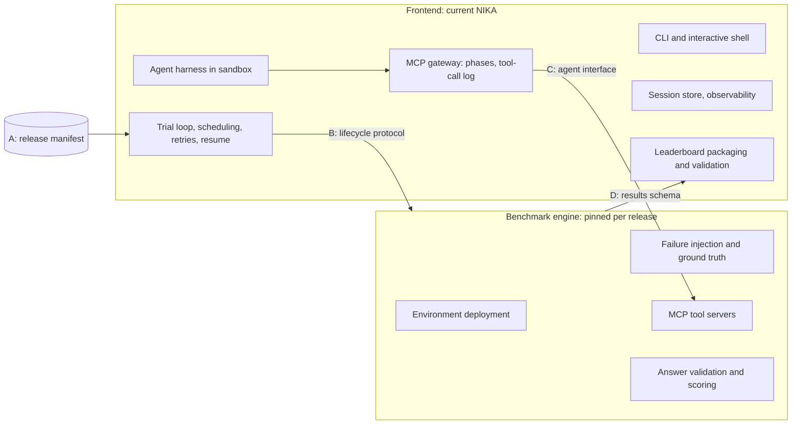

# Benchmark release contracts

The newest NIKA CLI should run every published benchmark release, so that a new agent can be scored on release 0.1.0 with the same sessions, sandbox, observability, and leaderboard packaging as on the latest release. To keep those scores comparable with earlier ones, the parts that define a release stay as they were when it was published: its network environments, failure injection and ground truth, agent tools, and scoring. Everything else, including the agent under test, is current code.

This document defines the four versioned contracts between those two halves, how evaluation policy is separated from execution mechanics, and the order in which NIKA adopts them. It is the design for [#292](https://github.com/sands-lab/nika/issues/292), which replaces the whole-checkout pinning proposed in [#289](https://github.com/sands-lab/nika/pull/289).

## Frontend and benchmark engine

The **frontend** is the NIKA you run. The **benchmark engine** is the code of one published release, built from that release's Git tag and run as a separate container. One process cannot import two versions of `nika`, and an old release also pins its own Python dependencies, emulator tooling, and images, so the benchmark engine never runs inside the frontend's Python process. The engine runs its environments on an emulation backend such as Kathará, Containerlab, or Kubernetes; "backend" keeps that meaning.



| Frontend (current NIKA) | Benchmark engine (pinned per release) |
| --- | --- |
| CLI and interactive shell | Environment deployment and teardown |
| Agent harnesses and sandbox | Failure injection, symptom checks, ground truth |
| MCP gateway: one URL per sandbox, phase enforcement, tool-call log | MCP tool servers and the task description |
| Scheduling, parallelism, retries, resume | Answer validation and scoring |
| Session store and observability | Evaluation policy that is code, such as waiting for routing to converge |
| Model proxy: provider credentials, model-call log, step and token budgets | Unstructured report mapping: prompt, context formatting, voting |
| Validity rules, using thresholds the release declares | |
| Leaderboard packaging and submission | |

The frontend drives the trial loop and calls the benchmark engine for each lifecycle step. The benchmark engine never launches the agent, so scheduling, sessions, and the agent under test stay current for every release.

## Decisions

The maintainers settled the open decisions of #292 on 2026-11-01.

| Question | Decision |
| --- | --- |
| Where the MCP gateway runs | In the frontend. One gateway serves every release: the benchmark engine serves the tool servers, and the gateway gives the sandbox one URL, enforces the phases the release declares, and logs tool calls. A gateway fix therefore applies to every release without touching pinned code. |
| How the benchmark engine is packaged | One container image per release, built from the release tag, which pins Python dependencies and emulator tooling (Kathará, Containerlab). The container uses the host's Docker daemon through the mounted Docker socket instead of running Docker inside the container, so environments run as sibling containers on the host. The host kernel and Docker version are recorded in each run's provenance (contract D) but not pinned. |
| Where validity rules run | In the frontend, against fields that the results schema versions. The release manifest declares the thresholds. |
| How budgets are enforced | The release manifest declares the step, token, and time budgets, and the frontend enforces them; neither the harness nor the benchmark engine does. Steps are enforced at the frontend's model proxy (see [Budgets](#budgets)). |
| Which commits the release tags point to | The maintainers create the tags. `v0.2.0` points to the latest `dev` commit once the contracts are in place. `v0.1.0` points to a release branch that starts from `37d851ca` and adds the contracts (see [Release 0.1.0](#release-010)). |

## A. Release manifest

The release manifest states which benchmark engine runs a release, which contract versions it speaks, and the evaluation policy that defines the benchmark. It consists of `benchmark/releases/<version>/RELEASE.yaml` and the split task files it lists, as committed at the release tag.

Today's manifest declares the splits and their task counts, `defaults.n_trials`, `scoring`, `tools.allowed_mcp_servers`, and `images.required`. The contract adds the benchmark engine reference, the contract versions, a hash of each split's task file, and the evaluation policy that is now implicit in code or in `config/nika.yaml`:

```yaml
manifest_version: 1
id: nika-bench
version: 0.1.0
engine:
  tag: v0.1.0                         # protected Git tag in sands-lab/nika
  image: ghcr.io/sands-lab/nika-engine:0.1.0
  protocol: 1                         # contract B version
  results_schema: 1                   # contract D version
  agent_interface: sha256:…           # contract C digest
splits:
  test:
    cases_file: test.yaml
    case_count: 56
    sha256: …                         # hash of test.yaml
evaluation:
  n_trials: 3
  max_steps: 20
  token_budget: null                  # null: no token budget
  agent_timeout_sec: 1800
  submission_mode: structured
  validity:
    max_harness_rate: 0.05
scoring:
  id: rule-based
  leaderboard_primary: rca_f1
  judge_allowed: false
```

The image digest cannot be part of the tagged source it is built from. When a release is published, NIKA writes `benchmark/releases/<version>/engine.lock.json` with the tag's commit and the image digest. Like the manifest, the lock file never changes after publication.

Rules:

* A published manifest and its lock file never change. A fix is a new release under the [versioning policy](../../VERSIONING.md).
* The release tag is the single source of truth. The frontend uses the manifest copy that ships with it only after checking it against the tag, and stops with a release-drift error otherwise. This covers [#282](https://github.com/sands-lab/nika/issues/282), whose drift check against `v<version>` tags is proposed in [#287](https://github.com/sands-lab/nika/pull/287).
* Before running anything, the frontend checks that the task-file hashes reported by the benchmark engine match the manifest.
* The frontend refuses a manifest whose `manifest_version`, `engine.protocol`, or `engine.results_schema` it does not support, with an error that names the version and the supported range. It never falls back to another version.
* `config/nika.yaml` and CLI options may set execution mechanics, but they cannot override `evaluation` in an official run; a conflicting value stops the run. Selecting a release with `benchmark.release` in `config/nika.yaml` or with `--release` produces the same run.
* A manifest without an `engine` block runs on the current NIKA's benchmark engine, in process. This applies to unpublished work, such as ad-hoc task batches and the next release before it is tagged, and to 0.1.0 and 0.2.0 until their tagged manifests declare a benchmark engine. The frontend refuses to run a manifest that declares one until it can start benchmark engine containers.

Test: load every manifest under `benchmark/releases/` and verify its hashes; check that unsupported versions, a drifted manifest copy, and an `evaluation` override in an official run are each rejected.

## B. Lifecycle protocol

The lifecycle protocol is the only way the frontend asks the benchmark engine to do anything during a run. Before it, the trial loop in `run_single_case` (`src/nika/workflows/benchmark/run.py`) called `start_net_env`, `inject_failure`, `close_session`, and `run_eval_metrics` directly, and the MCP gateway and the fault-presence check reached into the environment and failure code themselves.

[NIKA Remote](../operations/remote.md) already runs environment deployment, failure injection, the fault-artifact recheck, session close, and artifact transfer behind an HTTP API (`src/nika/remote/`), so the benchmark engine is a NIKA Remote daemon built from the release tag. The lifecycle protocol versions that API, adds `describe`, `list_tasks`, and `score`, and moves the MCP gateway to the frontend.

The benchmark engine is a long-lived HTTP service on the host loopback interface. It serves the lifecycle operations under `/v<protocol>/` and the MCP tool servers under `/mcp/<server>`. It stays up for the whole run and holds per-trial state between calls, which some steps need: the fault-presence check, for example, reuses the failure instance that injected the fault. One benchmark engine serves all the trials of a run, including parallel ones.

| Operation | Input | Output |
| --- | --- | --- |
| `describe` | none | Supported protocol versions, release ID and version, engine commit, task-file hashes, agent-interface digest |
| `list_tasks` | Split | Task IDs and the deployment parameters the frontend schedules on, never ground truth |
| `start_trial` | Task ID, trial index, trial directory | Trial handle, and every resource the benchmark engine created |
| `inject` | Trial handle | Ready once the failure is active and its symptoms are observable |
| `agent_endpoints` | Trial handle | Task description, MCP servers per phase, and the submission context (contract C) |
| `fault_check` | Trial handle | Whether the injected failure is still present |
| `score` | Trial handle | Scores and score status, computed from the recorded answer |
| `stop_trial` | Trial handle or resource list | Teardown; safe to repeat, including after a frontend crash |

Rules:

* The benchmark engine reports every resource it creates: Docker containers and networks, Kathará labs, and Containerlab labs, each with the labels or names needed to remove it. The frontend records them in its session store (`STATE_DIR/runtime/sessions.db`), so `nika session ps` lists trials of any release and `nika session close` tears them down through `stop_trial`, or from the resource list when the benchmark engine is gone.
* Ground truth stays in the benchmark engine until `score`. The frontend decides whether a failed trial can be scored from the `inject` result, not by reading `ground_truth.json`.
* Errors carry one of the outcome classes in `src/nika/workflows/benchmark/outcomes.py` (`agent_failed`, `endpoint_failed`, `infra_failed`), so retry and resume behave the same for every release.
* Within a protocol version, changes are additive only: new optional fields or new operations. A breaking change gets a new version. The frontend declares the range of versions it supports and keeps an old version until no published release needs it.

The benchmark engine container mounts the host's Docker socket, `/var/run/netns`, and the run's results directory at the same absolute path, and runs on the host network with the privileges Containerlab needs. Environments therefore appear on the host as if the current NIKA had deployed them, and the frontend's observability attaches to them unchanged.

[`protocol.py`](../../src/nika/benchmark_engine/protocol.py) defines the operations as `LifecycleProtocol`, together with the contract versions this NIKA supports. [`engine.py`](../../src/nika/benchmark_engine/engine.py) implements them as `BenchmarkEngine`, the same class in every release: the frontend calls the current NIKA's `BenchmarkEngine` in process, and a release's engine container serves its own `BenchmarkEngine` to a frontend client. The trial loop, the MCP gateway, and the fault-presence check now call only through it, and a release run checks `describe` against the manifest before it starts. Three parts wait for the engine container in step 4: `list_tasks`, so the frontend still reads task rows from the split files that ship with it; `score` still writes `eval_metrics.json` instead of returning scores; and the trial loop still checks for `ground_truth.json` to classify failed trials.

Test: run the same protocol test suite against the current NIKA's engine and against each published benchmark engine image.

## C. Agent interface

The agent interface is everything an agent can observe and do. Fixing it per release is what makes a new agent's score on an old release comparable with earlier scores.

Most of it already exists. The agent package (`src/agent/`) does not import `nika`, and agents reach their tools only through the MCP gateway (`src/nika/mcp/gateway/`), which enforces the two phases in `src/agent/protocols.py`: `diagnosis` with the diagnosis tools, and `submission` with only `task_mcp_server`, whose `submit` tool validates and records the answer.

The contract covers:

* The task description shown to the agent.
* The MCP servers and their tool schemas in each phase. These servers depend on environment internals, so the benchmark engine serves them.
* The phase rules: which tools each phase allows, and how the agent moves from diagnosis to submission.
* The answer format, `{is_anomaly, root_causes}`, and the catalogs it is checked against: the fault ontology and the resource catalog.
* The telemetry the agent may read.

The **agent-interface digest** is a SHA-256 hash over the canonical JSON of the tool names, descriptions, and input schemas in each phase, together with the phase rules. The manifest records it, `describe` reports it, and the frontend refuses to start a run when they differ.

Rules:

* An agent harness depends only on this contract, never on NIKA internals or direct container access. A harness that bypasses it cannot be scored on any release.
* For a published release, the tools and schemas an agent gets from the benchmark engine are identical to those at the release commit. Any difference is a new benchmark revision, not a patch.
* The frontend's gateway may change how it carries tool calls, such as transport, logging, and timeouts, but not which tools exist or what they return.

Test: compute the digest from the benchmark engine image and compare it with the digest computed at the release commit.

## D. Results schema

The results schema defines what a run writes, so the current frontend can package and validate results from any release, and results from different releases and revisions stay distinguishable.

| File | Written by | Contents |
| --- | --- | --- |
| `run.json` (run directory) | Frontend | Run configuration, evaluation policy, provenance |
| `run.json` (trial directory) | Frontend | Trial identity, outcome, score status |
| `nika.jsonl`, `messages.jsonl`, `model_calls.jsonl` | Frontend | Lifecycle events, agent messages, model calls |
| `tool_calls.jsonl` | Frontend (gateway) | Every tool call the agent made |
| `submission.json` | Benchmark engine (`submit` tool) | The validated answer |
| `ground_truth.json` | Benchmark engine | Injected failures; written at injection today, and by `score` once the benchmark engine runs in its own container |
| `eval_metrics.json` | Benchmark engine for scores, frontend for token, step, and tool-call counts | Per-trial metrics |

Every run directory records `results_schema` and a `provenance` block:

```json
{
  "results_schema": 1,
  "provenance": {
    "frontend": {"version": "0.3.0", "commit": "…", "dirty": false},
    "engine": {"release": "0.1.0", "tag": "v0.1.0", "commit": "…", "image": "ghcr.io/sands-lab/nika-engine@sha256:…"},
    "protocol": 1,
    "host": {"docker": "28.3.2", "kernel": "6.8.0-107-generic"}
  }
}
```

The validity rules (`src/nika/evaluator/validity.py`) read harness traces such as `model_calls.jsonl`. The schema lists the trace fields they depend on, such as finish reasons, token counts, and phase markers, so a newer harness cannot break validation of an old release by changing a trace format.

Rules:

* Within a schema version, changes are additive only. The frontend keeps a reader for every version that a published release has produced.
* `nika leaderboard submit` and `nika leaderboard validate` check `results_schema` and reject versions they do not know.

Test: package and validate real output from each published benchmark engine with the current `nika leaderboard submit --dry-run` and `nika leaderboard validate`.

## Evaluation policy and execution mechanics

Today both live in the same trial loop. Policy belongs to the release, as benchmark engine code or as manifest data; mechanics belong to the frontend. Moving an item from the policy column to the mechanics column, or changing a policy item of a published release, is a new revision under the versioning policy.

| Policy (benchmark engine code or manifest) | Mechanics (frontend) |
| --- | --- |
| Task set and deployment parameters | Scheduling, parallelism, `heavy_batch_size` |
| Failure injection, ground truth, waiting for symptoms | Retrying `endpoint_failed` and `infra_failed` trials, resume |
| Tool surface and phase rules | Session store, logs, progress display |
| Answer format and scoring | Sandbox backend and model proxy |
| Trials per task, step and token budgets, time limits | Enforcing those budgets and limits |
| Submission mode, including the unstructured report mapper ([#291](https://github.com/sands-lab/nika/issues/291)) | Observability and metrics |
| Validity thresholds | Evaluating validity rules, leaderboard packaging and upload |
| | Firecracker lab image caching |

## Budgets

Every model request of a sandboxed agent already passes the frontend's model proxy ([`model_proxy.py`](../../src/nika/agents/sandbox/model_proxy.py)), which holds the provider credentials and writes `model_calls.jsonl`. The proxy charges each generation request against `max_steps` for the current phase, including requests from sub-agents that a harness's own turn limit does not count ([`model_calls.py`](../../src/nika/agents/sandbox/model_calls.py)). It refuses the first request past the budget, and the frontend stops the phase and logs `max_steps_reached`. Requests the provider could not serve are not charged.

A harness may still stop earlier on its own, but the proxy's count is the one that binds, so the same budget applies to every harness. A token budget ([#199](https://github.com/sands-lab/nika/issues/199)) extends the same proxy, and the agent time limit stays with the frontend's trial loop. The benchmark engine never sees model traffic. Host-run reference agents (`oracle`) make no model requests.

## Unstructured submission

In `unstructured` submission mode, a report mapper with its own model turns the agent's frozen diagnosis report into the scored answer and submits it through `submit` ([#291](https://github.com/sands-lab/nika/issues/291)). Its prompt, the formatting of the fault ontology and resource catalog for that prompt, and the voting over samples decide how a report is scored. They are therefore benchmark engine code, pinned with the release, and the manifest declares the submission mode and the mapper settings that affect scores.

The mapper sends its model requests through the frontend's model proxy, like an agent does. The benchmark engine then holds no provider credentials, the requests appear in `model_calls.jsonl`, and they are not charged to the agent's budget. #291 moves this code out of the agent package first; the contracts decide that it lands in the engine.

## Release 0.1.0

The 0.1.0 benchmark engine starts from `37d851ca`, the commit that restored 0.1.0 on the NIKA code of that time ([#134](https://github.com/sands-lab/nika/pull/134)) and that [#289](https://github.com/sands-lab/nika/pull/289) pins. A release branch adds the lifecycle protocol, the results schema, and the manifest fields on top of it, without changing environments, failures, tools, or scoring, and the maintainers tag it `v0.1.0`. The image digests that `e51ae74e` later pinned in the 0.1.0 manifest belong on that branch too, so the benchmark engine image uses the same upstream images as current runs.

## Implementation plan

Each step is a separate pull request against `dev`:

1. This document.
2. **Lifecycle protocol in the current code.** The trial loop calls the current NIKA's engine only through contract B, still in one process. Scores for 0.2.0 do not change; a Docker-backed run confirms it.
3. **Results schema version and provenance** (contract D), checked by `nika leaderboard submit` and `nika leaderboard validate`.
4. **Benchmark engine container**, built from a release tag, serving contract B and the MCP tool servers. The frontend reaches it through an `EngineClient` that implements `LifecycleProtocol`, and its gateway proxies to the tool servers. Sessions stay in the frontend's store.
5. **0.1.0 release branch** from `37d851ca`, tagged `v0.1.0` once it passes the protocol test suite.
6. **Removal of the 0.1.0 compatibility code** (`src/nika/net_env/compat/v010/`, `src/nika/problems/compat/v010/`, `docs/compat/release-0.1.0.md`), once the acceptance criteria of #292 pass.
