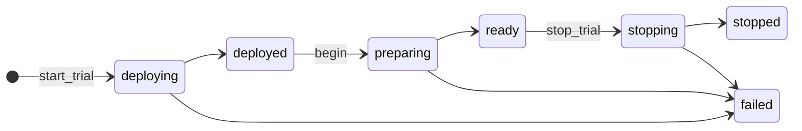

# Benchmark release contracts

Use the benchmark engine interface to integrate the current NIKA frontend with the environment, failure, tool, and scoring code selected by a benchmark release. This reference describes the implemented interface. The [versioning policy](../../VERSIONING.md) governs release compatibility and changes to evaluation conditions.

## Frontend and benchmark engine

The **frontend** is the NIKA CLI and its agent orchestration code. The **benchmark engine** deploys the network environment, injects failures, serves the agent's MCP tools, and scores its answer. The agent's model and harness are the system under test.

| Component | Responsibilities |
| --- | --- |
| Agent | Investigate through MCP tools and produce a diagnosis |
| Frontend | Select tasks, schedule trials, launch agent sandboxes, enforce agent budgets, record provenance, evaluate validity, and package results |
| Benchmark engine | Deploy and close environments, inject and check failures, provide task descriptions and MCP gateways, validate submissions, and compute scores |

The frontend also maps unstructured diagnosis reports through [`ReportMapper`](../../src/nika/agents/submission.py). The engine's task tool validates and records the resulting answer. Moving the mapper into the release's engine remains follow-up work under [#291](https://github.com/sands-lab/nika/issues/291) and [#292](https://github.com/sands-lab/nika/issues/292).

A manifest with an `engine` block selects a separate engine container. A manifest without one uses the current NIKA's engine in process. Ad-hoc task matrices also use the in-process engine. An emulation backend, such as Kathará or Containerlab, runs the engine's environments; it is distinct from the benchmark engine.

## A. Release manifest

[`RELEASE.yaml`](../../benchmark/releases/0.3.0/RELEASE.yaml) declares the release identity, split files and their hashes, trial defaults, required images, and scoring policy. Its `engine` block selects the implementation and lifecycle API:

```yaml
engine:
  tag: v0.3.0
  api:
    version: 1
```

This is the engine reference in release 0.3.0's manifest. It names the release tag, which points at the commit that contains this manifest. `engine.tag` also accepts a commit. The frontend builds that reference from a clean `git archive`, so uncommitted changes do not enter the image. `nika engine build <ref>` builds it ahead of a run. Without a local image whose commit label matches the reference, the first release run builds the image itself.

A manifest may also provide `engine.image`. The frontend uses that image when it exists locally or can be pulled; otherwise it builds from `engine.tag`. An image override does not check the image's commit against the Git reference. Run provenance records the image ID actually used.

Before deploying trials, the frontend checks the supported API version, the manifest's task-file hashes, and the hashes the engine reports through `describe`. See [`release.py`](../../src/nika/workflows/benchmark/release.py) for release validation and [`container.py`](../../src/nika/benchmark_engine/container.py) for image resolution.

Optional `evaluation` fields constrain release runs:

| Field | Meaning | When omitted |
| --- | --- | --- |
| `access` | Diagnosis tool and node access policy | All tools and nodes allowed |
| `max_trial_sec` | Maximum permitted agent timeout | No release-specific bound |
| `submission_modes` | Allowed structured or unstructured submission modes | Both modes allowed |

The frontend rejects a configured access role with a different policy, a timeout above the release bound, or a disallowed submission mode. The submitter chooses agent step, token, and time budgets within these constraints. The engine fixes tool output limits in its code; users cannot override them through run configuration.

Published releases do not change. Corrections follow the [versioning policy](../../VERSIONING.md); editing a published manifest or task file is not a way to update its behavior.

## B. Lifecycle protocol

[`LifecycleProtocol`](../../src/nika/benchmark_engine/protocol.py) defines the interface the trial loop uses for both the in-process engine and an engine container. [`BenchmarkEngine`](../../src/nika/benchmark_engine/engine.py) implements it. [`EngineClient`](../../src/nika/benchmark_engine/client.py) sends authenticated HTTP requests to the container's [service](../../src/nika/benchmark_engine/server.py).

| Operation | Input | Result |
| --- | --- | --- |
| `describe` | Optional release version | API versions, release identity, engine commit, task-file hashes, host Docker and kernel versions |
| `start_trial` | `TrialRequest`: task row, failure parameters, session ID, release version, and result paths | `TrialHandle` identifying the session, trial directory, and resources |
| `begin` | Trial handle | Agent task description after deployment and timeline preparation succeed; `scheduled` indicates that the frontend must release the timeline |
| `schedule_operation` | Trial handle and `start`, `agent-ready`, `status`, or `close` | Starts or observes the engine-owned timeline, or drains its work and recovers its mutations |
| `agent_endpoints` | Trial handle and gateway request | MCP gateway URLs, session and phase tokens, and MCP server selection |
| `close_agent_endpoints` | Trial handle | Closes the trial's gateway |
| `fault_check` | Trial handle | Failure-presence result or check error |
| `score` | Trial handle, optional result directory and infrastructure evidence flag | Writes evaluation artifacts |
| `stop_trial` | Trial handle and final session status | Closes the environment |

The frontend sends task rows, including expected root causes, rather than task IDs. The pinned engine checks release task rows against its own split files. The engine and frontend share trial directories: the engine writes `ground_truth.json` as it prepares or executes the timeline, and `score` writes scores there. Ground truth reaches the frontend before scoring. The current protocol does not transfer all results as HTTP response data.

For engines returning `scheduled: true`, the frontend opens the gateway before starting the timeline and waiting for its agent-start boundary. It observes completion and revisions through `schedule_operation`; the engine performs failure injection, traffic changes, and recovery on the lab controller. Engines that omit this field keep their existing immediate-start behavior. Explicit scheduled tasks require an engine that supports this operation.

For a timed schedule, `fault_check` checks every currently active fault occurrence on its injecting instance. Planned recovery removes that occurrence from the presence requirement. With no active faults, the result is `not_applicable`; other active faults must still be present. A missing active artifact remains `absent`, and a scheduler failure remains an error. Checks hold the scheduler's mutation locks so injection and recovery cannot produce a partial observation. Agent observations of recovered faults remain valid evidence for the task's diagnosis.

The frontend records `ready: true` in the trial's `run.json` after `begin` returns. Failure handling and resume use that field to determine whether the agent received a valid task. The frontend asks the engine to score completed trials, including on resume when metrics are missing. It does not grade the answer itself.

### Trial states

Environment startup can take minutes. Over HTTP, `start_trial`, `begin`, and `stop_trial` return a state while background work continues. `EngineClient` polls the HTTP-only `trial_status` operation and presents blocking lifecycle methods to callers.



The frontend chooses the session ID before deployment, so it can query or stop a trial after losing an HTTP response. Repeating an operation returns its current state. Starting a stopped or failed trial creates another attempt with the same session ID. A stop requested during deployment or preparation waits for that operation before teardown.

A `failed` state includes an error and an outcome class: `agent_failed`, `endpoint_failed`, or `infra_failed`. The frontend uses these classes for retry and resume decisions.

### Container, sessions, and supported execution modes

The frontend starts one engine container for the run and closes it when the run ends. The service also watches the frontend process. It binds to host loopback and requires the run token on lifecycle requests. Each trial's MCP gateway has its own session token; the frontend keeps the phase token from the agent.

The container shares the host's Docker daemon, network and process namespaces, and NIKA state directories. It mounts the Docker socket, network namespace directory, results, runtime state, cache, Containerlab working directory, and Kathará settings. It uses the frontend user's UID, GID, and username, so host CLI commands can find the engine's sessions. Environments run as sibling containers on the host.

The engine container runs with `--privileged` and passwordless `sudo`, which give its code root-equivalent access to the host. Run engine images and Git references you trust. Agent isolation uses the separate [agent sandbox](../operations/agent-sandbox.md).

Use `nika session ps`, `nika exec`, and `nika session close` to inspect and close sessions. Cleanup of a pinned trial restarts its recorded engine image when needed, so the engine that deployed the environment also tears it down. Session metadata and trial artifacts remain part of the shared frontend/engine interface.

| Execution mode | In-process engine | Release with a pinned engine |
| --- | --- | --- |
| Native | Supported | Supported through an engine container |
| NIKA Remote | Supported | Rejected before deployment |
| Firecracker | Supported | Rejected before deployment |

See [Remote execution](../operations/remote.md) and [Firecracker execution](../operations/firecracker.md) for configuration. Pinned remote engines remain follow-up work in [#308](https://github.com/sands-lab/nika/issues/308).

## C. Agent interface

The agent interface consists of the task description, MCP tools and their schemas, phase rules, diagnosis access policy, tool output limits, answer format, resource and fault catalogs, and telemetry. The release's engine serves its gateway and tools, so changes to the current frontend do not replace a pinned engine's tool implementations.

During diagnosis, agents use the permitted network tools. During submission, the gateway allows only the task server, whose `submit` tool validates and records `{is_anomaly, root_causes}`. The frontend controls the phase transition and freezes the diagnosis report. In unstructured mode, the frontend's report mapper produces the answer from that report and the frozen catalogs.

The gateway limits tool result text to 10,000 characters, with truncation notes and elision markers added outside the limit. See [Tool output limit](../agents/mcp-servers.md#tool-output-limit) for the retained text and list-item rules.

Agent harnesses use MCP tools rather than direct container access. Changes to what the agent observes or how NIKA evaluates its answer must follow the [versioning policy](../../VERSIONING.md).

## D. Results schema

The results schema distinguishes the frontend that ran the agent from the engine that ran the environment. [`provenance.py`](../../src/nika/workflows/benchmark/provenance.py) defines the current schema and builds run provenance.

| File | Writer | Contents |
| --- | --- | --- |
| Run-directory `run.json` | Frontend | Configuration, budgets, schema version, provenance |
| Trial-directory `run.json` | Frontend and engine through shared session state | Trial identity, readiness, outcome, and score status |
| `nika.jsonl`, `messages.jsonl`, `model_calls.jsonl` | Frontend and environment event collection | Lifecycle events, agent messages, model calls |
| `tool_calls.jsonl` | Engine gateway | Recorded MCP calls |
| `submission.json`, `ground_truth.json` | Engine | Validated answer and injected failures |
| `eval_metrics.json` | Engine for scores, frontend for usage counts | Scores and token, step, and tool-call counts |

Run-directory `run.json` records `schema_version: 1` and `provenance.frontend`, `provenance.engine`, and `provenance.host`. These blocks include the frontend version and commit, engine API and commit, pinned engine reference and image ID when applicable, and environment host Docker and kernel versions. For an ad-hoc batch, the engine release is null. An in-process engine has no pinned tag or image.

On resume, the frontend records changed provenance in `provenance_history`; it refuses a different schema version. Leaderboard packaging carries the schema version and provenance into `results/identity.yaml`, and validation rejects unsupported schema versions. Records written before the schema field existed use version 1.

## Contract versions

Two interface versions serve different readers:

| Field | Covers | Current supported value |
| --- | --- | --- |
| `engine.api.version` in the release manifest | Engine lifecycle API, manifest interpretation, and engine-written results | `1` |
| `schema_version` in run-directory `run.json` | Frontend-written run records | `1` |

Backward-compatible additions retain the interface version. A breaking change requires another supported version. The frontend rejects unsupported versions before running a release or reading its results. These interface versions do not replace the benchmark version or determine whether a change needs an edition, revision, or patch; use the [versioning policy](../../VERSIONING.md) for that decision.

## Verify an integration

Run the [engine container E2E tests](testing.md#verify-benchmark-engines) to exercise the normal release workflow. They check successful oracle diagnosis, ground truth, failure presence after injection and during the trial, tool calls, provenance, and removal of owned runtime resources. The manual release verification workflow also compares pinned-engine scores with the in-process engine. Keep changes to task data, injection, tool behavior, and scoring separate from frontend execution changes so reviewers can assess their effect on benchmark reproducibility.
