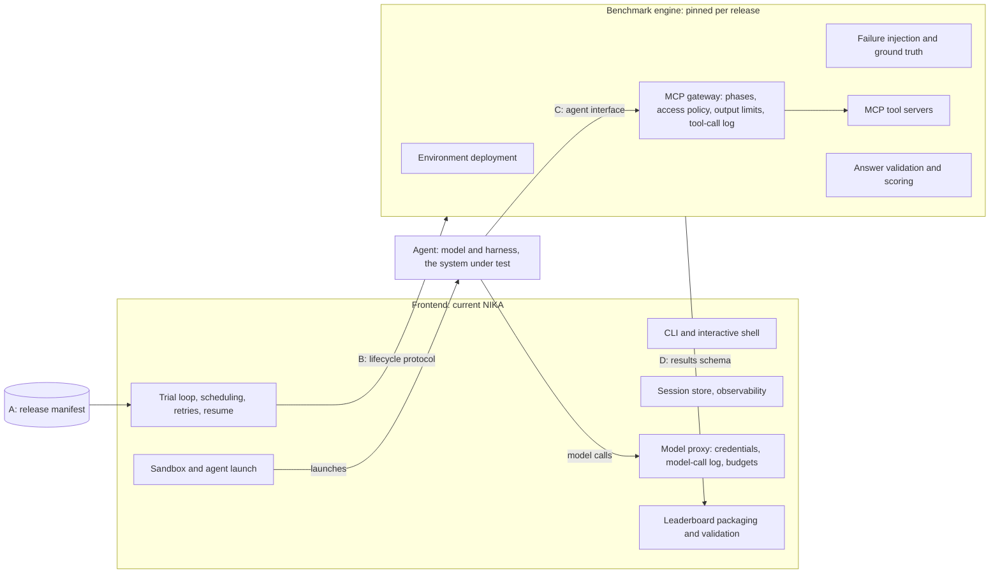
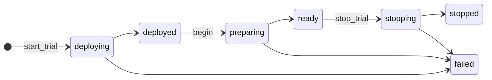

# Benchmark release contracts

The newest NIKA CLI should run every published benchmark release, so that a new agent can be scored on release 0.1.0 with the same sessions, sandbox, observability, and leaderboard packaging as on the latest release. To keep those scores comparable with earlier ones, the parts that define a release stay as they were when it was published: its network environments, failure injection and ground truth, the agent's tools and the MCP gateway that serves them, and scoring. The code that launches and observes the agent is current.

This document defines the four versioned contracts between those two halves, how evaluation policy is separated from execution mechanics, and the order in which NIKA adopts them. It is the design for [#292](https://github.com/sands-lab/nika/issues/292), which replaces the whole-checkout pinning proposed in [#289](https://github.com/sands-lab/nika/pull/289).

## Frontend and benchmark engine

The **frontend** is the NIKA you run. The **benchmark engine** is the code of one published release, built from that release's Git tag and run as a separate container. One process cannot import two versions of `nika`, and an old release also pins its own Python dependencies, emulator tooling, and images, so a published release's benchmark engine never runs inside the frontend's Python process. A manifest without an `engine` block, such as an ad-hoc task batch, runs on the current NIKA's engine in process instead (see [A. Release manifest](#a-release-manifest)). The engine runs its environments on an emulation backend such as Kathará, Containerlab, or Kubernetes; "backend" keeps that meaning.



| Frontend (current NIKA) | Benchmark engine (pinned per release) |
| --- | --- |
| CLI and interactive shell | Environment deployment and teardown |
| Sandbox and agent launch | Failure injection, symptom checks, ground truth |
| Scheduling, parallelism, retries, resume | MCP gateway: one URL per sandbox, phase rules, access policy, tool output limits, tool-call log |
| Session store and observability | MCP tool servers and the task description |
| Model proxy: provider credentials, model-call log, step and token budgets | Answer validation and scoring |
| Validity rules, using thresholds the release declares | Evaluation policy that is code, such as waiting for routing to converge |
| Leaderboard packaging and submission | Unstructured report mapping: prompt, context formatting, voting |

The agent, a model and its harness, is the system under test and belongs to neither half. Its author versions it, and NIKA records which agent ran. It talks to the frontend through the workspace layout, `task.json`, and the gateway and model proxy endpoints the frontend hands it, which is always the current frontend and needs no per-release version. It talks to the benchmark engine through contract C, the MCP tools it may use.

The frontend drives the trial loop and calls the benchmark engine for each lifecycle step. The benchmark engine never launches the agent, so scheduling, sessions, and the agent under test stay current for every release.

## Decisions

The maintainers settled the open decisions of #292 on 2026-11-01.

| Question | Decision |
| --- | --- |
| Where the MCP gateway runs | In the benchmark engine. The gateway truncates tool results, appends a note to every tool description, and enforces the access policy, so it changes what the agent sees; in the frontend, a change such as `9c2e43fc`'s unified truncation would silently alter every published release. Pinned with the release, everything the agent observes comes from the release's engine. A gateway bug found later is fixed by a patch release on each release line. |
| How the benchmark engine is packaged | One container image per release, built from the release tag, which pins Python dependencies and emulator tooling (Kathará, Containerlab). The container uses the host's Docker daemon through the mounted Docker socket instead of running Docker inside the container, so environments run as sibling containers on the host. The host kernel and Docker version are recorded in each run's provenance (contract D) but not pinned. |
| Where validity rules run | In the frontend, against fields that the run-record schema versions. The release manifest declares the thresholds. |
| How budgets are enforced | The submitter chooses the step, token, and time budgets as part of the agent's design, and the frontend enforces them; neither the harness nor the benchmark engine does. Steps are enforced at the frontend's model proxy, and `run.json` records the budgets so the leaderboard can report them next to the score (see [Budgets](#budgets)). The release only bounds how long a trial may run (`evaluation.max_trial_sec`). |
| Which commits the release tags point to | The maintainers create the tags. `v0.2.0` points to the latest `dev` commit once the contracts are in place. `v0.1.0` points to a release branch that starts from `37d851ca` and adds the contracts (see [Release 0.1.0](#release-010)). |

## A. Release manifest

The release manifest states which benchmark engine runs a release, which engine API version it speaks, and the evaluation policy that defines the benchmark. It consists of `benchmark/releases/<version>/RELEASE.yaml` and the split task files it lists, as committed at the release tag.

Today's manifest declares the splits and their task counts, `defaults.n_trials`, `scoring`, `tools.allowed_mcp_servers`, and `images.required`. The contract adds the benchmark engine reference and its API version, a hash of each split's task file, and the evaluation policy that is now implicit in code or in `config/nika.yaml`:

```yaml
id: nika-bench
version: 0.1.0
engine:
  tag: v0.1.0                         # protected Git tag in sands-lab/nika
  api:
    version: 1                        # lifecycle operations, manifest format, engine-written files
splits:
  test:
    cases_file: test.yaml
    case_count: 56
    sha256: …                         # hash of test.yaml
defaults:
  n_trials: 3
evaluation:
  max_trial_sec: 2400                 # tasks stay valid at least this long
  access:                             # what the agent may touch; the engine's gateway enforces it
    tools: ["*"]
    node_roles: ["*"]
  submission_modes: [structured, unstructured]
  validity:
    max_harness_rate: 0.05
scoring:
  id: rule-based
  leaderboard_primary: rca_f1
  judge_allowed: false
```

The `evaluation` fields hold what defines the task beyond its task file:

* `max_trial_sec` is the longest trial for which the release's tasks stay valid. Timed failures such as `sender_resource_contention`, DHCP leases, and traffic profiles run out, so a run whose `agent.timeout_sec` exceeds it is refused.
* `access` is the diagnosis access policy (`tools`, `node_roles`, `node_ids`). It is part of the task, so the frontend sends it to the engine's gateway instead of taking it from `agent.access.role`, and refuses a run whose configured role selects a different policy. Unset, it allows everything, which is what 0.1.0 and 0.2.0 were published with.
* `submission_modes` lists the submission modes the release allows. Unset, both are allowed.

The step, token, and time budgets are not in the manifest: the submitter chooses them (see [Budgets](#budgets)). The tool output limit is not either: it is gateway code, pinned with the engine.

The image digest cannot be part of the tagged source it is built from. When a release is published, NIKA writes `benchmark/releases/<version>/engine.lock.json` with the tag's commit and the image digest. Like the manifest, the lock file never changes after publication.

Rules:

* A published manifest and its lock file never change. A fix is a new release under the [versioning policy](../../VERSIONING.md).
* The release tag is the single source of truth. The frontend uses the manifest copy that ships with it only after checking it against the tag, and stops with a release-drift error otherwise. This covers [#282](https://github.com/sands-lab/nika/issues/282), whose drift check against `v<version>` tags is proposed in [#287](https://github.com/sands-lab/nika/pull/287).
* Before running anything, the frontend checks that the task-file hashes reported by the benchmark engine match the manifest.
* The frontend refuses a manifest whose `engine.api.version` it does not support, with an error that names the version and the supported range. It never falls back to another version. `engine.api.version` stays at this location in every manifest format, because the frontend reads it before it knows the format.
* `config/nika.yaml` and CLI options may set execution mechanics, but they cannot override `evaluation` in an official run; a conflicting value stops the run. Selecting a release with `benchmark.release` in `config/nika.yaml` or with `--release` produces the same run.
* A manifest without an `engine` block runs on the current NIKA's benchmark engine, in process. This applies to unpublished work, such as ad-hoc task batches and the next release before it is tagged, and to 0.1.0 until its release branch declares a benchmark engine. 0.2.0 declares its engine. A manifest with an `engine` block always runs on that engine's container and never falls back to the current NIKA's engine.

Test: load every manifest under `benchmark/releases/` and verify its hashes; check that unsupported versions, a drifted manifest copy, and an `evaluation` override in an official run are each rejected.

## B. Lifecycle protocol

The lifecycle protocol is the only way the frontend asks the benchmark engine to do anything during a run. Before it, the trial loop in `run_single_case` (`src/nika/workflows/benchmark/run.py`) called `start_net_env`, `inject_failure`, `close_session`, and `run_eval_metrics` directly, and the MCP gateway and the fault-presence check reached into the environment and failure code themselves.

The same protocol applies wherever the benchmark engine runs. The engine always runs on the host that runs the environments, because it deploys them through that host's Docker and serves each trial's MCP gateway next to them. [NIKA Remote](../operations/remote.md) has a separate API (`src/nika/remote/`) that mirrors the hands-on commands, such as `nika env run` and `nika failure inject`, for the current NIKA on a remote lab host. For a release without an `engine` block, the in-process engine forwards deployment, injection, and the gateway to that API when NIKA Remote is enabled. To run a pinned engine on a remote lab host, NIKA Remote will start the engine's container there, and the frontend will speak the same lifecycle protocol to it.

The benchmark engine is a long-lived HTTP service on the host loopback interface. It serves the lifecycle operations under `/v<API version>/`, and the MCP gateway it opens for each trial serves the agent directly. It stays up for the whole run and holds per-trial state between calls, which some steps need: the fault-presence check, for example, reuses the failure instance that injected the fault. One benchmark engine serves all the trials of a run, including parallel ones.

| Operation | Input | Output |
| --- | --- | --- |
| `describe` | Release | Supported engine API versions, release ID and version, engine commit, task-file hashes, host Docker and kernel versions |
| `list_tasks` | Split | Task IDs and the deployment parameters the frontend schedules on, never ground truth |
| `start_trial` | Task ID, release version, trial index, trial directory | Trial handle, and every resource the benchmark engine created |
| `begin` | Trial handle | The task description the agent receives, once the agent may start; for every current task, its failure is then injected and verified |
| `trial_status` | Session ID | Over HTTP, the trial's state (see [Trial states](#trial-states)) |
| `agent_endpoints` | Trial handle, access policy, where the agent runs | The trial's MCP gateway (contract C): its URL for the frontend and for the agent, the session and phase tokens, and the MCP servers it serves |
| `close_agent_endpoints` | Trial handle | Closes the trial's MCP gateway |
| `fault_check` | Trial handle | Whether the injected failure is still present |
| `score` | Trial handle | Scores and score status, computed from the recorded answer |
| `stop_trial` | Trial handle or resource list | Teardown; safe to repeat, including after a frontend crash |

Rules:

* The benchmark engine reports every resource it creates: Docker containers and networks, Kathará labs, and Containerlab labs, each with the labels or names needed to remove it. The frontend records them in its session store (`STATE_DIR/runtime/sessions.db`), so `nika session ps` lists trials of any release.
* The engine that deployed a trial also tears it down through `stop_trial`, on Ctrl+C as at the end of a trial. A pinned engine's container exits with its run, so `nika session close` and `nika session wipe` start it again from the image that the run's `run.json` records.
* The frontend sends the release version in the `start_trial` request and receives the agent's task description from `begin`, instead of exchanging them through the engine's session record.
* `begin` marks the moment the agent is about to start, and the engine decides what the task needs by then. A task that injects a failure later in the trial schedules it in the engine from that moment, and the frontend's calls stay the same.
* The frontend decides whether a failed trial can be scored by whether `begin` returned, which it records as `ready` in the trial's `run.json` so that a parent process can read it after a worker dies. It does not read `ground_truth.json` for this decision.
* The frontend never grades an answer itself. When resume finds a solved trial without metrics, it asks the run's engine to `score` it.
* Errors carry one of the outcome classes in `src/nika/workflows/benchmark/outcomes.py` (`agent_failed`, `endpoint_failed`, `infra_failed`), so retry and resume behave the same for every release.
* The frontend moves a trial from diagnosis to submission through the gateway's phase endpoint, with the phase token from `agent_endpoints`, which never reaches the agent. The gateway freezes the diagnosis report and returns the submission context.
* Within an engine API version, changes are additive only (see [Contract versions](#contract-versions)).

The benchmark engine container mounts the host's Docker socket, `/var/run/netns`, and the run's results directory at the same absolute path, and runs on the host network with the privileges Containerlab needs. Environments therefore appear on the host as if the current NIKA had deployed them, and the frontend's observability attaches to them unchanged.

[`protocol.py`](../../src/nika/benchmark_engine/protocol.py) defines the operations as `LifecycleProtocol`, together with the engine API versions this NIKA supports. [`engine.py`](../../src/nika/benchmark_engine/engine.py) implements them as `BenchmarkEngine`, the same class in every release: the frontend calls the current NIKA's `BenchmarkEngine` in process, and a release's engine container serves its own `BenchmarkEngine` through [`server.py`](../../src/nika/benchmark_engine/server.py) to the frontend's `EngineClient` ([`client.py`](../../src/nika/benchmark_engine/client.py)). The trial loop, the agent's MCP gateway ([`engine_gateway`](../../src/nika/agents/mcp_config.py)), and the fault-presence check call only through it, and a release run checks `describe` against the manifest before it starts. The in-process engine opens the gateway in the frontend's process, or through NIKA Remote's attach call when NIKA Remote is enabled.

When a manifest declares an `engine` block, the frontend starts one container for the run ([`container.py`](../../src/nika/benchmark_engine/container.py)) and stops it when the run ends:

* **Launch.** The image's entrypoint starts the engine service. The frontend passes only `--host`, `--port`, and `--parent-pid` (the service exits when that frontend process ends), with the run's token in `NIKA_ENGINE_TOKEN`. Every engine image accepts these arguments; they are part of the engine API version, like the lifecycle operations.
* **Image.** The frontend uses the local image `nika/benchmark-engine:<tag>` when its commit label matches `engine.tag`, and otherwise builds it from `engine.tag` with the [Dockerfile](../../src/nika/benchmark_engine/docker/Dockerfile) at that tag. `nika engine build <tag>` builds it ahead of time. The build context is `git archive` of the tag's commit. The repository does not track `uv.lock`, so the build resolves Python dependencies as of the commit's time, and rebuilding a tag gives the same versions. The run's provenance records the image ID.
* **Image override.** A manifest may set `engine.image` to an image that is present locally or can be pulled, and the frontend then runs that image as given, without checking that it was built from `engine.tag`. Releases do not need it; the tag identifies the engine.
* **Shared host state.** The container runs as the frontend's user on the host network and process namespace. It mounts the Docker socket, `/var/run/netns`, NIKA's `runtime/` and `.nika_cache/` directories, the run's results directory, and the Containerlab working directory, each at the same path, together with the host's Kathará settings. The sessions the engine creates are therefore in the frontend's session store, and `nika session ps` and `nika session close` handle them as usual.
* **Access.** The engine listens on the host's loopback interface and accepts only lifecycle requests that carry the run's token. The gateway it opens for a trial binds where the agent's sandbox reaches it, as on a host install, and accepts only MCP requests that carry that trial's session token. The gateway writes `tool_calls.jsonl` into the shared trial directory.
* **Limits.** Firecracker execution and NIKA Remote cannot run a release that pins a benchmark engine yet, and the frontend stops such a run with an error. [#308](https://github.com/sands-lab/nika/issues/308) runs pinned engines on NIKA Remote lab hosts. The engine exits when the frontend process ends; environments left behind are removed with `nika session close`.

Some parts still rely on the frontend's split files or on the trial directory that the engine container shares, so ground truth reaches the frontend before `score`:

* The frontend reads task rows, including their expected root causes, from the split files that ship with it, and sends them to `start_trial` instead of task IDs from `list_tasks`.
* `begin` writes `ground_truth.json` into the trial directory, and `score` writes `eval_metrics.json` there instead of returning scores.

Once the frontend sends task IDs only and the engine writes `ground_truth.json` at `score`, ground truth stays in the engine until `score`. A pinned engine on a remote lab host needs the engine's files to come back through the protocol instead of a shared directory.

The frontend also still writes its own trial fields, such as `ready`, the agent settings, and the run's provenance, through the session record that the engine creates, and the sandbox manager reads the environment name and lab backend from that record. An engine from an earlier release therefore has to keep that record in the format the current frontend reads.

Test: run the same protocol test suite against the current NIKA's engine and against each published benchmark engine image.

### Trial states

Deploying an environment or preparing a trial can take many minutes. A request held open that long fails when the connection drops or a timeout expires first, and the engine keeps working on a trial the frontend has given up on. Over HTTP, `start_trial`, `begin`, and `stop_trial` therefore answer at once with the trial's state and do their work in the background, and the frontend polls `trial_status` until the state settles.



* The frontend chooses each trial's session ID, so it can ask about or stop a trial whose `start_trial` answer never reached it.
* Repeating `start_trial`, `begin`, or `stop_trial` returns the trial's current state instead of redoing the work. `start_trial` on a stopped or failed trial starts a new attempt, which is how a retried trial reuses its session ID.
* `stop_trial` is accepted in any state. The engine runs one operation per trial at a time, so a stop sent while the trial deploys or prepares waits for that work and then tears the environment down.
* A `ready` state carries the agent's task, and a `failed` state carries the error and its outcome class.

`EngineClient` keeps the blocking methods of `LifecycleProtocol` by polling, so the trial loop is the same for the in-process engine and an engine container.

## C. Agent interface

The agent interface is everything an agent can observe and do. Fixing it per release is what makes a new agent's score on an old release comparable with earlier scores.

Most of it already exists. The agent package (`src/agent/`) does not import `nika`, and agents reach their tools only through the MCP gateway (`src/nika/mcp/gateway/`), which enforces the two phases in `src/agent/protocols.py`: `diagnosis` with the diagnosis tools, and `submission` with only `task_mcp_server`, whose `submit` tool validates and records the answer.

The contract covers:

* The task description shown to the agent.
* The MCP servers and their tool schemas and descriptions in each phase.
* The phase rules: which tools each phase allows, and how the agent moves from diagnosis to submission.
* The access policy: which tools and nodes the agent may touch during diagnosis.
* How tool results are bounded: the output limit and the truncation note.
* The answer format, `{is_anomaly, root_causes}`, and the catalogs it is checked against: the fault ontology and the resource catalog.
* The telemetry the agent may read.

The benchmark engine runs the gateway and the tool servers, so contract C is whatever the release's engine serves, and no digest or tool snapshot needs maintaining. Two parts used to come from the user's configuration: the manifest now pins the access policy, and the tool output limit is fixed in the engine's code.

The gateway's tool output limit is one uniform ceiling of 10,000 characters for every tool and every model, which is too tight for large context windows and can still be too loose for small ones. A later release can bound output per tool instead, through arguments with documented defaults on the tools whose output size is a property of the tool, such as packet capture and log queries. The gateway would keep only a high safety cap against runaway output, reported as an error, and the harness would manage its own context. That changes what agents encounter, so it is a new revision; 0.1.0 and 0.2.0 keep their limit.

Rules:

* An agent harness depends only on this contract, never on NIKA internals or direct container access. A harness that bypasses it cannot be scored on any release.
* Every change to the contract changes what the agent encounters, so it is a new benchmark revision, not a patch.

Test: list the tools each published benchmark engine image serves in each phase, with their descriptions, and compare them with a run at the release commit.

## D. Results schema

The results schema defines what a run writes, so the current frontend can package and validate results from any release, and results from different releases and revisions stay distinguishable. The engine API version covers the files the benchmark engine writes, and `schema_version` in `run.json` covers the files the frontend writes (see [Contract versions](#contract-versions)).

| File | Written by | Contents |
| --- | --- | --- |
| `run.json` (run directory) | Frontend | Run configuration, budgets, provenance |
| `run.json` (trial directory) | Frontend | Trial identity, whether the trial became `ready`, outcome, score status |
| `nika.jsonl`, `messages.jsonl`, `model_calls.jsonl` | Frontend | Lifecycle events, agent messages, model calls |
| `tool_calls.jsonl` | Benchmark engine (gateway) | Every tool call the agent made |
| `submission.json` | Benchmark engine (`submit` tool) | The validated answer |
| `ground_truth.json` | Benchmark engine | Injected failures; written by `begin` today, and by `score` once ground truth leaves the shared trial directory |
| `eval_metrics.json` | Benchmark engine for scores, frontend for token, step, and tool-call counts | Per-trial metrics |

Every run directory records `schema_version` and a `provenance` block in `run.json`:

```json
{
  "schema_version": 1,
  "provenance": {
    "frontend": {"version": "1.0.0", "commit": "…", "dirty": false},
    "engine": {"release": "0.1.0", "api": 1, "tag": "v0.1.0", "commit": "…", "dirty": false, "image": "ghcr.io/sands-lab/nika-engine@sha256:…"},
    "host": {"docker": "28.3.2", "kernel": "6.8.0-107-generic"}
  }
}
```

`engine` comes from `describe`, with `api` set to the engine API version the run used. `host` is the machine that runs the environments, as the benchmark engine reports it: the local machine, or the NIKA Remote host when NIKA Remote is enabled. `tag` and `image` stay `null` while a release runs on the current NIKA's benchmark engine. An ad-hoc task batch records `release: null`. `provenance` describes the latest launch; a resume with different provenance appends it to `provenance_history`, and a resume with a different `schema_version` is refused.

[`provenance.py`](../../src/nika/workflows/benchmark/provenance.py) builds these fields, and the leaderboard package's `results/identity.yaml` carries them as `run.schema_version` and `run.provenance`. Runs recorded before `schema_version` existed are read as version 1.

The validity rules (`src/nika/evaluator/validity.py`) read harness traces such as `model_calls.jsonl`. The schema lists the trace fields they depend on, such as finish reasons, token counts, and phase markers, so a newer harness cannot break validation of an old release by changing a trace format.

Rules:

* The frontend keeps a reader for every `schema_version` that published results use.
* `nika leaderboard submit` and `nika leaderboard validate` check `schema_version` and reject versions they do not know.

Test: package and validate real output from each published benchmark engine with the current `nika leaderboard submit --dry-run` and `nika leaderboard validate`.

## Contract versions

The current frontend runs engines pinned to different releases, so two numbers record what two programs of different versions agree on:

| Field | Location | Covers | Answers |
| --- | --- | --- | --- |
| `engine.api.version` | Release manifest | The manifest format, the lifecycle operations, and the files the engine writes (`submission.json`, `ground_truth.json`, scores, `tool_calls.jsonl`) | Can this frontend operate this engine and read its outputs? |
| `schema_version` | Each run's `run.json` | The files the frontend writes (`run.json`, `nika.jsonl`, `messages.jsonl`, `model_calls.jsonl`) | Can this reader understand the frontend-written records? |

Neither follows from a version number. NIKA's version describes one program, and under the [versioning policy](../../VERSIONING.md) a breaking interface change and an ordinary bug fix are both patches. Release lines also move in parallel: if `v0.2.1` sends only task IDs to `start_trial` instead of task rows, `v0.2.2` fixes an injection race, and a later `v0.1.1` adopts the new request, the frontend must send task rows to `v0.1.0` and `v0.2.0` and task IDs to the others. Reading `engine.api.version` tells it which; the alternative is a table of every release in the frontend's code. Likewise, release 0.1.0 can be run by today's frontend and by a later one that moves `finish_reason` in `model_calls.jsonl`, which the `truncated_final_turn` validity rule reads, so `schema_version` tells `nika leaderboard validate` which reader to use.

The tools the agent sees are not covered by either number: they belong to the release (contract C).

For both numbers, backward-compatible additions, such as a new optional field or a new operation, keep the number, and a breaking change increments it. The frontend refuses versions it does not know before a run starts or before it reads results, and keeps a version only while a published release or published results need it.

## Evaluation policy and execution mechanics

Today both live in the same trial loop. Policy belongs to the release, as benchmark engine code or as manifest data; mechanics belong to the frontend. Moving an item from the policy column to the mechanics column, or changing a policy item of a published release, is a new revision under the versioning policy.

| Policy (benchmark engine code or manifest) | Mechanics (frontend) |
| --- | --- |
| Task set and deployment parameters | Scheduling, parallelism, `heavy_batch_size` |
| Failure injection, ground truth, waiting for symptoms | Retrying `endpoint_failed` and `infra_failed` trials, resume |
| Tool surface, phase rules, access policy, tool output limits | Session store, logs, progress display |
| Answer format and scoring | Sandbox backend and model proxy |
| Trials per task, the longest valid trial (`max_trial_sec`) | Step, token, and time budgets, which the submitter chooses, and enforcing them |
| Allowed submission modes, including the unstructured report mapper ([#291](https://github.com/sands-lab/nika/issues/291)) | Observability and metrics |
| Validity thresholds | Evaluating validity rules, leaderboard packaging and upload |
| | Firecracker lab image caching |

## Budgets

The submitter chooses `max_steps`, the token budget, and `agent.timeout_sec`, because they are part of an agent's design; fixing one value per release would limit that design. `run.json` records them, and the leaderboard reports them next to the score. The agent time limit cannot exceed the release's `max_trial_sec`.

Every model request of a sandboxed agent already passes the frontend's model proxy ([`model_proxy.py`](../../src/nika/agents/sandbox/model_proxy.py)), which holds the provider credentials and writes `model_calls.jsonl`. The proxy charges each generation request against `max_steps` for the current phase, including requests from sub-agents that a harness's own turn limit does not count ([`model_calls.py`](../../src/nika/agents/sandbox/model_calls.py)). It refuses the first request past the budget, and the frontend stops the phase and logs `max_steps_reached`. Requests the provider could not serve are not charged.

A harness may still stop earlier on its own, but the proxy's count is the one that binds, so the same budget applies to every harness. A token budget ([#199](https://github.com/sands-lab/nika/issues/199)) extends the same proxy, and the agent time limit stays with the frontend's trial loop. The benchmark engine never sees model traffic. Host-run reference agents (`oracle`) make no model requests.

## Unstructured submission

In `unstructured` submission mode, a report mapper with its own model turns the agent's frozen diagnosis report into the scored answer and submits it through `submit` ([#291](https://github.com/sands-lab/nika/issues/291)). Its prompt, the formatting of the fault ontology and resource catalog for that prompt, and the voting over samples decide how a report is scored. They are therefore benchmark engine code, pinned with the release, and the manifest lists the submission modes it allows.

The mapper sends its model requests through the frontend's model proxy, like an agent does. The benchmark engine then holds no provider credentials, the requests appear in `model_calls.jsonl`, and they are not charged to the agent's budget. #291 moves this code out of the agent package first; the contracts decide that it lands in the engine.

## Release 0.1.0

The 0.1.0 benchmark engine starts from `37d851ca`, the commit that restored 0.1.0 on the NIKA code of that time ([#134](https://github.com/sands-lab/nika/pull/134)) and that [#289](https://github.com/sands-lab/nika/pull/289) pins. A release branch adds the lifecycle protocol, the run-record schema version, the manifest fields, and the benchmark engine's service and image on top of it, without changing environments, failures, tools, or scoring, and the maintainers tag it `v0.1.0`. The image digests that `e51ae74e` later pinned in the 0.1.0 manifest belong on that branch too, so the benchmark engine image uses the same upstream images as current runs.

## Implementation plan

Each step is a separate pull request against `dev`:

1. This document.
2. **Lifecycle protocol in the current code.** The trial loop calls the current NIKA's engine only through contract B, still in one process. Scores for 0.2.0 do not change; a Docker-backed run confirms it.
3. **Run-record schema version and provenance** (contract D), checked by `nika leaderboard submit` and `nika leaderboard validate`.
4. **Benchmark engine container**, built from a release tag, serving contract B and running each trial's MCP gateway. The frontend reaches it through an `EngineClient` that implements `LifecycleProtocol`. Sessions stay in the frontend's store.
5. **0.1.0 release branch** from `37d851ca`, tagged `v0.1.0` once it passes the protocol test suite.
6. **Removal of the 0.1.0 compatibility code** (`src/nika/net_env/compat/v010/`, `src/nika/problems/compat/v010/`, `docs/compat/release-0.1.0.md`), once the acceptance criteria of #292 pass.
