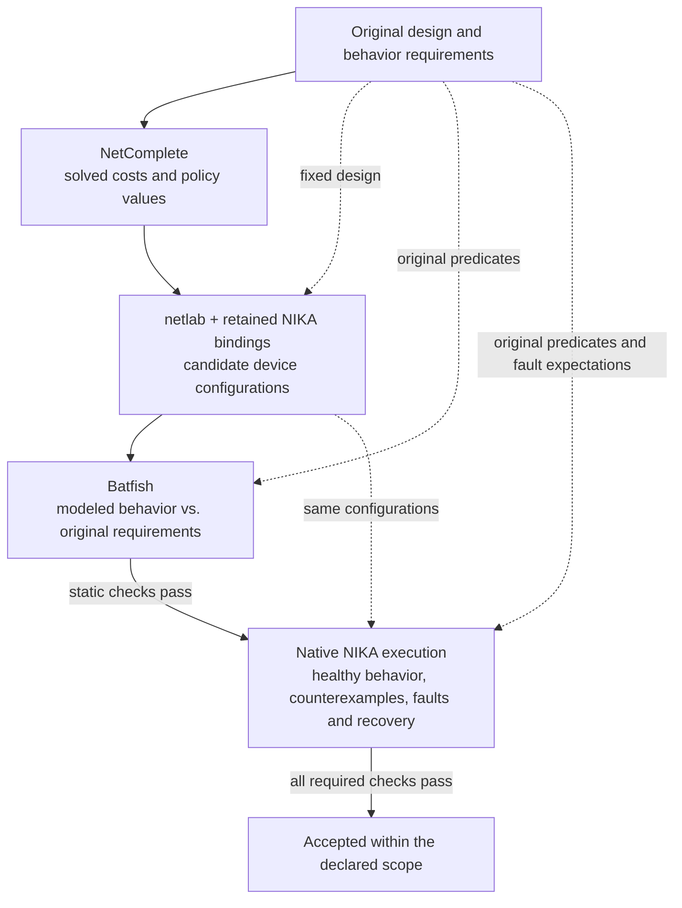
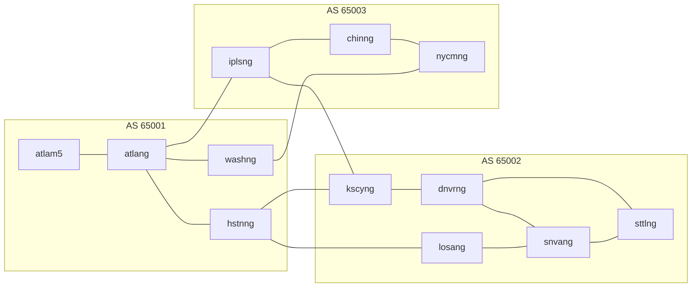

# Specification-driven environment verification

NIKA checks whether a constructed network satisfies its original behavior specification. This walkthrough follows one Abilene design through routing completion, device configuration, static analysis and real execution. Each step identifies its input and output.

Run this experiment explicitly during environment development. Normal benchmark execution keeps its existing startup path; saved constructions can be reused without rerunning synthesis and analysis.

## Why these stages are separate

A route requirement does not specify all configuration values, a solved value does not supply every device's syntax, and a generated configuration does not establish its behavior. The workflow assigns each problem to a supported tool:

| Stage | Purpose in this workflow | When it is needed |
| --- | --- | --- |
| NetComplete | Solve unknown costs and policy values under the original routing constraints | When the routing sketch contains supported unknowns; omit it for fully specified designs |
| netlab | Generate device-specific configuration from the fixed design and solved values | When the solver does not emit the target device's configuration; it reduces NIKA-maintained templates, not proof obligations |
| Batfish | Independently compute modeled behavior from the final configuration and compare it with the original requirements | For routing static acceptance; another forwarding model needs an appropriate analyzer |
| NIKA native checks | Observe actual sessions, installed routes, packets, fault effects and recovery | For native acceptance; static-only results cannot substitute for execution |

NetComplete can export configurations through its [Tekton Cisco IOS backend](https://github.com/nsg-ethz/tekton/blob/b60e931334e690919d12a5826600e5c400b6173d/tekton/cisco.py), tested with IOS 15.2. NIKA instead uses its supported solver outputs and netlab's device backends for targets including IOS XR, SR Linux and RouterOS. netlab is replaceable and supplies no additional formal guarantee.

## The complete workflow



A failed or required unsupported check rejects the construction. Expected behavior always comes from the original specification, not from an earlier tool's output. Deliberately incorrect candidates must produce their predeclared violations in static analysis and execution.

## 1. Start with a network and a design

The example uses the vendored [Abilene graph](../../src/nika/net_env/isp/topologies/abilene.xml): 12 routers and 15 physical links. This diagram shows every router link, omitting loopbacks and attached hosts.



Before synthesis, the experiment fixes the following design. NIKA's existing builder supplies deterministic address and session bindings. These are inputs to NetComplete, not choices discovered by it.

| Design input | Value in this environment |
| --- | --- |
| AS membership | The three groups shown above |
| Intra-AS routing | OSPF area 0; iBGP route reflection with one reflector per AS |
| Reflectors | `atlam5`, `dnvrng`, `chinng`; the other routers in each AS are clients |
| Inter-AS routing | eBGP on the five links between the groups |
| Router loopbacks | Fixed `/32` addresses; for example, `dnvrng = 10.255.0.4/32` |
| Physical link addresses | Fixed `/31` addresses; for example, `atlang–iplsng = 10.0.0.4/31` |
| Business prefix origins | `washng`: `198.51.100.0/24`; `losang`: `198.51.101.0/24`; `nycmng`: `198.51.102.0/24` |
| Fixed policies | Existing business-prefix admission and export policies |
| Reference path policy | Preserve the shortest-path/ECMP sets of the original graph with uniform intra-AS cost 10, including the declared link-down graph |
| Declared link incident | Disable `dnvrng:eth1`, the attachment to `snvang` |
| Unknown values | Active intra-AS OSPF costs and supported per-prefix BGP import decisions/preferences |

OSPF does not form adjacencies across AS boundaries. External-link subnets are advertised passively within the local AS so BGP next hops remain reachable. NetComplete does not choose the AS partition, reflector placement, protocol stack or fault target in this experiment.

## 2. State the required behavior before filling the unknowns

The original specification contains path requirements and BGP exit orders, plus adjacency and communication requirements. In this catalogue experiment, the builder enumerates paths from the fixed reference graph before invoking the solver; the designer does not hand-write every per-router predicate. Here are excerpts from that input specification, expressed as design statements rather than API calls.

| Original requirement | Healthy network | After the `dnvrng–snvang` outage |
| --- | --- | --- |
| Path from `losang` to `dnvrng`'s loopback | `losang → snvang → dnvrng` | `losang → snvang → sttlng → dnvrng` |
| Path from `snvang` to that loopback | `snvang → dnvrng` | `snvang → sttlng → dnvrng` |
| Exit from AS 65001 for `198.51.102.0/24` | Prefer AS 65003 to AS 65002 | Retain that preference while both exits remain available |
| Protocol adjacencies | Expected OSPF and BGP sessions are established | Surviving sessions match the fault-state specification |
| Business communication | Declared endpoint pairs can communicate | Communication follows the independently declared fault-state requirements |

The complete example fixes six exit orders. In this table, `>` means preferred neighboring AS, not a prescribed numeric local preference.

| Selecting AS | Original exit orders |
| --- | --- |
| 65001 | For `198.51.101.0/24`: 65002 > 65003; for `198.51.102.0/24`: 65003 > 65002 |
| 65002 | For `198.51.100.0/24`: 65001 > 65003; for `198.51.102.0/24`: 65003 > 65001 |
| 65003 | For `198.51.100.0/24`: 65001 > 65002; for `198.51.101.0/24`: 65002 > 65001 |

We follow AS 65001's requirement for `198.51.102.0/24` below: **AS 65003 before AS 65002**.

The builder resolves these statements into concrete predicates before solving:

| Predicate | Expected value |
| --- | --- |
| First external AS of the selected route at `hstnng` for `198.51.102.0/24` | `65003` |
| Next hop at `snvang` for `10.255.0.4/32`, healthy | `dnvrng`, address `10.0.0.14` |
| Next hop at `snvang` for the same prefix, link down | `sttlng`, address `10.0.0.29` |

NIKA derives per-hop predicates from the specified paths with fixed logic. It does not infer the desired path from the configuration later produced by netlab. The complete experiment resolves to 133 healthy predicates; the tables show only the subset needed to explain the transformations.

## 3. Let NetComplete fill the declared holes

**Input:** the fixed graph and routing sketch, unknown cost/policy fields, and the original healthy and fault-state requirements.

[NetComplete](https://www.usenix.org/conference/nsdi18/presentation/el-hassany) completes a partial configuration subject to routing requirements. For OSPF, the declared paths must be shortest paths under the solved costs. Healthy and link-down graphs share surviving-link cost variables: the solver cannot choose a different configuration for the outage. If no supported assignment satisfies the requirements, the experiment rejects the construction rather than changing the required behavior.

**Output in the recorded run:** 20 interface-cost bindings and 10 neighbor import policies. The 20 bindings describe both ends of the ten intra-AS links, with symmetric costs. All solved active OSPF costs were 1. Selected BGP outputs were:

| Router in AS 65001 | Import from | Prefix | Solved admission | Solved local preference |
| --- | --- | --- | --- | --- |
| `atlang` | AS 65003, peer `10.0.0.5` | `198.51.102.0/24` | Permit | 2 |
| `washng` | AS 65003, peer `10.0.0.26` | Same prefix | Permit | 2 |
| `hstnng` | AS 65002, peer `10.0.0.19` | Same prefix | Permit | 1 |
| `hstnng` | AS 65002, peer `10.0.0.21` | Same prefix | Permit | 1 |

The ordering `2 > 1` implements the original exit order. The exact numbers are solver outputs; another satisfying assignment could use different values. Unit costs make the healthy `snvang → dnvrng` path shorter than the alternate. Removing that link leaves `snvang → sttlng → dnvrng` as the specified route.

NIKA saves these values as structured routing parameters. In this integration, it does **not** ask NetComplete to export the final device CLI. IGP and AS-import completion are supported stages over the fixed sketch; this experiment does not invoke NetComplete's full BGP-to-OSPF feedback synthesis.

## 4. Generate the target device configuration

**Input:** the original graph, addresses, AS/RR assignments and fixed policies, the solved parameters above, and a selected device profile.

netlab expands this input into addressed interfaces, protocol sessions and routing policies, then renders the target network operating system's syntax. NIKA checks that the derived BGP sessions and prefix origins agree with the fixed sketch. NIKA retains features such as RouterOS finite filters and iBGP attachment of generated admission policies; these remain subject to the same final checks.

**Output:** a candidate configuration for each router. At `atlang`, the solved AS 65003 preference becomes these FRR fragments. These are abbreviated excerpts from the recorded candidate, not complete standalone configurations.

```text
ip prefix-list NC_PFX_0_1-ipv4 seq 100 permit 198.51.102.0/24

route-map NC_IN_0-ipv4 permit 20
  set local-preference 2
  match ip address prefix-list NC_PFX_0_1-ipv4

router bgp 65001
  address-family ipv4
    neighbor 10.0.0.5 route-map NC_IN_0-ipv4 in
```

Selecting IOS XR and reusing the same fixed design and solved values produces prefix sets and route policies instead. These excerpts were generated offline with the pinned netlab version for this walkthrough:

```text
prefix-set NC_PFX_0_1
  198.51.102.0/24
end-set

route-policy NC_IN_0
  ...
  if destination in NC_PFX_0_1 then
    set local-preference 2
    done
  endif
  ...
end-policy

router bgp 65001
  neighbor 10.0.0.5
    address-family ipv4 unicast
      route-policy NC_IN_0 in
```

Both express the same prefix-specific import decision. RouterOS and SR Linux need their own supported renderings; sharing a solved value does not make their configuration languages interchangeable. The IOS XR excerpt is generation evidence, not native XRd acceptance. The execution results in step 6 belong to FRR.

Before relying on netlab for a design, compare its candidate with NIKA's native renderer for the same design. [`generator_consistency.py`](../../experiment/scenario_validation/generator_consistency.py) renders both, analyzes each with the platform's Batfish export and lists every differing routing fact: interface addresses, IGP areas, costs and adjacencies, BGP sessions and roles, RIB and FIB entries, selected BGP paths and per-neighbor import/export outcomes. An empty difference list shows that the two generators agree within that projection, not that either candidate meets the requirements; steps 5 and 6 still decide acceptance. The [experiment guide](../../experiment/scenario_validation/README.md#compare-native-and-netlab-configurations) describes the command and report.

## 5. Check the final candidate with Batfish

**Input:** final configurations, host/interface addressing, physical connectivity, and the original predicates from step 2. A fault-state snapshot also identifies the disabled link endpoints.

Batfish parses the configuration, computes modeled protocol/route state and answers routing and forwarding questions. NIKA compares those answers with the original expectations. It does not merely compare netlab's output with NetComplete's numeric parameters. This independent check matters because a correct solver assignment can still be bound to the wrong interface or peer during generation. Solver success alone does not establish that the final configurations implement that assignment.

| Check | Original expected answer | Recorded Batfish answer |
| --- | --- | --- |
| Selected BGP route at `hstnng` for `198.51.102.0/24` | First external AS is 65003 | BEST route, AS path `65003`, local preference 2 |
| Healthy next hop at `snvang` for `10.255.0.4/32` | `dnvrng` | Declared next-hop predicate passed |
| Next hop for the same prefix after link removal | `sttlng` | Fault-state next-hop predicate passed |
| Full healthy specification | Every required predicate passes | 133 passed |
| Full link-down specification | Every fault-state predicate passes | 133 passed |

Batfish reads this example's FRR configuration directly. IOS XR also has a native parser. NIKA uses restricted projections for RouterOS, SR Linux and FRR IS-IS. Each projection reads the concrete candidate and rejects unsupported syntax; it does not prove that analyzer and router semantics are identical. The pinned Batfish build includes the [FRR next-hop correction](../../scripts/batfish/frr-next-hop-self.patch).

A deliberate bad candidate tests whether the checks detect the intended mistake. Removing `washng`'s business-prefix announcement violated exactly 12 predeclared predicates in this run. A violation, tool error or required unsupported property rejects the candidate; it does not count as acceptance.

## 6. Deploy, observe, inject and recover

**Input:** the statically accepted candidate and the same original requirements. NIKA deploys it through the ordinary environment lifecycle.

**Output:** real protocol, installed-route and packet observations, followed by fault-state and recovery reports. For the tracked BGP predicate, FRR's selected AS path was `65003`, matching both the original requirement and Batfish's prediction.

| Executed state in the recorded FRR run | Required observation | Recorded outcome |
| --- | --- | --- |
| Healthy | Complete original specification holds | 133 passed |
| Business-announcement withdrawal | Exactly the declared original predicates fail | Same 12 violations as static analysis |
| Maximum-prefix incident on `hstnng–losang` | The two directed BGP-adjacency predicates fail | Exactly those two violations |
| `dnvrng–snvang` link down | Complete declared fault-state specification holds | 133 passed |
| Recovery after each incident | Complete healthy specification holds again | 133 passed after each recovery |

Equal counts alone do not establish correctness. Each row must match the declared predicate identities and expectations for that state. Shared acceptance assertions enforce this rule across environment families.

Native checks matter because a modeled route is not an installed route, and modeled forwarding is not an observed packet exchange. Runtime-only original requirements supplement shared predicates where the static model is insufficient, including installed ECMP limits and enterprise overlay isolation.

## ISP device profiles

`device_profile` selects a concrete network operating system, while `backend`
selects its execution environment. The existing benchmark row identity includes
both fields, so the same graph and protocol sketch can have distinct FRR, SR
Linux, IOS XR and RouterOS tasks without adding a separate `vendor` field.
IOS XR and RouterOS ISP deployments support `igp: ospf` or `isis` (Level 2) and
`bgp_mode: none`, `ibgp_rr` and `ebgp`; security overlays remain excluded. ISP
contracts declare OSPF adjacencies only, so readiness checks IS-IS Level-2
adjacencies natively on both. RouterOS IS-IS analysis projects the concrete
RouterOS circuits to the same IOS XR form used for FRR IS-IS.

With both vendor images installed, run the retained native matrix serially:

```bash
uv run pytest tests/nika/validation/test_vendor_isp_workflow.py -m e2e -x -q
```

The matrix uses ARPANET196912 for OSPF and iBGP route reflection, and DataXchange
for multi-AS BGP. IOS XR runs each of these BGP sketches over both OSPF and
IS-IS, and RouterOS runs all three BGP sketches over IS-IS. Each profile follows NetComplete, Batfish, native checks,
configuration negative controls, link failure and recovery. Keep native
acceptance results separate from offline configuration compilation.

Recorded native examples include:

| Graph | BGP sketch | Profiles | Healthy predicates |
| --- | --- | --- | --- |
| ARPANET196912 | none | IOS XR (OSPF, IS-IS), RouterOS | 20 |
| ARPANET196912 | iBGP route reflection | IOS XR (OSPF, IS-IS), RouterOS | 36 |
| DataXchange | multi-AS BGP | IOS XR (OSPF, IS-IS), RouterOS | 62 |
| Abilene | multi-AS BGP | RouterOS | 133 |

The `-iosxr` Clos, campus and enterprise specimens (size `s`) also passed native
execution with 14 + 2, 21 and 4 + 6 healthy predicates, including their registered
failures on XR or FRR routers.

Each listed execution also rejected its declared configuration negative controls,
checked the link-failure state and restored every healthy predicate. These are
model-specific acceptance results, not a proof about arbitrary configurations.
The IOS XR Abilene variant passed its 133 static checks, but its native deployment
was rejected by memory admission and is not included in native coverage.

To generate fault targets for a profile, use the existing benchmark generator:

```python
from nika.workflows.benchmark.generate import build_failure_cases

cases, rejected = build_failure_cases(
    scenario="isp_arpanet196912", problem="link_down", topo_size="",
    isp_options={"igp": "ospf", "bgp_mode": "none", "rpki": False,
                 "backend": "kathara", "device_profile": "routeros"},
)
rows = [dict(scenario="isp_arpanet196912", problem="link_down", **case)
        for case in cases]
```

The generated rows retain `device_profile`, injection targets and ground truth.
A manifest containing multiple profiles is handled by `benchmark_isp_profiles`
and the existing routing experiment. Native variants receive distinct profile
keys; existing default-profile keys remain unchanged.

The native profiles consume the same typed graph, path requirements and
NetComplete parameter types. IOS XR configurations go directly to Batfish.
RouterOS configurations pass through a restricted, concrete-command projection:
explicit IPv4 addresses, point-to-point OSPF in area 0, passive interfaces,
BGP sessions and reflector roles, exact-prefix filters and local preference.
RouterOS IS-IS becomes the FRR Level-2 wide-metric form and then IOS XR, as FRR
IS-IS does: point-to-point circuits keep their Level-2 metric, and passive
circuits, including the loopback, advertise their prefix with metric 0, as
RouterOS does.
The projection reads the final candidate, including counterexamples; unknown
commands or policy actions are rejected. Native forwarding and protocol
observations remain required to validate this model's assumptions.

Native ISP profiles use standard next-hop selection: reflected routes retain their
next hop, as recommended by [RFC 4456 section 4](https://www.rfc-editor.org/rfc/rfc4456#section-4).
External-link subnets are advertised passively in the AS's OSPF domain, keeping
unchanged external next hops reachable. RouterOS `force-self` also rewrites
reflected next hops; it is not equivalent to ordinary FRR `next-hop-self`.
The restricted projection rejects that iBGP setting rather than modeling it
as FRR's different operation. See the
[RouterOS next-hop choices](https://help.mikrotik.com/docs/spaces/ROS/pages/331612228/routing%2Bbgp)
and [FRR BGP commands](https://docs.frrouting.org/en/latest/bgp.html).

For a vendor comparison, regenerate injection targets from each profile's
inventory. RouterOS reserves its first port for management, so copying a Linux
interface index from an FRR task can select a different attachment. Pair tasks
by the original graph edge and fault, then retain the generated physical
attachment and ground truth for each profile. The routing experiment accepts
native `link_down` bindings and explicitly rejects configuration failures that
still require FRR-specific commands. Published benchmark releases are unchanged.

Native ISP profiles use the benchmark runner's heavy tier, which runs exclusively
by default. Before creating containers, deployment checks a conservative memory
estimate: 3 GiB per XRd router or 1 GiB per RouterOS router, 256 MiB per edge host,
and 2 GiB of headroom. Insufficient available memory rejects deployment. These
estimates limit experiment size. Native router containers also have matching
3 GiB / 1 GiB memory limits and one CPU each.
Large graphs can be compiled offline without claiming that native execution was
validated.

In ISP environments, one `device_profile` applies to every router. In `dc_clos`,
`campus_lan` and `enterprise_branch`, `device_profile: iosxr` runs only the routers
of the eligible roles on XR, and the other nodes keep FRR/Linux. These experiments
complete the FRR sketch, translate each eligible router's completed configuration
to IOS XR, and analyze the XR and FRR configurations together in one Batfish
snapshot. The `-iosxr` specimens in `experiment/scenario_validation` retain the FRR
specimens' requirements and replace only the XR-specific negative controls.

### RouterOS routers in Ethernet environments

`dc_clos`, `campus_lan` and `enterprise_branch` at size `s` run their eligible
router roles on RouterOS with `device_profile: routeros`. The specimens
`clos-routeros.json`, `campus-routeros.json` and `enterprise-routeros.json`
keep the FRR specimens' original requirements, completion sketches, incidents
and registered failures; counterexamples use RouterOS commands.

NetComplete completes the FRR sketch. The RouterOS translation keeps the
solved values: export route maps become filter chains that apply the first
exact-prefix match and reject the rest, OSPF costs set the network template's
cost, and Site Edge import preferences become the tunnel's import chain.
Batfish analyzes the final RouterOS candidates together with the FRR routers.
Each converted router is projected back to FRR under its container interface
names: addresses, static and blackhole routes, OSPF network templates with
their costs (RouterOS default 1) and passive flags, and BGP with connected
origins and exact-prefix chains. Enterprise Site Edges, analyzed with the Linux
static model, contribute only their `main` table, as FRR edges do; VRFs,
WireGuard, BGP, NAT and QoS stay runtime requirements. The projections reject
any other statement.

Native checks observe intents on the router that holds them, including
non-backbone OSPF areas and the Site Edge's overlay BGP table. After a
registered failure, restoration re-adds only the RouterOS menu groups whose
configuration changed. `ospf_area_misconfiguration` moves the router's first
area templates to a new area natively.

RouterOS installs one best BGP path, so the Clos specimen omits the FRR
specimen's healthy ECMP predicates and its `maximum-paths` counterexample; it
disables one BGP session natively instead. The RouterOS platform declares no
netlab device for these environments, so `--config-generator netlab` rejects
them; netlab's RouterOS device also has no IS-IS module, so RouterOS IS-IS ISP
profiles use NIKA's renderer only.

## SDN and P4 forwarding verification

The acceptance sequence stays the same, but fixed match/action candidates have no routing holes to solve. Their existing domain generators produce OpenFlow rules or P4Runtime entries. NIKA derives a restricted forwarding model from those concrete entries and the physical topology; [NetKAT](https://doi.org/10.1145/2535838.2535862) supplies its semantics and [KATch](https://github.com/cornell-netlab/KATch) decides the queries. NetComplete and netlab are not used.

| Original requirement or incident | Static check | Native check |
| --- | --- | --- |
| Client-service ICMP communication | A successful forwarding trace exists; round-trip requirements also check the reverse direction | The declared packet exchange succeeds |
| Unowned-address isolation | No successful forwarding trace exists | The declared packet exchange fails |
| Missing endpoint route | Removing an LPM entry or adding a destination drop violates exactly the predeclared predicates | Apply the corresponding configuration change and reproduce those violations |
| Endpoint-interface outage and recovery | Remove the endpoint attachment and check the fault-state requirements | Disable that endpoint interface, check the fault state, then restore healthy behavior |

For P4, compilation also checks the projected LPM key and forwarding action. The static claim covers well-formed IPv4 ICMP with sufficient TTL and resolved neighbors. It excludes full parser/control-flow/extern correctness, ARP, controller transitions, queueing and stateful services. Reachability establishes a possible trace, not delivery under every selector/hash choice. Native waypoint mapping is unsupported; endpoint-only outages do not cover every effect of the benchmark's broader `link_down` action.

## Acceptance scope and reproduction

Acceptance establishes the declared properties within the supported static models and exercised native states. It does not prove universal compiler correctness, analyzer/router equivalence or convergence under arbitrary failures; other bugs can remain.

| Environment family | Experiment scope and boundary |
| --- | --- |
| ISP FRR and SR Linux | Supported OSPF or IPv4 Level-2 IS-IS sketches, iBGP RR and ordinary eBGP; IS-IS uses a shortest-path reduction with symmetric metrics 1–65,535, not a native NetComplete IS-IS solver |
| ISP IOS XR | Supported OSPF or IPv4 Level-2 IS-IS sketches with no BGP, iBGP RR or eBGP, subject to device/fault bindings and parser limits; ISP contracts declare OSPF adjacencies only, so IS-IS adjacencies are checked natively on XR |
| ISP RouterOS | Supported OSPF sketches with no BGP, iBGP RR or eBGP, subject to device/fault bindings and projection limits |
| Clos, campus, enterprise, min3clos and direct BGP | Declared routing, communication, policy and isolation; installed ECMP and overlay behavior require native evidence |
| Clos, campus and enterprise with `device_profile: iosxr` | The same sketches and requirements as FRR, size `s`; XR and FRR routers are analyzed together, with netlab generating the XR routers as `iosxr` devices |
| SDN and P4 | Restricted forwarding checks plus native counterexamples, outages and recovery; recorded native packet acceptance covers sizes `s` and `m`, while `l` has static evidence only |
| Kubernetes and llmd | Existing readiness/runtime checks; outside this formal-analysis experiment |

With `device_profile: iosxr`, `dc_clos` (size `s`) runs every router on XRd, `campus_lan` its core routers and `enterprise_branch` its provider routers. The other roles stay FRR/Linux, so one deployment mixes vendors. NetComplete completes the FRR design, and each eligible router runs the XR translation of its completed configuration. One Batfish snapshot holds the XR and FRR configurations, and native checks read each requirement on the router that observes it. A fault on an XR router is undone by replacing its running configuration with the one saved before injection. The `-iosxr` specimens in `experiment/scenario_validation` keep the FRR requirements and replace only the XR-specific negative controls. Other routing models reject mixed-vendor deployments, because their projections would omit the XR routers. With netlab, NIKA keeps the static routes, eBGP multipath and open eBGP policies that the pinned XR templates do not emit. See [native IOS XR routers](../operations/network-scenarios.md#native-ios-xr-routers) for the roles and limits.

Catalogue support, offline generation, static acceptance and native acceptance are distinct. A representative run does not cover every topology/vendor/protocol combination. Heavy native environments run one at a time and remain subject to resource admission.

Each experiment saves its original specification, solved parameters, candidate configurations and verification reports. Use the [experiment guide](../../experiment/scenario_validation/README.md) for dependencies, execution, saved-build replay and test matrices, and the [runtime validation guide](scenario-validation.md) for ordinary startup checks.

The recorded FRR example uses the benchmark's OSPF/eBGP Abilene profile with six AS-exit orders. From the repository root, prepare the benchmark inputs, then run only that profile:

```bash
uv run python experiment/scenario_validation/benchmark_isp.py benchmark/working/cases.yaml --scenario isp_abilene --output /tmp/abilene-input
uv run python experiment/scenario_validation/experiment.py /tmp/abilene-input/isp_abilene--ospf--ebgp--kathara/specification.json --config-generator netlab --runtime --output /tmp/abilene-verified
```

The first command writes the input `specification.json` without deploying a network. The second saves `routing-parameters.json`, `candidate-configs/atlang.conf`, `static-healthy.json`, `runtime-healthy.json` and `summary.json` under `/tmp/abilene-verified`, corresponding to the values, configuration and results shown above.
