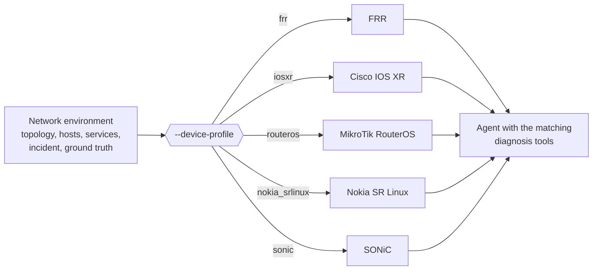
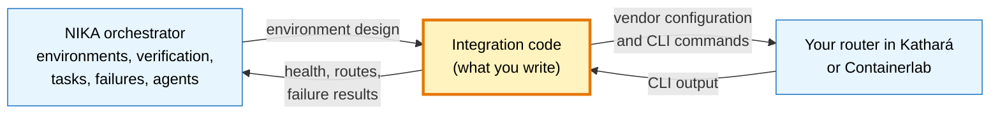

# 🌐 Multi-vendor routers

NIKA runs the same network environment on routers from different vendors, so you can test whether an agent troubleshoots a network it has not seen on FRR. You choose the router platform, NIKA keeps the topology, addressing, hosts, incidents, and ground truth the same, and the agent gets the diagnosis tools of that platform.

This page tells you which routers NIKA supports, how to select one, what NIKA does to keep a vendor environment trustworthy, and how to add your own. Each topic links to the reference that holds the detail.



A vendor image can limit the traffic or the incidents available, as the section on what NIKA guarantees describes below.

## 🧭 Supported routers

A router platform is called a [device profile](../../GLOSSARY.md). Without `--device-profile`, a Kathará environment deploys FRR and a Containerlab environment deploys Nokia SR Linux. The two eBGP pair environments always deploy their named vendor's routers.

| Device profile | Router | Runs on | What you need |
| --- | --- | --- | --- |
| `frr` | [FRR](https://frrouting.org/) (default) | Kathará | Nothing extra |
| `iosxr` | Cisco IOS XR, as the XRd Control Plane container | Kathará | A Cisco XRd image you download and load |
| `routeros` | MikroTik RouterOS, as the Cloud Hosted Router (CHR) VM | Kathará | A RouterOS image you build locally, and KVM on the host |
| `nokia_srlinux` | Nokia SR Linux | Containerlab | Nothing extra; NIKA pulls the image |
| `sonic` | SONiC virtual switch | Containerlab | The SONiC image, which `uv run nika images prepare` downloads |

## 🗺️ Which environments support which routers

Each cell shows how much of the environment runs on that vendor's routers:

* ✅ **Full:** every router of the environment runs on the vendor, at every size the environment offers.
* 🟡 **Partial:** only some router roles or sizes run on the vendor. The other routers, hosts, and services stay FRR or Linux.
* ➖ **None:** the vendor is not available for the environment.

| Environment | Cisco IOS XR | MikroTik RouterOS | Nokia SR Linux | SONiC |
| --- | :---: | :---: | :---: | :---: |
| Data center Clos | 🟡 | 🟡 | ➖ | ➖ |
| Campus LAN | 🟡 | 🟡 | ➖ | ➖ |
| Enterprise branch WAN | 🟡 | 🟡 | ➖ | ➖ |
| ISP backbone (SNDlib graphs) | ✅ | ✅ | ✅ | ✅ |
| ISP backbone (Topology Zoo graphs) | ✅ | ✅ | ➖ | ➖ |
| Five-node Clos fabric | ➖ | ➖ | ✅ | ✅ |
| Two-router IOS XR eBGP pair | ✅ | ➖ | ➖ | ➖ |
| Two-router RouterOS eBGP pair | ➖ | ✅ | ➖ | ➖ |

FRR is the default for the Kathará environments in the table and is not available for the Containerlab-only five-node Clos fabric or the two vendor-specific pairs, which always run their named routers. The SDN, P4, and Kubernetes environments run only on their own platforms.

### What a partial cell converts

NIKA converts only the roles a vendor can run. A role stays FRR when the vendor image cannot do its job. For example, XRd cannot bridge access ports or terminate WireGuard.

| Environment | On Cisco IOS XR | On MikroTik RouterOS |
| --- | --- | --- |
| Data center Clos | Spine routers, size `s` | Spine and leaf routers, size `s` |
| Campus LAN | Core routers | Core, distribution, and server-gateway routers, size `s` |
| Enterprise branch WAN | Provider routers | Site edges, size `s` |

> [!NOTE]
> A size a vendor does not support is rejected with an error that names the supported sizes. For IOS XR and RouterOS, NIKA checks host memory before it creates any container and rejects labs that do not fit. Containerlab ISP deployments have no such check, so keep large SR Linux or SONiC graphs to hosts with enough memory.

The environment names above map to the identifiers `dc_clos`, `campus_lan`, `enterprise_branch`, `isp_<topology>`, `min3clos`, `iosxr_simple_bgp`, and `routeros_simple_bgp`. Run `uv run nika env list` for the registered environments and backends.

## 🚀 Run an environment on another vendor

### Prepare the host and the vendor image

> [!IMPORTANT]
> Cisco and MikroTik do not allow NIKA to redistribute their images, so you supply the IOS XR and RouterOS images once before you use those profiles.

Install NIKA and the backend you need first, as [Installation](installation.md) and the [backend requirements](network-scenarios.md#backend-requirements) describe. Image setup steps are in [Network scenarios](network-scenarios.md):

* [IOS XR image](network-scenarios.md#ios-xr-simple-bgp-scenario): download XRd Control Plane from Cisco and load it, or pass the tarball to the installer with `./scripts/install.sh --with-vendor-images --xrd-tarball <path>`.
* [RouterOS image](network-scenarios.md#routeros-simple-bgp-scenario): build it with `./scripts/install.sh --with-vendor-images`. The host needs KVM.
* [SONiC image](network-scenarios.md#sonic-routers-on-containerlab): `uv run nika images prepare`.

For IOS XR and RouterOS, if an image is missing or the host lacks the memory, NIKA stops with an explanation before it deploys anything.

### Start the environment

Pass `--device-profile` when you start an environment. NIKA starts a session as usual.

```shell
uv run nika env run dc_clos -s s --device-profile routeros
uv run nika env run campus_lan -s s --device-profile iosxr
uv run nika env run min3clos --device-profile sonic
uv run nika env run isp_abilene --device-profile nokia_srlinux --backend containerlab
```

The agent needs no extra setup. NIKA picks the diagnosis tool that matches the session's device profile: `iosxr_exec` for IOS XR, `routeros_exec` for RouterOS, and the SR Linux or SONiC command tools on Containerlab. See [MCP servers](../agents/mcp-servers.md) for the tools. Benchmark tasks record their device profile and run the same way.

---

The sections above are the path to run an environment on another vendor. The sections below are reference material: what NIKA checks on a vendor router, and how to add a router that NIKA does not support yet.

## ✅ What NIKA guarantees on a vendor router

A vendor environment is only useful if the incident is the same incident the agent would meet on FRR. NIKA covers that in four places:

* **Same environment.** Topology, addressing, hosts, services, and ground truth do not change. Only the routers of the converted roles run the vendor's configuration.
* **Healthy before the incident.** In the Clos, campus, enterprise, and ISP environments, NIKA waits at startup for the live routers to come up and reads the vendor's own `show` output to check a core subset of the environment's declared requirements, such as routing sessions and routes, before it starts the incident. This is a readiness check, not the full set of requirements. The two eBGP pair environments run their own startup check. Separately, environment developers can run an opt-in construction experiment that synthesizes and statically analyzes a vendor design against its original requirements. It is not part of normal startup; [Environment construction and verification](../development/scenario-verification.md) explains it and its limits.
* **Only failures the vendor can run.** Each vendor implements the router operations a failure needs, such as changing a BGP AS number or an OSPF area. NIKA generates a task on a vendor router only when that vendor implements every operation of the failure, and refuses to inject otherwise instead of changing nothing. [Router platforms](failures.md#router-platforms) lists the failures and how each vendor applies them.
* **Failures that run end to end.** For IOS XR, RouterOS, and SONiC, `uv run nika benchmark validate-profiles` deploys one representative task for each cell, an environment, device profile, and failure combination, injects it, and confirms through the failure's own verification that the fault took effect and that the ground truth matches the injected root causes. It then recovers the network, and a cell passes only when the failure's recovery is confirmed. All base ISP topologies count as one `isp` environment. Recorded cells are skipped unless you pass `--rerun`, except validated cells without confirmed recovery, which run again. `nika benchmark generate --validated-only` keeps tasks on those three vendors only for validated combinations. See [Validate device-profile cells](../development/creating-benchmark-tasks.md#validate-device-profile-cells) for the options that select cells.

> [!NOTE]
> A vendor image can change what an agent encounters. RouterOS CHR sends at most 1 Mbit/s per interface, so NIKA scales the traffic to fit and skips failures that need a faster path. IOS XR does not report link carrier state to its interfaces, so a link failure shows up when the routing protocol times out. [Network scenarios](network-scenarios.md#run-other-environments-on-routeros-routers) lists these differences.

## 🔌 Add your own router

Running a new router in NIKA starts outside NIKA: the vendor's image has to run as a node in Kathará or Containerlab, and the two emulators already do that work. NIKA adds what turns a running router into a benchmark task: it configures the router from the environment's design, verifies the network, gives the agent a CLI tool, and injects failures.



The yellow block is the code you write: a platform module for a Kathará router, or changes to the environments for a Containerlab router. NIKA (blue) and the emulator (blue) provide the rest. The router only has to run and answer CLI commands.

### 1. Run the router in an emulator

Get a node of your vendor running in the emulator on its own first, with data interfaces, a way to run CLI commands, and a startup configuration. The emulator documentation covers this, so NIKA does not repeat it:

* **Kathará:** the [Docker images repository](https://github.com/KatharaFramework/Docker-Images) for Dockerfiles and custom images, the [`lab.conf` manual](https://www.kathara.org/man-pages/kathara-lab.conf.5.html) for the options that attach a device to a network, and the [VRNetLab pages](https://github.com/KatharaFramework/Kathara/wiki/VRNetLab) of the Kathará wiki for vendor virtual machines, including [MikroTik RouterOS](https://github.com/KatharaFramework/Kathara/wiki/MikroTik-RouterOS).
* **Containerlab:** [node kinds](https://containerlab.dev/manual/kinds/) for the vendors it supports and [nodes](https://containerlab.dev/manual/nodes/) for their options.
* **Vendor images that are virtual machines:** [vrnetlab](https://containerlab.dev/manual/vrnetlab/) wraps a vendor VM into a container, and its [source repository](https://github.com/srl-labs/vrnetlab) has the build steps. NIKA runs RouterOS this way.

### 2. Integrate your router

What you write depends on the backend.

#### Kathará router: write a platform module

A **platform module** is a Python file that tells NIKA how to work with one vendor's routers. NIKA describes every environment in vendor-neutral terms, and the module translates between that description and your router. It answers four questions:

| NIKA asks | The module provides |
| --- | --- |
| How do I configure this router? | The vendor startup configuration for each router, translated from the environment's design |
| Can it run here? | A check, before any container starts, that the image exists and the host has enough memory |
| Is the network healthy? | How to read the vendor's own CLI output to confirm sessions and routes, and how long to wait for the router to boot |
| How does a failure act on it? (optional) | The router operations that failures use, such as changing a BGP AS number |

Use the [RouterOS module](../../src/nika/net_env/utils/routeros/platform.py) as the template. Then connect it to the rest of NIKA:

1. **Register the module** in [`native_routers.py`](../../src/nika/net_env/native_routers.py).
2. **Choose the roles it replaces.** Each environment declares which router roles may run the profile, and at which sizes, in `NATIVE_PROFILE_ROLES` and `NATIVE_PROFILE_SIZES`. Add the profile to the environment's `device_profiles` in [`net_env_pool.py`](../../src/nika/net_env/net_env_pool.py). The ISP environments need two more changes, because they validate the profile name and accept only `iosxr` and `routeros` on Kathará today: add the profile and its backend pair to [`profiles.py`](../../src/nika/net_env/isp/profiles.py), and extend the [ISP vendor environment](../../src/nika/net_env/isp/kathara/vendor.py) to build your router. Skip the ISP environments for a first version.
3. **Extend the readiness checks.** Environments check the routers at startup with queries chosen per profile, and use the FRR query for any profile they do not name. In [`dc_clos`](../../src/nika/net_env/dc_clos/lab.py), `_bgp_peers` selects the IOS XR and RouterOS BGP queries, so add your router's query there and in each environment that checks BGP or OSPF. Without it, NIKA runs FRR commands on your router and startup never succeeds.
4. **Give the agent a tool** for the vendor CLI. Add the tool to the [MCP server registry](../../src/nika/mcp/registry.py) and extend `select_diagnosis_servers` there, which recognizes only the `iosxr` and `routeros` profiles on Kathará today, so your profile's tool is attached to the session.

Failure operations are optional. Failures that need an operation your module does not implement are not generated for your router, so a first version can start with none.

#### Containerlab router: extend the environments

A Containerlab router does not use a platform module, because each Containerlab environment renders and deploys its own nodes. Use the [SONiC integration](../../src/nika/net_env/utils/sonic/) as the template:

* Add the profile and its Containerlab backend pair to [`profiles.py`](../../src/nika/net_env/isp/profiles.py), and list it in `containerlab_device_profiles` for `min3clos` in [`net_env_pool.py`](../../src/nika/net_env/net_env_pool.py).
* Teach each environment that should run it to render the vendor's nodes and configuration: the [ISP Containerlab environment](../../src/nika/net_env/isp/containerlab/lab.py) and [`min3clos`](../../src/nika/net_env/min3clos/lab.py).
* Map the profile to its agent tool in `CONTAINERLAB_ROUTER_SERVERS` in the [MCP server registry](../../src/nika/mcp/registry.py).
* Optionally expose `FAULT_OPS` from the vendor's module in [`utils/`](../../src/nika/net_env/utils/) and register it in `_CONTAINERLAB_PLATFORMS` in [`router_ops.py`](../../src/nika/problems/support/router_ops.py) for failure operations.

[Create benchmark tasks](../development/creating-benchmark-tasks.md) covers how failures declare the operations they need.

### 3. Try and validate your router

Start an environment on your profile and inspect it with `nika exec` and your agent tool:

```shell
uv run nika env run <environment> --device-profile <yours>
```

To validate failures end to end, `validate-profiles` needs three things, or it lists no cells for your profile or cannot complete:

* **A failure-operations provider.** The `fault_ops` field of a Kathará platform module, or an entry for a Containerlab router in `_CONTAINERLAB_PLATFORMS` in [`router_ops.py`](../../src/nika/problems/support/router_ops.py) that points to the module's `FAULT_OPS`.
* **The vendor image tag.** An `IMAGE` constant in `nika/net_env/utils/<profile>/common.py`, as in the [RouterOS module](../../src/nika/net_env/utils/routeros/common.py), which validation records with each result. For a Containerlab router, the same file also defines `ROUTER_MEMORY_MIB`, the memory one router needs in MiB. Task generation reads it to decide which ISP graphs fit, and generation fails without it.
* **Tasks for the profile in the benchmark pool.** Regenerate the pool with `uv run nika benchmark generate` after the environments declare your profile. For a Containerlab router, first add the profile to `CONTAINERLAB_ALTERNATE_PROFILES` in [`generate.py`](../../src/nika/workflows/benchmark/generate.py), which holds only `sonic` today.

Confirm that the cells exist, then run them:

```shell
uv run nika benchmark validate-profiles --device-profile <yours> --list
uv run nika benchmark validate-profiles --device-profile <yours>
```

See [Validate device-profile cells](../development/creating-benchmark-tasks.md#validate-device-profile-cells) for the command's options.
