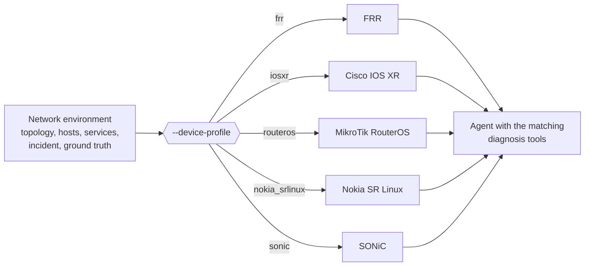
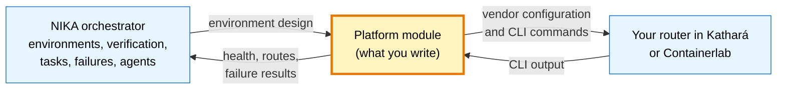

# 🌐 Multi-vendor routers

NIKA runs the same network environment on routers from different vendors, so you can test whether an agent troubleshoots a network it has not seen on FRR. You choose the router platform, NIKA keeps the topology, addressing, hosts, incidents, and ground truth the same, and the agent gets the diagnosis tools of that platform.

This page tells you which routers NIKA supports, how to select one, what NIKA does to keep a vendor environment trustworthy, and how to add your own. Each topic links to the reference that holds the detail.



The environment, the incident, and the ground truth stay the same. Only the router platform and the agent's CLI tool change.

## 🧭 Supported routers

A router platform is called a [device profile](../../GLOSSARY.md). Every environment deploys FRR unless you select another profile.

| Device profile | Router | Runs on | What you need |
| --- | --- | --- | --- |
| `frr` | [FRR](https://frrouting.org/) (default) | Kathará | Nothing extra |
| `iosxr` | Cisco IOS XR, as the XRd Control Plane container | Kathará | A Cisco XRd image you download and load |
| `routeros` | MikroTik RouterOS, as the Cloud Hosted Router (CHR) VM | Kathará | A RouterOS image you build locally, and KVM on the host |
| `nokia_srlinux` | Nokia SR Linux | Containerlab | Nothing extra; NIKA pulls the image |
| `sonic` | SONiC virtual switch | Containerlab | The SONiC image, which `uv run nika images prepare` downloads |

## 🗺️ Which environments support which routers

Each cell shows how much of the environment runs on that vendor's routers:

* ✅ **Full:** every router of the environment runs on the vendor, at every size the environment offers.
* 🟡 **Partial:** only some router roles or sizes run on the vendor. The other routers, hosts, and services stay FRR or Linux.
* ➖ **None:** the vendor is not available for the environment.

| Environment | Cisco IOS XR | MikroTik RouterOS | Nokia SR Linux | SONiC |
| --- | :---: | :---: | :---: | :---: |
| Data center Clos | 🟡 | 🟡 | ➖ | ➖ |
| Campus LAN | 🟡 | 🟡 | ➖ | ➖ |
| Enterprise branch WAN | 🟡 | 🟡 | ➖ | ➖ |
| ISP backbone (SNDlib graphs) | ✅ | ✅ | ✅ | ✅ |
| ISP backbone (Topology Zoo graphs) | ✅ | ✅ | ➖ | ➖ |
| Five-node Clos fabric | ➖ | ➖ | ✅ | ✅ |
| Two-router IOS XR eBGP pair | ✅ | ➖ | ➖ | ➖ |
| Two-router RouterOS eBGP pair | ➖ | ✅ | ➖ | ➖ |

FRR runs every environment above, and the SDN, P4, and Kubernetes environments run only on their own platforms.

### What a partial cell converts

NIKA converts only the roles a vendor can run. A role stays FRR when the vendor image cannot do its job. For example, XRd cannot bridge access ports or terminate WireGuard.

| Environment | On Cisco IOS XR | On MikroTik RouterOS |
| --- | --- | --- |
| Data center Clos | Spine routers, size `s` | Spine and leaf routers, size `s` |
| Campus LAN | Core routers | Core, distribution, and server-gateway routers, size `s` |
| Enterprise branch WAN | Provider routers | Site edges, size `s` |

> [!NOTE]
> A size a vendor does not support is rejected with an error that names the supported sizes. Large ISP graphs are limited by host memory, which NIKA checks before it creates any container.

The environment names above map to the identifiers `dc_clos`, `campus_lan`, `enterprise_branch`, `isp_<topology>`, `min3clos`, `iosxr_simple_bgp`, and `routeros_simple_bgp`. Run `uv run nika env list` for the registered environments and backends.

## 🚀 Run an environment on another vendor

Pass `--device-profile` when you start an environment. NIKA starts a session as usual.

```shell
uv run nika env run dc_clos -s s --device-profile routeros
uv run nika env run campus_lan -s s --device-profile iosxr
uv run nika env run min3clos --device-profile sonic
uv run nika env run isp_abilene --device-profile nokia_srlinux --backend containerlab
```

The agent needs no extra setup. NIKA picks the diagnosis tool that matches the session's device profile: `iosxr_exec` for IOS XR, `routeros_exec` for RouterOS, and the SR Linux or SONiC command tools on Containerlab. See [MCP servers](../agents/mcp-servers.md) for the tools. Benchmark tasks record their device profile and run the same way.

### Prepare the vendor image

> [!IMPORTANT]
> Cisco and MikroTik do not allow NIKA to redistribute their images, so you supply the IOS XR and RouterOS images once before you use those profiles.

Setup steps are in [Network scenarios](network-scenarios.md):

* [IOS XR image](network-scenarios.md#ios-xr-simple-bgp-scenario): download XRd Control Plane from Cisco and load it, or pass it to the installer with `--xrd-tarball`.
* [RouterOS image](network-scenarios.md#routeros-simple-bgp-scenario): build it with `./scripts/install.sh --with-vendor-images`. The host needs KVM.
* [SONiC image](network-scenarios.md#sonic-routers-on-containerlab): `uv run nika images prepare`.

If an image is missing or the host lacks the memory, NIKA stops with an explanation before it deploys anything.

## ✅ What NIKA guarantees on a vendor router

A vendor environment is only useful if the incident is the same incident the agent would meet on FRR. NIKA checks that in four places:

* **Same environment.** Topology, addressing, hosts, services, and ground truth do not change. Only the routers of the converted roles run the vendor's configuration.
* **Healthy before the incident.** NIKA builds each vendor configuration from the environment's declared requirements, such as reachability, routing, and isolation. It analyzes the design with a static model (Batfish where it has a parser for the vendor) and then waits for the live routers to meet the requirements, reading the vendor's own `show` output. [Environment construction and verification](../development/scenario-verification.md) explains the checks and their limits.
* **Only failures the vendor can run.** Each vendor implements the router operations a failure needs, such as changing a BGP AS number or an OSPF area. NIKA generates a task on a vendor router only when that vendor implements every operation of the failure, and refuses to inject otherwise instead of changing nothing. [Router platforms](failures.md#router-platforms) lists the failures and how each vendor applies them.
* **Failures that run end to end.** `uv run nika benchmark validate-profiles` deploys one representative task for each environment, device profile, and failure, injects it, checks the symptom and ground truth, and recovers the network. `nika benchmark generate --validated-only` keeps vendor tasks only for validated combinations. See [Validate device-profile cells](../development/creating-benchmark-tasks.md#validate-device-profile-cells).

> [!NOTE]
> A vendor image can change what an agent encounters. RouterOS CHR sends at most 1 Mbit/s per interface, so NIKA scales the traffic to fit and skips failures that need a faster path. IOS XR does not report link carrier state to its interfaces, so a link failure shows up when the routing protocol times out. [Network scenarios](network-scenarios.md#run-other-environments-on-routeros-routers) lists these differences.

## 🔌 Add your own router

Running a new router in NIKA starts outside NIKA: the vendor's image has to run as a node in Kathará or Containerlab, and the two emulators already do that work. NIKA adds what turns a running router into a benchmark task: it configures the router from the environment's design, verifies the network, gives the agent a CLI tool, and injects failures.



The yellow block is the adapter you write; NIKA (blue) and the emulator (blue) provide the rest. The router only has to run and answer CLI commands. The platform module is the adapter that lets NIKA's vendor-neutral environments talk to it.

### 1. Run the router in an emulator

Get a node of your vendor running in the emulator on its own first, with data interfaces, a way to run CLI commands, and a startup configuration. The emulator documentation covers this, so NIKA does not repeat it:

* **Kathará:** [Kathará wiki](https://github.com/KatharaFramework/Kathara/wiki) for [custom images](https://github.com/KatharaFramework/Kathara/wiki/Kathara-Images) and the [`lab.conf`](https://github.com/KatharaFramework/Kathara/wiki/Kathara-lab.conf) options that attach a device to a network.
* **Containerlab:** [node kinds](https://containerlab.dev/manual/kinds/) for the vendors it supports and [nodes](https://containerlab.dev/manual/nodes/) for their options.
* **Vendor images that are virtual machines:** [vrnetlab](https://containerlab.dev/manual/vrnetlab/) wraps a vendor VM into a container, and its [source repository](https://github.com/hellt/vrnetlab) has the build steps. NIKA runs RouterOS this way.

### 2. Write the platform module

A **platform module** is a Python file that tells NIKA how to work with one vendor's routers. NIKA describes every environment in vendor-neutral terms, and the module translates between that description and your router. It answers four questions:

| NIKA asks | The module provides |
| --- | --- |
| How do I configure this router? | The vendor startup configuration for each router, translated from the environment's design |
| Can it run here? | A check, before any container starts, that the image exists and the host has enough memory |
| Is the network healthy? | How to read the vendor's own CLI output to confirm sessions and routes, and how long to wait for the router to boot |
| How does a failure act on it? (optional) | The router operations that failures use, such as changing a BGP AS number |

Use the existing modules as templates: [RouterOS](../../src/nika/net_env/utils/routeros/platform.py) for a Kathará router and [SONiC](../../src/nika/net_env/utils/sonic/) for a Containerlab router. Then connect it to the rest of NIKA:

1. **Register the module** in [`native_routers.py`](../../src/nika/net_env/native_routers.py).
2. **Choose the roles it replaces.** Each environment declares which router roles may run the profile, and at which sizes, in `NATIVE_PROFILE_ROLES` and `NATIVE_PROFILE_SIZES`. Add the profile to the environment's `device_profiles` in [`net_env_pool.py`](../../src/nika/net_env/net_env_pool.py). ISP environments also list the allowed backend and profile pairs in [`profiles.py`](../../src/nika/net_env/isp/profiles.py).
3. **Give the agent a tool** for the vendor CLI, and map the profile to it in the [MCP server registry](../../src/nika/mcp/registry.py).

Failure operations are optional. Failures that need an operation your module does not implement are not generated for your router, so a first version can start with none.

For a Containerlab router, register the profile and its backend pair, map it to its tool in `CONTAINERLAB_ROUTER_SERVERS`, and optionally expose `FAULT_OPS` from its module.

[Create benchmark tasks](../development/creating-benchmark-tasks.md) covers how failures declare the operations they need. Then run `uv run nika env run <environment> --device-profile <yours>` and the [`validate-profiles` command](../development/creating-benchmark-tasks.md#validate-device-profile-cells) to check your router.
