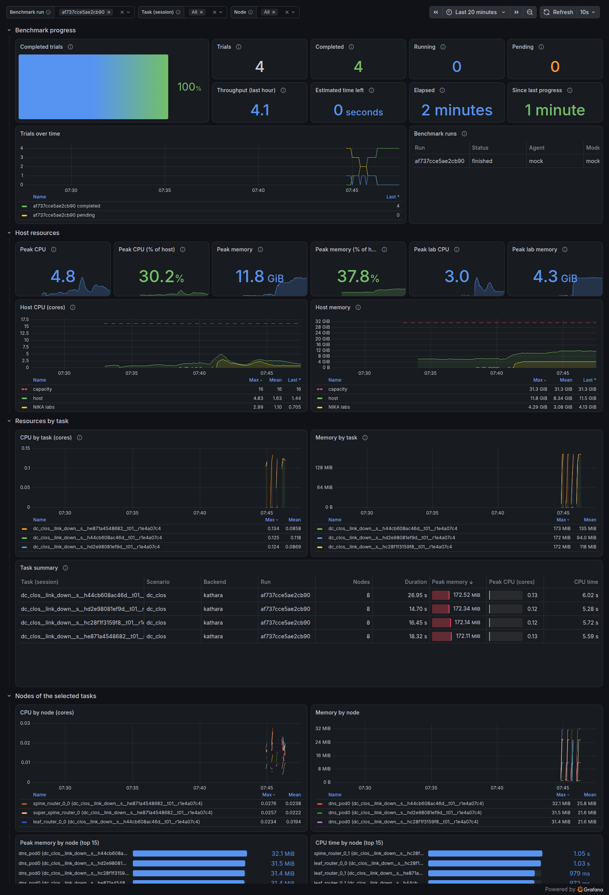

# Monitor benchmarks and lab resources

A long benchmark run gives little feedback in a terminal, and sizing a lab host requires knowing how much CPU and memory each task uses. NIKA can record both on the lab host and show them in a Grafana dashboard:

* **Benchmark progress:** completed, running, and pending trials for each benchmark run, with throughput, an estimate of the time left, and the time since the run last made progress.
* **Host resources:** CPU and memory used on the whole machine, the share used by NIKA environments, and the peak of each in the selected time range.
* **Resources by task:** CPU and memory over time for each task (one session per trial), a summary table with each task's duration, peak memory, peak CPU, and CPU time, and a breakdown by node.



Monitoring is off by default and works for Kathara and Containerlab environments alike. Every service binds only to `127.0.0.1`, and none of the data reaches agents through MCP tools or telemetry.

## Turn monitoring on

Prerequisites: Docker with the Compose plugin, on the host that runs the environments.

```shell
uv run nika observability on
```

This starts the monitoring services and prints their addresses. Open Grafana at <http://127.0.0.1:3000>; the **NIKA benchmark** dashboard is its home page and needs no login. From another machine, forward the port over SSH first:

```shell
ssh -L 3000:127.0.0.1:3000 <lab-host>
```

The services keep running, including across Docker restarts, until you turn monitoring off. While monitoring is on, every environment NIKA deploys is recorded automatically, whether it comes from `nika benchmark run`, `nika env run`, `nika case`, or the interactive shell. No other command or flag is needed.

`uv run nika observability status` shows whether monitoring is on. `uv run nika observability off` stops it and keeps the recorded history, 30 days by default, for the next time you turn it on. Add `--purge` to delete the history as well.

## Read the dashboard

Use the variables at the top to select a **benchmark run**, one or more **tasks**, and **nodes**. **All** also includes sessions started outside a benchmark run, such as `nika env run`. Panels cover the selected time range, so set it to the span of the run you want to analyze; past runs stay available after their sessions close.

A benchmark run appears while it runs and for 10 minutes after it finishes. The **Status** column of the run table shows `stopped` for a run whose process ended without finishing, for example after a crash. **Since last progress** turns orange after 30 minutes without a finished trial, which on a run with a shorter case timeout suggests a stuck run.

Host memory is the memory in use (total minus available, as in `free`). Environment memory is the working set of the environment's containers. CPU time includes the deployment of the environment.

## Share a run's dashboard

To follow a benchmark run from a phone or another computer, or to send it to a collaborator, NIKA can give each run a public link to its dashboard. Sharing is off by default.

A link opens this host's whole Grafana, not just one run. The run in the link is a dashboard filter, not an access restriction: anyone who opens the link can select every other run on the host and query all the monitoring data that Grafana can read. Benchmark session ids also name the injected failure, so keep links away from agents under evaluation. `allowed_emails` limits who can open a link; it does not limit which runs they see.

Turn sharing on in `config/nika.yaml`:

```yaml
nika:
  metrics:
    share:
      enabled: true
```

With monitoring on, `nika benchmark run` then prints the link when the run starts and again when it ends, and the live progress view shows it as **📊 dashboard**:

```text
📊 Live dashboard · gpt-5 · cli.codex · 2026-10-26 09:00 UTC: https://<random-words>.trycloudflare.com/d/nika-benchmark/nika-benchmark?var-run_id=<run_id>&from=…  (expires 2026-11-02 09:00 UTC)
```

Runs are named after their model, agent, and creation time in UTC; the dashboard and `nika observability links` show the name, with the run id beside it. The link opens the dashboard with the run selected, from its start until now. It works for 7 days (`ttl_days`, up to 30), then stops for good. A resumed run keeps its link while the link is valid. To see the links again:

```shell
uv run nika observability links                          # every run of this checkout
uv run nika observability links --result-dir <run dir>   # one run, from its dashboard.json
uv run nika observability unshare <run_id>               # revoke a link before it expires
```

A new link can take up to a minute to start working while its address propagates.

`nika observability off` also closes every link.

Without `allowed_emails`, anyone with the link can open it. To restrict viewers, list their addresses in `allowed_emails` (a pattern such as `'*@example.com'` works too). Visitors then confirm their address with a one-time code that Cloudflare emails them.

The `share` settings apply when NIKA opens a link. A link that is already open keeps the access and lifetime it started with, including when its run is resumed, and `nika observability on` does not change it. To apply new settings to a run, revoke its link with `uv run nika observability unshare <run_id>`, then open a new one with `uv run nika observability share --result-dir <run dir>`. The same command shares a run that has finished, or one whose link has expired.

Each link is a [Cloudflare Quick Tunnel](https://developers.cloudflare.com/tunnel/get-started/quick-tunnels/) from the lab host to the local Grafana. It needs no Cloudflare account, but the host must reach Cloudflare on outbound port 7844, and Cloudflare offers Quick Tunnels without an uptime guarantee. NIKA runs one `cloudflared` container per run and records the link in the run's result directory (`dashboard.json`) and in its progress document.

## Push the data to Grafana Cloud

To follow runs without an SSH tunnel, or to see several lab hosts in one place, Prometheus can also push NIKA's series to Grafana Cloud. The push is off by default, and the local stack works the same with or without it.

1. In the Grafana Cloud portal, open your stack's **Prometheus** details. Note the remote-write endpoint and the instance ID, the numeric username.
2. Create an access policy token with the `metrics:write` scope.
3. Turn the push on and add the endpoint and username to `config/nika.yaml`, and the token to `.env`:

   ```yaml
   nika:
     metrics:
       remote_write:
         enabled: true
         url: https://prometheus-prod-XX-prod-REGION.grafana.net/api/prom/push
         username: "1234567"
   ```

   ```shell
   NIKA_METRICS_REMOTE_WRITE_TOKEN=glc_...
   ```

4. Run `uv run nika observability on` again on each lab host to apply the settings.
5. In Grafana Cloud, import [`nika-benchmark.json`](../../src/nika/metrics/stack/grafana/dashboards/nika-benchmark.json) (**Dashboards → New → Import**) and pick your stack's Prometheus as the **Data source**.

To stop pushing, set `enabled: false` and run `uv run nika observability on` again. New samples appear in Grafana Cloud within seconds of being recorded. Only NIKA's series are pushed (`nika:*` and `nika_*`), each with a `host` label set to the lab host's name; select it with the **Host** variable. The raw cAdvisor and node exporter series stay on the host.

Session ids of benchmark trials contain the task id, which names the injected failure. Pushing them publishes this ground truth to your Grafana Cloud stack, so keep agents under evaluation away from it.

## Change the sampling interval

Prometheus scrapes every 15 seconds by default, and cAdvisor samples at the same interval. Peak values are the largest sample taken, so a coarser interval can miss short memory peaks, for example while an environment boots, and gives no CPU rate for tasks shorter than about two intervals. To change it, set `nika.metrics.scrape_interval` in `config/nika.yaml` to a value from `5s` to `60s`, and run `uv run nika observability on` again.

## Query the data in Prometheus

The dashboard reads Prometheus at <http://127.0.0.1:9090>, which you can also query directly. These series remain after a session closes:

| Series | Meaning |
| --- | --- |
| `nika:session_cpu_cores` | CPU cores used by all containers of a session |
| `nika:session_cpu_seconds_total` | CPU time all containers of a session have used, deployment included |
| `nika:session_memory_working_set_bytes` | Working-set memory of all containers of a session |
| `nika:session_containers` | Number of containers in a session |
| `nika:container_cpu_cores` | CPU cores used by one node (labels `node`, `name`) |
| `nika:container_cpu_seconds_total` | CPU time one node has used since its container started |
| `nika:container_memory_working_set_bytes` | Working-set memory of one node |
| `nika:host_cpu_cores`, `nika:host_memory_used_bytes` | CPU and memory used on the whole host |
| `nika_benchmark_trials` | Trials of a benchmark run by `state`: `total`, `completed`, `pending`, `running` |

Session series carry the labels `session_id`, `run_id`, `lab_name`, `backend`, and `scenario`; `run_id` is empty for a session outside a benchmark run. For example:

```promql
# Peak memory of each task of a benchmark run
max by (session_id, scenario) (max_over_time(nika:session_memory_working_set_bytes{run_id="<run_id>"}[1d]))

# Average CPU per environment, to compare environments
avg by (scenario) (avg_over_time(nika:session_cpu_cores[1d]))
```

## Coverage and limits

The per-task measurements cover environment containers only. They exclude the agent process, model inference, and agent sandboxes; the host panels include them.

With [remote lab execution](remote.md), run `nika observability on` on the lab host to measure the environments, and on the agent host to follow benchmark progress.

With [Firecracker execution](firecracker.md), environments run inside microVMs, so the dashboard shows benchmark progress and the microVMs' host usage but no per-task or per-node breakdown.

## How it works

[cAdvisor](https://github.com/google/cadvisor) measures every Docker container on the host, which covers both backends, and the Prometheus node exporter measures the host. When NIKA deploys an environment or starts a benchmark run while monitoring is on, it also starts a NIKA exporter in the background. The exporter reads the checkout's session store and the progress documents in `runtime/benchmark_runs/`. It maps each Docker container to its session, node, and benchmark run, and publishes the run's trial counts. It exits once the checkout has had no session and no running benchmark for two minutes. Recording rules in [`rules.yml`](../../src/nika/metrics/stack/rules.yml) join the sources and store the result under the session labels, so the attribution persists after the session ends.

Several checkouts on one host share the same services. Each checkout runs its own exporter on a free port and registers it in `~/.cache/nika/metrics/targets/`. The exporter logs to `runtime/metrics/exporter.log`.

`nika observability on` writes the Prometheus configuration, including the remote-write token, to `~/.cache/nika/metrics/prometheus/`, readable only by you and the Prometheus container. `nika observability off` deletes the token file.

The services use ports `3000` (Grafana), `9090` (Prometheus), `8098` (cAdvisor), and `9109` (node exporter) on `127.0.0.1`. If one is taken, change it in [`docker-compose.yml`](../../src/nika/metrics/stack/docker-compose.yml) and in the scrape targets of [`stack.py`](../../src/nika/metrics/stack.py). The dashboard is provisioned from [`nika-benchmark.json`](../../src/nika/metrics/stack/grafana/dashboards/nika-benchmark.json). To edit it in Grafana, sign in as `admin` with the password that `nika observability on` stores in `~/.cache/nika/metrics/grafana_admin_password`, and save a copy.
