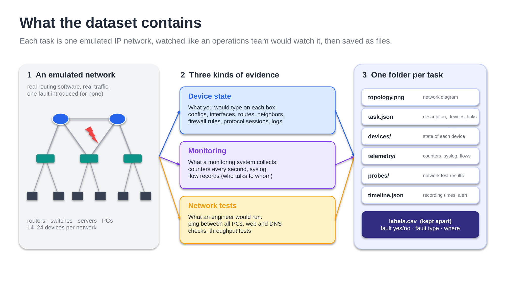
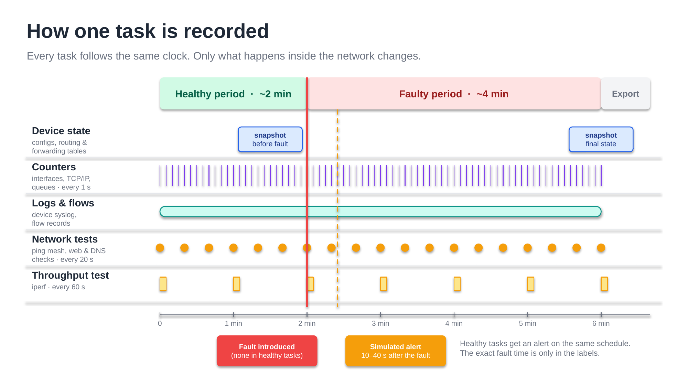
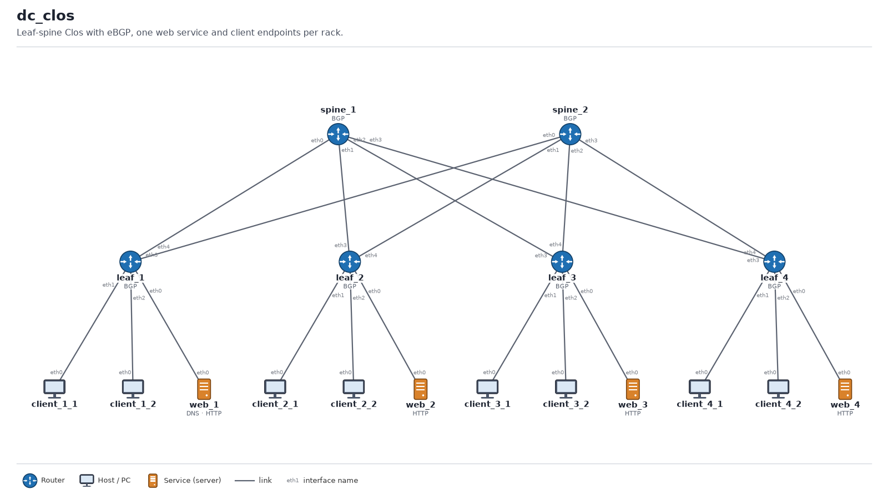

# Network incident dataset

This dataset lets you train and evaluate models that troubleshoot IP networks from recorded evidence, without running a network yourself. Each **task** is one recording of an emulated IP network. The network runs normally for about two minutes, then a **fault** is introduced, and recording continues for about four more minutes. Healthy tasks follow the same schedule without a fault. Device state, monitoring data, and network-test results are saved as plain files.

A model reads a task's evidence and answers three questions; the labels hold the reference answers:

1. Is something wrong? (yes/no)
2. Where is the fault? (a device, an interface, or a link)
3. What kind of fault is it? (for example, a wrong default gateway)



## What is recorded

The networks are built from real routing and server software: Linux hosts, FRRouting routers, DNS, DHCP and web servers, programmable switches, and Kubernetes clusters. They carry realistic background traffic, such as users browsing web servers.

Three kinds of evidence are recorded. Which files exist depends on the network's devices, and every task of the same network has the same files, so the file list never hints at the fault:

| Evidence | What it is | Examples |
| --- | --- | --- |
| **Device state** | The output of the commands an engineer would type on each device, captured at the end of the task | interface addresses, routing table, ARP table, firewall rules, BGP/OSPF neighbors, running configuration, process list, service configuration, logs |
| **Monitoring** | What a monitoring system collects continuously | per-interface and TCP/IP counters every second, device syslog, flow records (who talked to whom, how much) |
| **Network tests** | Tests run from end hosts throughout the task | ping between hosts, web page loads, DNS lookups, throughput measurements, traceroutes |

Together they connect a cause to its effects. For example, a PC with a wrong default gateway shows that route and an unresolved neighbor entry in its device state, its network tests fail for destinations outside its subnet, and its monitored traffic drops.

## How a task is recorded



- Monitoring and network tests run for the whole task, so you can compare the healthy and faulty periods.
- Device state is captured twice: shortly before the fault and at the end. Only the end state is part of the default model input (see [`before_fault/`](#dataset-layout)).
- Each task has a simulated **alert time**, 10 to 40 seconds after the fault, marking when troubleshooting could start. Healthy tasks get an alert time on the same schedule, so its presence does not reveal a fault. The exact fault time is only in the labels.

The default input covers the whole recording, so it supports diagnosis after the fact. To evaluate diagnosis at alert time instead, keep only measurements up to the alert time and leave out the final device state.

## Dataset layout

```text
dataset/
├── tasks.csv                  one row per task: network, size, times
├── labels.csv                 one row per task: the answer
├── tasks/<task_id>/           everything a model may read
│   ├── topology.png           network diagram
│   ├── task.json              network description, devices and their roles, links
│   ├── timeline.json          recording start and end, alert time
│   ├── devices/<device>/      device state, one text file per command group
│   ├── controllers/           SDN or programmable-switch controller state, when the network has one
│   ├── telemetry/             prometheus/<metric>.csv, syslog.log, netflow.csv
│   └── probes/                ping mesh, web and DNS checks, throughput tests, traceroutes
├── labels/<task_id>.json      the answer, with the fault time
└── before_fault/<task_id>/    device state 30 s before the fault
```

Keep `labels.csv` and `labels/` out of the model input. Leave out `before_fault/` by default: comparing it with the end state makes configuration faults much easier to spot. Include it only when you evaluate diagnosis with a known pre-fault snapshot, and report that choice.

Task IDs such as `dc_clos-0cee4113` name the network, never the fault.

## Use the dataset

Load the task index, the answers for scoring, and one task's evidence with pandas:

```python
import json
from pathlib import Path

import pandas as pd

root = Path("dataset")
tasks = pd.read_csv(root / "tasks.csv")
labels = pd.read_csv(root / "labels.csv")  # for scoring only, never model input

task = root / "tasks" / "dc_clos-0cee4113"
info = json.loads((task / "task.json").read_text())
routes = (task / "devices" / "client_1_1" / "routes.txt").read_text()
rx = pd.read_csv(task / "telemetry/prometheus/node_network_receive_bytes_total.csv", parse_dates=["time"])
pings = pd.read_json(task / "probes/pingmesh.jsonl", lines=True)
```

`labels.csv` has the columns `task_id`, `is_anomaly`, `fault_category`, `fault_type` and `faulty_component`. Healthy tasks have `is_anomaly` set to `False` and the fault columns empty. A task with several affected components lists them separated by `;`.

Each Prometheus CSV has a `time` column and one column per device or interface, such as `client_1_1{device=eth0}`. Columns named `*_total` are cumulative counters: to get a rate, subtract consecutive values and divide by the time between them.

> [!IMPORTANT]
> A whole task is too large for a language-model prompt. In the sample, one task holds 5.6 to 30 MB of text (roughly 1.4 to 7.6 million tokens), mostly one-second counters, flow records, and, in programmable-switch networks, per-packet measurements. Select files, downsample the counters, or summarize them before building a prompt.

## Example: a wrong default gateway



In task `dc_clos-0cee4113`, the labels say that `client_1_1` was given a wrong default gateway. The evidence shows it from three sides:

- **Device state** of `client_1_1`, from `devices/client_1_1/routes.txt` and `neighbors.txt`: the default route points to an address with no answering neighbor.

  ```text
  default via 10.0.1.254 dev eth0
  10.0.1.254 dev eth0 INCOMPLETE
  ```

- **Network tests**, from `probes/`: after the fault, the ping mesh reports 9 unreachable host pairs, all involving `client_1_1`, and web checks from `client_1_1` fail for every server except the one in its own rack.
- **Monitoring**, from `telemetry/prometheus/node_network_transmit_packets_total.csv`: apart from throughput tests to its own rack, `client_1_1` sends about 150 packets per minute after the fault instead of several thousand.

Task `dc_clos-366c1886` records the same network without a fault and has the same files, which makes it a useful comparison.

## Networks in the sample

| Task | Network | Fault |
| --- | --- | --- |
| `dc_clos-366c1886` | Data center leaf-spine fabric with BGP | none (healthy) |
| `dc_clos-0cee4113` | Data center leaf-spine fabric with BGP | wrong default gateway on a PC |
| `campus_lan-37b38822` | Campus network with OSPF, DHCP, DNS, web servers and a load balancer | rogue DHCP options point PCs to a wrong DNS server |
| `enterprise_branch-f34d86d9` | Branch offices connected by WireGuard VPN tunnels | wrong VPN peer key |
| `isp_abilene-f4518f14` | Internet-provider backbone modeled on the US Abilene network (IS-IS, SONiC routers) | IS-IS authentication mismatch between two routers |
| `k8s_lab-b7b160ba` | Kubernetes cluster behind a BGP data center network | cluster DNS cut off by a firewall rule |
| `p4_dc_fabric-e5ae4e69` | Data center fabric of programmable (P4) switches | missing forwarding table entry |
| `p4_dc_gateway-289fb50c` | Programmable (P4) gateway with load balancing and packet-level measurements | TCP SYN flood from a client |
| `sdn_l3_clos-3f56d2a0` | Switches programmed by a central controller (OpenFlow, ONOS) | a higher-priority forwarding rule hides the intended one |

---

## Record more tasks

This part is for whoever produces the dataset. Set up [NIKA](../../README.md) first and run the commands from the repository root. A recorder collects the evidence on a fixed schedule in place of a troubleshooting agent; it makes no diagnosis.

1. Choose the networks and faults to record. Each selector is `network:fault[:size]`; use `healthy` as the fault for healthy tasks.

   ```bash
   uv run python scripts/offline_recording/make_cases.py \
       dc_clos:host_incorrect_gateway:s dc_clos:healthy:s -o recording.yaml
   ```

2. Record them. The first variable turns on one-second monitoring.

   ```bash
   NIKA_TELEMETRY_PROFILE=fine uv run nika benchmark run \
       --config recording.yaml --agent recorder --result_dir results/recording -y
   ```

3. Build the dataset folder and draw the topologies.

   ```bash
   uv run python scripts/offline_recording/export_dataset.py results/recording -o dataset
   uv run scripts/offline_recording/topology/draw_topology.py dataset
   ```

The [dry-run task list](dryrun.yaml) is the selection behind the sample. [`figures/make_figures.py`](figures/make_figures.py) redraws the figures on this page from their PowerPoint sources.
