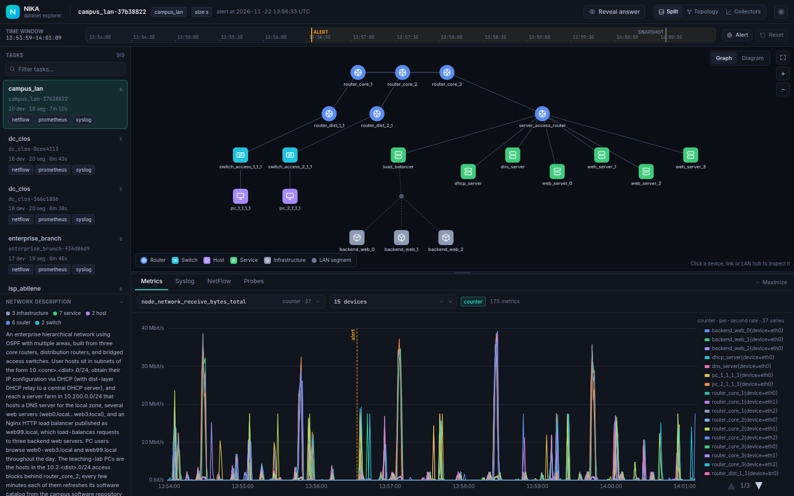

# Dataset explorer

A local web dashboard for browsing an offline-recording dataset. For each task you can see the topology, the state snapshots of every device (with a diff against the before-fault capture), Prometheus metrics, syslog, NetFlow, probes, INT reports and controller dumps, all on one shared time window.



## Run with Docker

```bash
docker build -t nika-dataset-explorer scripts/offline_recording/explorer
docker run --rm -p 8050:8050 -v <dataset>:/data:ro nika-dataset-explorer
```

Open http://localhost:8050. `<dataset>` is the folder that contains `tasks/`, `labels/` and `before_fault/`.

## Run without Docker

You need `uv` and Node.js 20 or later. From `scripts/offline_recording/explorer`:

```bash
(cd frontend && npm ci && npm run build)
EXPLORER_DATA=<dataset> uv run uvicorn --app-dir backend explorer_backend.app:app --port 8050
```

The backend serves the built frontend from `frontend/dist`. For frontend development, keep the backend running and start `npm run dev` in `frontend/`. Vite serves on port 5173 and forwards `/api` to port 8050.

Set `EXPLORER_DATA` to the dataset path. `EXPLORER_STATIC` overrides the location of the built frontend.

## Use

- Pick a task in the left sidebar. The answer (fault type, faulty component and injection time) stays hidden until you click **Reveal answer**.
- Click a device in the graph to open its state files, metrics, syslog lines and exported flows. Click a link or a LAN hub to see the interface counters of each end. **Diagram** shows the pre-rendered `topology.png` when the task has one.
- Drag on the time bar under the header to zoom every chart and table to a window. Double-click the bar to reset it. Charts mark the alert time, and the fault injection time once the answer is revealed.
- The **Collectors** area has a metric browser across devices, plus tabs for syslog, NetFlow, probes (pingmesh, HTTP/DNS, iperf, traceroute), INT and controller dumps. Each tab appears only when the task has that data.

## Layout

| Path | Contents |
| --- | --- |
| `backend/explorer_backend/dataset.py` | Reads and caches the dataset files. Large files (Prometheus CSVs, INT JSONL) are read on first request and aggregated on the server. |
| `backend/explorer_backend/app.py` | FastAPI app. [API.md](API.md) documents the endpoints. |
| `frontend/` | Vite, React and TypeScript app that uses Cytoscape.js and ECharts. |
| `tests/` | Backend parsing tests that use a synthetic dataset: `uv run --group dev pytest`. |

## Known limitations

- The INT collector keeps only the last few seconds of hop reports under load ([#391](https://github.com/sands-lab/nika/issues/391)), so in the sample p4_dc_gateway task every report falls just after `recording_end` and outside the global time window. The INT tab shows a warning when this happens.
- INT `switch_id` values are shown as numbers, because the dataset does not map them to device names.
- Interface counters come from node_exporter (`node_network_*`) or SONiC (`sonic_interface_*`, where `ethN` maps to `Ethernet{4(N-1)}`). Devices with neither, such as the campus_lan web servers, have no counters ([#392](https://github.com/sands-lab/nika/issues/392)).
- The pingmesh heatmap filters to the time window but does not take part in the synced crosshair.
